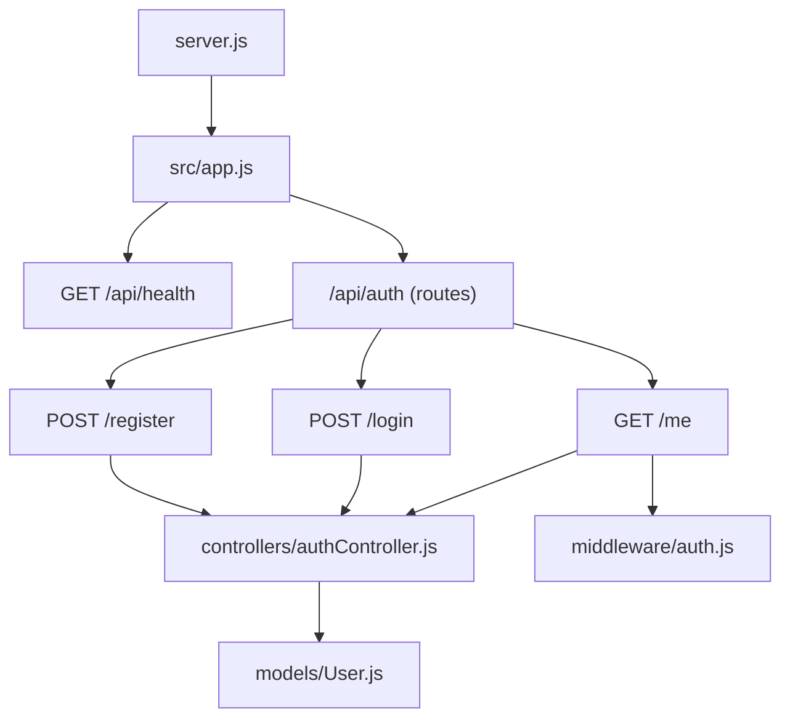
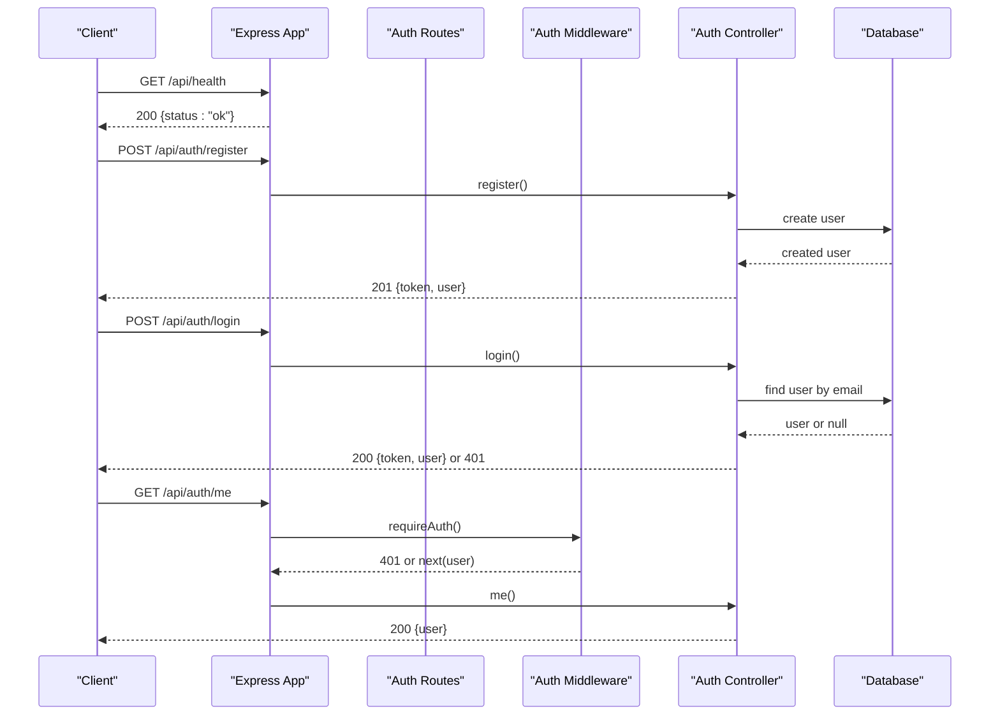
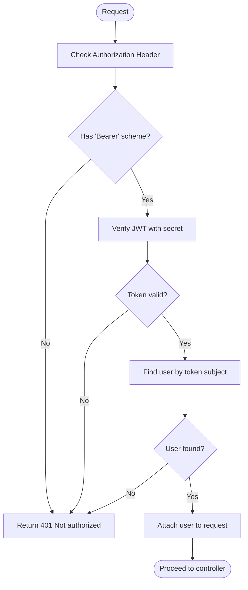
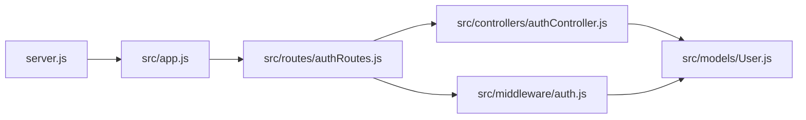

# API Reference

<cite>
**Referenced Files in This Document**
- [server.js](file://backend/server.js)
- [app.js](file://backend/src/app.js)
- [authRoutes.js](file://backend/src/routes/authRoutes.js)
- [authController.js](file://backend/src/controllers/authController.js)
- [auth.js](file://backend/src/middleware/auth.js)
- [User.js](file://backend/src/models/User.js)
</cite>

## Table of Contents
1. [Introduction](#introduction)
2. [Project Structure](#project-structure)
3. [Core Components](#core-components)
4. [Architecture Overview](#architecture-overview)
5. [Detailed Component Analysis](#detailed-component-analysis)
6. [Dependency Analysis](#dependency-analysis)
7. [Performance Considerations](#performance-considerations)
8. [Troubleshooting Guide](#troubleshooting-guide)
9. [Conclusion](#conclusion)

## Introduction
This document provides comprehensive API documentation for the backend endpoints, including HTTP methods, URL patterns, request/response schemas, authentication requirements, validation rules, and common error responses. It covers:
- User registration
- User login
- Current user retrieval
- Health check

The backend is an Express application that exposes RESTful endpoints under /api, with JSON payloads and JWT-based authentication for protected routes.

## Project Structure
The backend is organized into layers:
- Entry point and server configuration
- Application setup (middleware, CORS, global error handling)
- Route definitions
- Controllers implementing business logic
- Middleware for authentication
- Data models

**Diagram sources**
- [server.js:1-9](file://backend/server.js#L1-L9)
- [app.js:1-56](file://backend/src/app.js#L1-L56)
- [authRoutes.js:1-13](file://backend/src/routes/authRoutes.js#L1-L13)
- [authController.js:1-74](file://backend/src/controllers/authController.js#L1-L74)
- [auth.js:1-24](file://backend/src/middleware/auth.js#L1-L24)
- [User.js:1-50](file://backend/src/models/User.js#L1-L50)

**Section sources**
- [server.js:1-9](file://backend/server.js#L1-L9)
- [app.js:1-56](file://backend/src/app.js#L1-L56)

## Core Components
- Authentication middleware validates Bearer tokens and attaches the authenticated user to the request.
- Controllers implement registration, login, and current user retrieval logic with input validation and error handling.
- The User model defines schema constraints, password hashing, and safe JSON serialization.

Key responsibilities:
- Input validation and sanitization in controllers
- JWT signing and verification
- Database operations via Mongoose
- Global error handling for malformed requests and server errors

**Section sources**
- [auth.js:1-24](file://backend/src/middleware/auth.js#L1-L24)
- [authController.js:1-74](file://backend/src/controllers/authController.js#L1-L74)
- [User.js:1-50](file://backend/src/models/User.js#L1-L50)

## Architecture Overview
The API follows a layered architecture:
- Routes define URL patterns and attach middleware.
- Controllers handle request processing and orchestrate data access.
- Middleware enforces authentication.
- Models encapsulate database schema and behavior.

**Diagram sources**
- [app.js:24-41](file://backend/src/app.js#L24-L41)
- [authRoutes.js:6-12](file://backend/src/routes/authRoutes.js#L6-L12)
- [authController.js:19-71](file://backend/src/controllers/authController.js#L19-L71)
- [auth.js:4-23](file://backend/src/middleware/auth.js#L4-L23)

## Detailed Component Analysis

### Health Check
- Method: GET
- URL: /api/health
- Authentication: None
- Request body: None
- Response:
  - 200 OK: { status: "ok" }
- Notes:
  - Used for service health monitoring and readiness checks.

Example response:
- 200 OK: { "status": "ok" }

**Section sources**
- [app.js:26-28](file://backend/src/app.js#L26-L28)

### User Registration
- Method: POST
- URL: /api/auth/register
- Authentication: None
- Request headers:
  - Content-Type: application/json
- Request body schema:
  - name: string (required, trimmed, max length 80)
  - email: string (required, valid email format, unique)
  - password: string (required, minimum 8 characters)
- Validation rules:
  - All fields must be strings.
  - Email must match a standard email pattern.
  - Password must be at least 8 characters.
  - Duplicate email returns conflict.
- Responses:
  - 201 Created: { token: string, user: object }
    - user object includes id, name, email, timestamps; password is excluded.
  - 400 Bad Request: { message: string }
    - Missing or invalid fields.
  - 409 Conflict: { message: string }
    - Email already exists.
  - 500 Internal Server Error: { message: "Server error" }
    - Unexpected server-side failure.

Common use cases:
- New user onboarding flow.
- Pre-flight validation before account creation.

Error examples:
- 400 Bad Request: { "message": "Name, email, and password are required" }
- 400 Bad Request: { "message": "Please provide a valid name and email" }
- 400 Bad Request: { "message": "Password must be at least 8 characters" }
- 409 Conflict: { "message": "An account with this email already exists" }

**Section sources**
- [authRoutes.js:8](file://backend/src/routes/authRoutes.js#L8)
- [authController.js:19-51](file://backend/src/controllers/authController.js#L19-L51)
- [User.js:4-28](file://backend/src/models/User.js#L4-L28)
- [User.js:39-47](file://backend/src/models/User.js#L39-L47)

### User Login
- Method: POST
- URL: /api/auth/login
- Authentication: None
- Request headers:
  - Content-Type: application/json
- Request body schema:
  - email: string (required)
  - password: string (required)
- Validation rules:
  - Both fields must be present and strings.
  - Credentials are validated against stored user record.
- Responses:
  - 200 OK: { token: string, user: object }
    - user object excludes password.
  - 400 Bad Request: { message: string }
    - Missing or invalid fields.
  - 401 Unauthorized: { message: "Invalid email or password" }
  - 500 Internal Server Error: { message: "Server error" }

Common use cases:
- Authenticating users to obtain a JWT token.
- Refreshing session state after successful login.

Error examples:
- 400 Bad Request: { "message": "Email and password are required" }
- 401 Unauthorized: { "message": "Invalid email or password" }

**Section sources**
- [authRoutes.js:9](file://backend/src/routes/authRoutes.js#L9)
- [authController.js:53-67](file://backend/src/controllers/authController.js#L53-L67)

### Current User Retrieval
- Method: GET
- URL: /api/auth/me
- Authentication: Required
- Authentication header:
  - Authorization: Bearer <JWT_TOKEN>
- Request body: None
- Responses:
  - 200 OK: { user: object }
    - user object excludes password.
  - 401 Unauthorized: { message: "Not authorized" }
    - Missing or invalid Authorization header, invalid token, or unknown user.
  - 500 Internal Server Error: { message: "Server error" }

Common use cases:
- Fetching the profile of the currently authenticated user.
- Validating token integrity and user existence.

Error examples:
- 401 Unauthorized: { "message": "Not authorized" }

**Section sources**
- [authRoutes.js:10](file://backend/src/routes/authRoutes.js#L10)
- [auth.js:4-23](file://backend/src/middleware/auth.js#L4-L23)
- [authController.js:69-71](file://backend/src/controllers/authController.js#L69-L71)

### Authentication Flow

**Diagram sources**
- [auth.js:4-23](file://backend/src/middleware/auth.js#L4-L23)

## Dependency Analysis
The following diagram shows how components depend on each other:

**Diagram sources**
- [server.js:1-9](file://backend/server.js#L1-L9)
- [app.js:1-56](file://backend/src/app.js#L1-L56)
- [authRoutes.js:1-13](file://backend/src/routes/authRoutes.js#L1-L13)
- [authController.js:1-74](file://backend/src/controllers/authController.js#L1-L74)
- [auth.js:1-24](file://backend/src/middleware/auth.js#L1-L24)
- [User.js:1-50](file://backend/src/models/User.js#L1-L50)

**Section sources**
- [authRoutes.js:1-13](file://backend/src/routes/authRoutes.js#L1-L13)
- [authController.js:1-74](file://backend/src/controllers/authController.js#L1-L74)
- [auth.js:1-24](file://backend/src/middleware/auth.js#L1-L24)
- [User.js:1-50](file://backend/src/models/User.js#L1-L50)

## Performance Considerations
- Use HTTPS in production to protect credentials and tokens.
- Ensure JWT_SECRET is set securely and not logged.
- Keep payload minimal; avoid sending sensitive fields like passwords in responses.
- Consider rate limiting on authentication endpoints to prevent brute-force attacks.
- Optimize database queries by selecting only necessary fields.

[No sources needed since this section provides general guidance]

## Troubleshooting Guide
Common issues and resolutions:
- Invalid JSON body:
  - Symptom: 400 Bad Request with message "Invalid JSON body".
  - Cause: Malformed JSON in request body.
  - Resolution: Validate JSON structure before sending.
- Not authorized:
  - Symptom: 401 Unauthorized with message "Not authorized".
  - Cause: Missing or invalid Authorization header, invalid token, or unknown user.
  - Resolution: Ensure Authorization header uses "Bearer <token>" and token is valid.
- Invalid email or password:
  - Symptom: 401 Unauthorized with message "Invalid email or password".
  - Cause: Incorrect credentials.
  - Resolution: Verify email and password.
- Email already exists:
  - Symptom: 409 Conflict with message indicating duplicate email.
  - Cause: Attempting to register with an existing email.
  - Resolution: Use a different email or log in instead.

Global error handling:
- Entity parse failures return 400 with "Invalid JSON body".
- Unhandled exceptions return 500 with "Server error".

**Section sources**
- [app.js:43-53](file://backend/src/app.js#L43-L53)
- [auth.js:4-23](file://backend/src/middleware/auth.js#L4-L23)
- [authController.js:19-71](file://backend/src/controllers/authController.js#L19-L71)

## Conclusion
This API provides secure user registration, login, and profile retrieval using JWT-based authentication. The health endpoint supports operational monitoring. Follow the documented request/response schemas and validation rules to integrate clients effectively. For protected endpoints, always include a valid Bearer token in the Authorization header.

[No sources needed since this section summarizes without analyzing specific files]