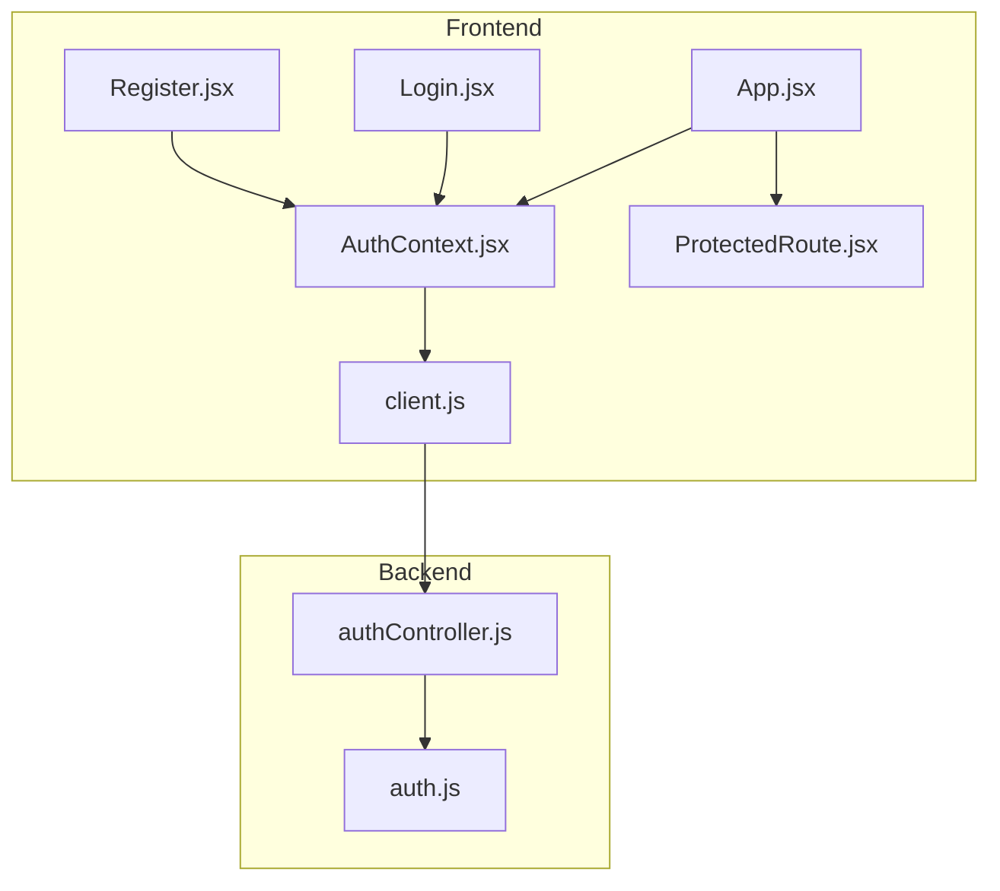
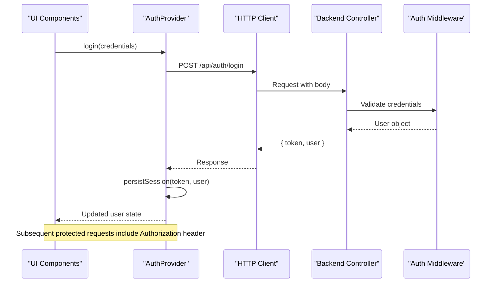
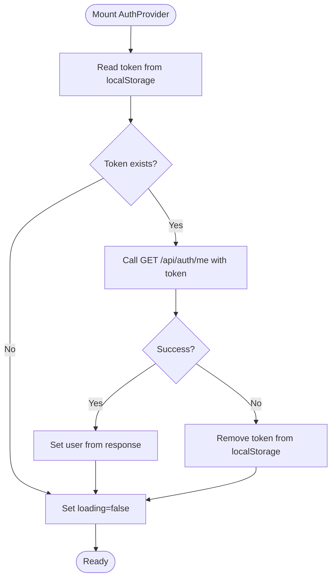
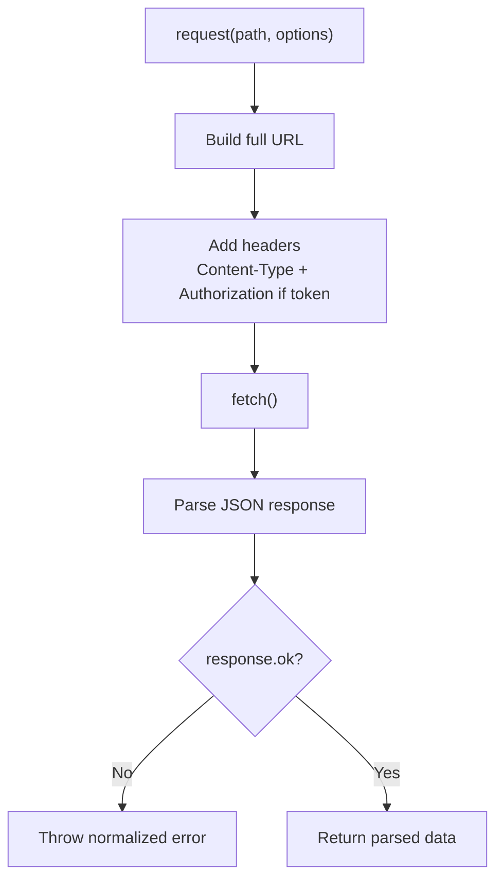
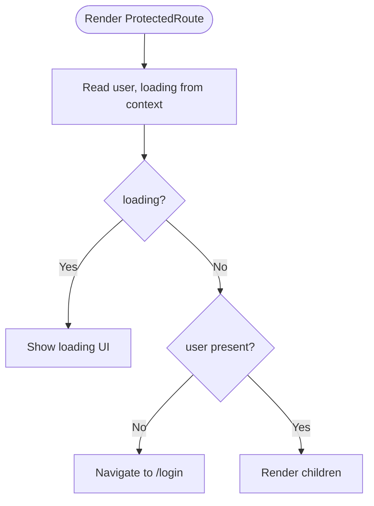
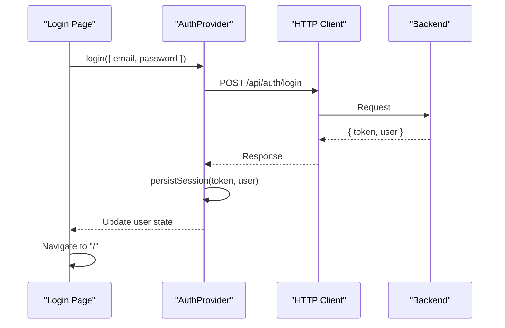
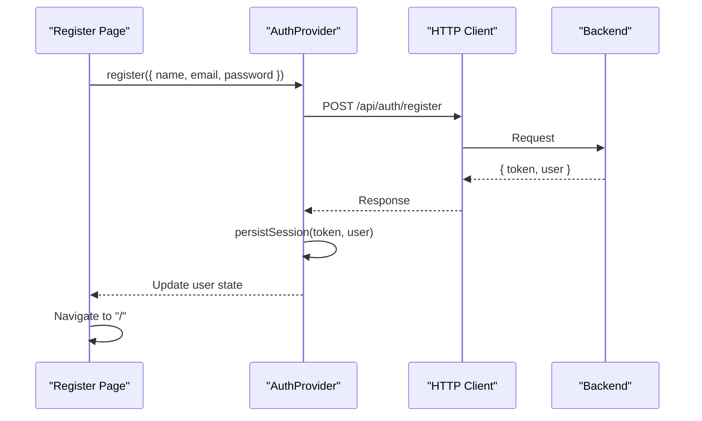
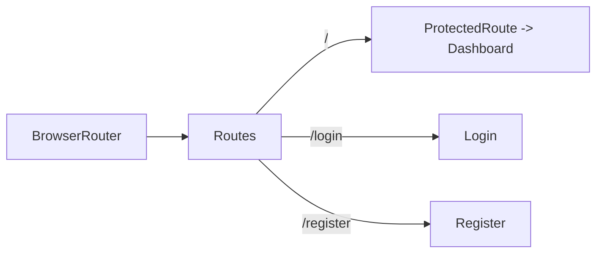
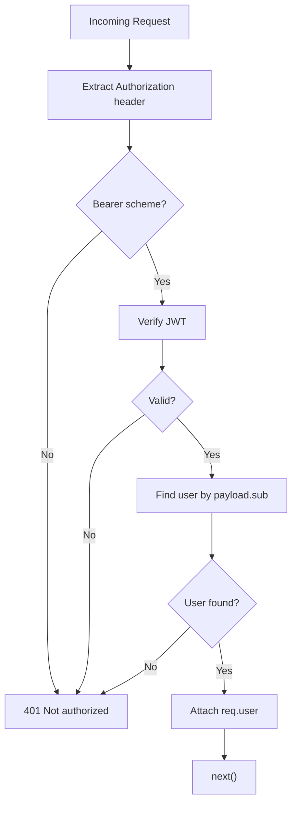
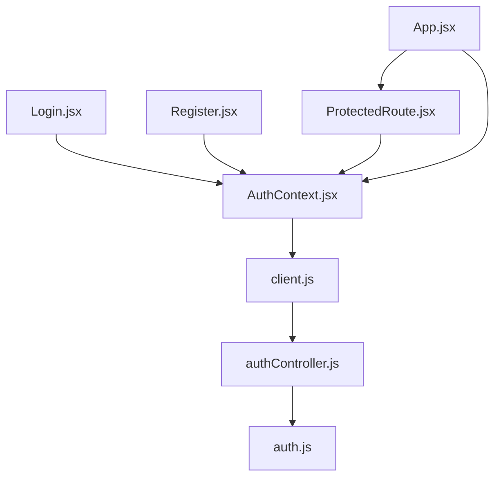

# Authentication State Management

<cite>
**Referenced Files in This Document**
- [AuthContext.jsx](file://frontend/src/context/AuthContext.jsx)
- [client.js](file://frontend/src/api/client.js)
- [ProtectedRoute.jsx](file://frontend/src/components/ProtectedRoute.jsx)
- [Login.jsx](file://frontend/src/pages/Login.jsx)
- [Register.jsx](file://frontend/src/pages/Register.jsx)
- [App.jsx](file://frontend/src/App.jsx)
- [authController.js](file://backend/src/controllers/authController.js)
- [auth.js](file://backend/src/middleware/auth.js)
</cite>

## Table of Contents
1. [Introduction](#introduction)
2. [Project Structure](#project-structure)
3. [Core Components](#core-components)
4. [Architecture Overview](#architecture-overview)
5. [Detailed Component Analysis](#detailed-component-analysis)
6. [Dependency Analysis](#dependency-analysis)
7. [Performance Considerations](#performance-considerations)
8. [Troubleshooting Guide](#troubleshooting-guide)
9. [Conclusion](#conclusion)

## Introduction
This document explains the authentication state management system implemented with React Context, localStorage persistence, and automatic token injection for API requests. It covers the AuthContext provider, authentication hooks, session lifecycle, protected routes, and how frontend components synchronize with backend authentication endpoints.

## Project Structure
The authentication logic spans both frontend and backend:
- Frontend:
  - Context provider and hook for global auth state
  - HTTP client that injects tokens into requests
  - Protected route component to guard authenticated pages
  - Login and Register pages orchestrating user flows
  - App shell wiring providers and routes
- Backend:
  - Auth controller handling registration, login, and current user introspection
  - Middleware validating Bearer tokens and attaching user to request

**Diagram sources**
- [App.jsx:1-29](file://frontend/src/App.jsx#L1-L29)
- [AuthContext.jsx:1-73](file://frontend/src/context/AuthContext.jsx#L1-L73)
- [client.js:1-33](file://frontend/src/api/client.js#L1-L33)
- [ProtectedRoute.jsx:1-17](file://frontend/src/components/ProtectedRoute.jsx#L1-L17)
- [Login.jsx:1-73](file://frontend/src/pages/Login.jsx#L1-L73)
- [Register.jsx:1-105](file://frontend/src/pages/Register.jsx#L1-L105)
- [authController.js:1-74](file://backend/src/controllers/authController.js#L1-L74)
- [auth.js:1-24](file://backend/src/middleware/auth.js#L1-L24)

**Section sources**
- [App.jsx:1-29](file://frontend/src/App.jsx#L1-L29)
- [AuthContext.jsx:1-73](file://frontend/src/context/AuthContext.jsx#L1-L73)
- [client.js:1-33](file://frontend/src/api/client.js#L1-L33)
- [ProtectedRoute.jsx:1-17](file://frontend/src/components/ProtectedRoute.jsx#L1-L17)
- [Login.jsx:1-73](file://frontend/src/pages/Login.jsx#L1-L73)
- [Register.jsx:1-105](file://frontend/src/pages/Register.jsx#L1-L105)
- [authController.js:1-74](file://backend/src/controllers/authController.js#L1-L74)
- [auth.js:1-24](file://backend/src/middleware/auth.js#L1-L24)

## Core Components
- AuthProvider and useAuth hook:
  - Provides global user, loading state, and actions (login, register, logout).
  - Persists JWT in localStorage under a stable key.
  - On mount, restores session by calling /api/auth/me with the stored token.
- HTTP client:
  - Centralizes fetch calls, base URL configuration, JSON serialization, and error normalization.
  - Accepts an optional token parameter to attach Authorization header.
- ProtectedRoute:
  - Guards routes based on presence of authenticated user.
  - Redirects unauthenticated users to login.
- Pages:
  - Login and Register handle form submission, call context methods, and navigate after success.

**Section sources**
- [AuthContext.jsx:1-73](file://frontend/src/context/AuthContext.jsx#L1-L73)
- [client.js:1-33](file://frontend/src/api/client.js#L1-L33)
- [ProtectedRoute.jsx:1-17](file://frontend/src/components/ProtectedRoute.jsx#L1-L17)
- [Login.jsx:1-73](file://frontend/src/pages/Login.jsx#L1-L73)
- [Register.jsx:1-105](file://frontend/src/pages/Register.jsx#L1-L105)

## Architecture Overview
The system follows a clear separation of concerns:
- UI components consume the AuthContext for state and actions.
- The context layer persists tokens and manages session restoration.
- The HTTP client ensures consistent request formatting and token injection.
- The backend validates tokens and returns user data or errors.

**Diagram sources**
- [AuthContext.jsx:43-46](file://frontend/src/context/AuthContext.jsx#L43-L46)
- [client.js:28-32](file://frontend/src/api/client.js#L28-L32)
- [authController.js:53-66](file://backend/src/controllers/authController.js#L53-L66)
- [auth.js:4-23](file://backend/src/middleware/auth.js#L4-L23)

## Detailed Component Analysis

### AuthContext Provider and Hook
Responsibilities:
- Initialize user and loading states.
- Restore session from localStorage on mount by calling /api/auth/me.
- Persist token and user via localStorage when login/register succeeds.
- Provide login, register, and logout functions.
- Expose a memoized value to minimize re-renders.

Key behaviors:
- Session restoration uses a cleanup flag to avoid state updates after unmount.
- Invalid or expired tokens trigger removal of the stored token.
- Logout clears persisted token and resets user state.

**Diagram sources**
- [AuthContext.jsx:12-36](file://frontend/src/context/AuthContext.jsx#L12-L36)

**Section sources**
- [AuthContext.jsx:1-73](file://frontend/src/context/AuthContext.jsx#L1-L73)

### HTTP Client and Token Injection
Responsibilities:
- Normalize fetch behavior and error handling.
- Attach Authorization header when a token is provided.
- Export convenience methods for auth endpoints.

Automatic token injection pattern:
- When calling protected endpoints, pass the token retrieved from localStorage or context-managed state to ensure Authorization header inclusion.

**Diagram sources**
- [client.js:3-26](file://frontend/src/api/client.js#L3-L26)

**Section sources**
- [client.js:1-33](file://frontend/src/api/client.js#L1-L33)

### ProtectedRoute Guard
Responsibilities:
- Read user and loading from AuthContext.
- Show a loading indicator while restoring session.
- Redirect unauthenticated users to login.

**Diagram sources**
- [ProtectedRoute.jsx:4-15](file://frontend/src/components/ProtectedRoute.jsx#L4-L15)

**Section sources**
- [ProtectedRoute.jsx:1-17](file://frontend/src/components/ProtectedRoute.jsx#L1-L17)

### Login Flow
Responsibilities:
- Collect email/password.
- Call context login method.
- Navigate to home on success; display server-provided error on failure.

**Diagram sources**
- [Login.jsx:17-30](file://frontend/src/pages/Login.jsx#L17-L30)
- [AuthContext.jsx:43-46](file://frontend/src/context/AuthContext.jsx#L43-L46)
- [client.js:28-32](file://frontend/src/api/client.js#L28-L32)
- [authController.js:53-66](file://backend/src/controllers/authController.js#L53-L66)

**Section sources**
- [Login.jsx:1-73](file://frontend/src/pages/Login.jsx#L1-L73)

### Register Flow
Responsibilities:
- Validate local fields (e.g., password confirmation).
- Call context register method.
- Navigate to home on success; display server-provided error on failure.

**Diagram sources**
- [Register.jsx:19-38](file://frontend/src/pages/Register.jsx#L19-L38)
- [AuthContext.jsx:48-51](file://frontend/src/context/AuthContext.jsx#L48-L51)
- [client.js:28-32](file://frontend/src/api/client.js#L28-L32)
- [authController.js:19-50](file://backend/src/controllers/authController.js#L19-L50)

**Section sources**
- [Register.jsx:1-105](file://frontend/src/pages/Register.jsx#L1-L105)

### App Shell and Routing
Responsibilities:
- Wrap application with Router and AuthProvider.
- Protect dashboard route using ProtectedRoute.
- Define public routes for login and register.

**Diagram sources**
- [App.jsx:8-28](file://frontend/src/App.jsx#L8-L28)

**Section sources**
- [App.jsx:1-29](file://frontend/src/App.jsx#L1-L29)

### Backend Authentication
Responsibilities:
- Register: validate input, create user, return token and user.
- Login: verify credentials, return token and user.
- Me: return current user for session validation.
- Middleware: parse Bearer token, verify signature, attach user to request.

**Diagram sources**
- [auth.js:4-23](file://backend/src/middleware/auth.js#L4-L23)
- [authController.js:69-71](file://backend/src/controllers/authController.js#L69-L71)

**Section sources**
- [authController.js:1-74](file://backend/src/controllers/authController.js#L1-L74)
- [auth.js:1-24](file://backend/src/middleware/auth.js#L1-L24)

## Dependency Analysis
- Frontend dependencies:
  - AuthContext depends on the HTTP client for network operations.
  - Pages depend on AuthContext for state and actions.
  - ProtectedRoute depends on AuthContext for user and loading state.
  - App wires routing and providers.
- Backend dependencies:
  - Auth controller depends on models and JWT utilities.
  - Auth middleware depends on JWT verification and user lookup.

**Diagram sources**
- [AuthContext.jsx:1-73](file://frontend/src/context/AuthContext.jsx#L1-L73)
- [client.js:1-33](file://frontend/src/api/client.js#L1-L33)
- [ProtectedRoute.jsx:1-17](file://frontend/src/components/ProtectedRoute.jsx#L1-L17)
- [Login.jsx:1-73](file://frontend/src/pages/Login.jsx#L1-L73)
- [Register.jsx:1-105](file://frontend/src/pages/Register.jsx#L1-L105)
- [App.jsx:1-29](file://frontend/src/App.jsx#L1-L29)
- [authController.js:1-74](file://backend/src/controllers/authController.js#L1-L74)
- [auth.js:1-24](file://backend/src/middleware/auth.js#L1-L24)

**Section sources**
- [AuthContext.jsx:1-73](file://frontend/src/context/AuthContext.jsx#L1-L73)
- [client.js:1-33](file://frontend/src/api/client.js#L1-L33)
- [ProtectedRoute.jsx:1-17](file://frontend/src/components/ProtectedRoute.jsx#L1-L17)
- [Login.jsx:1-73](file://frontend/src/pages/Login.jsx#L1-L73)
- [Register.jsx:1-105](file://frontend/src/pages/Register.jsx#L1-L105)
- [App.jsx:1-29](file://frontend/src/App.jsx#L1-L29)
- [authController.js:1-74](file://backend/src/controllers/authController.js#L1-L74)
- [auth.js:1-24](file://backend/src/middleware/auth.js#L1-L24)

## Performance Considerations
- Memoization:
  - AuthContext exposes a memoized value to reduce unnecessary re-renders across consumers.
- Minimal state:
  - Only user and loading are held in context; heavy payloads are not cached in memory beyond what’s necessary.
- Network efficiency:
  - Single call to /api/auth/me during initialization avoids redundant checks.
- Error normalization:
  - Centralized error handling prevents repeated try/catch blocks in components.

[No sources needed since this section provides general guidance]

## Troubleshooting Guide
Common issues and resolutions:
- Cannot reach the server:
  - Ensure the backend is running and the frontend environment variable points to the correct API URL.
- Invalid or missing token:
  - If /api/auth/me fails, the stored token is removed; re-authenticate to refresh the session.
- Not authorized responses:
  - Verify that protected requests include the Authorization header with a valid Bearer token.
- Route redirects to login unexpectedly:
  - Confirm that the session was restored successfully and that user state is non-null before accessing protected routes.

**Section sources**
- [client.js:15-23](file://frontend/src/api/client.js#L15-L23)
- [AuthContext.jsx:21-31](file://frontend/src/context/AuthContext.jsx#L21-L31)
- [ProtectedRoute.jsx:7-13](file://frontend/src/components/ProtectedRoute.jsx#L7-L13)
- [auth.js:4-23](file://backend/src/middleware/auth.js#L4-L23)

## Conclusion
The authentication system combines React Context for global state, localStorage for persistence, and a centralized HTTP client for token injection. The flow is straightforward: authenticate via the backend, persist the token, restore sessions on app load, and protect routes accordingly. Errors are normalized and surfaced to users, and the architecture keeps concerns cleanly separated between UI, state, networking, and backend services.

[No sources needed since this section summarizes without analyzing specific files]