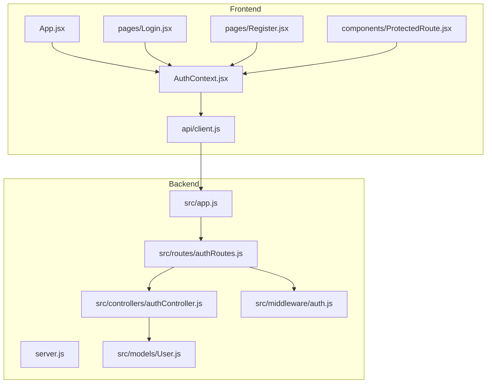
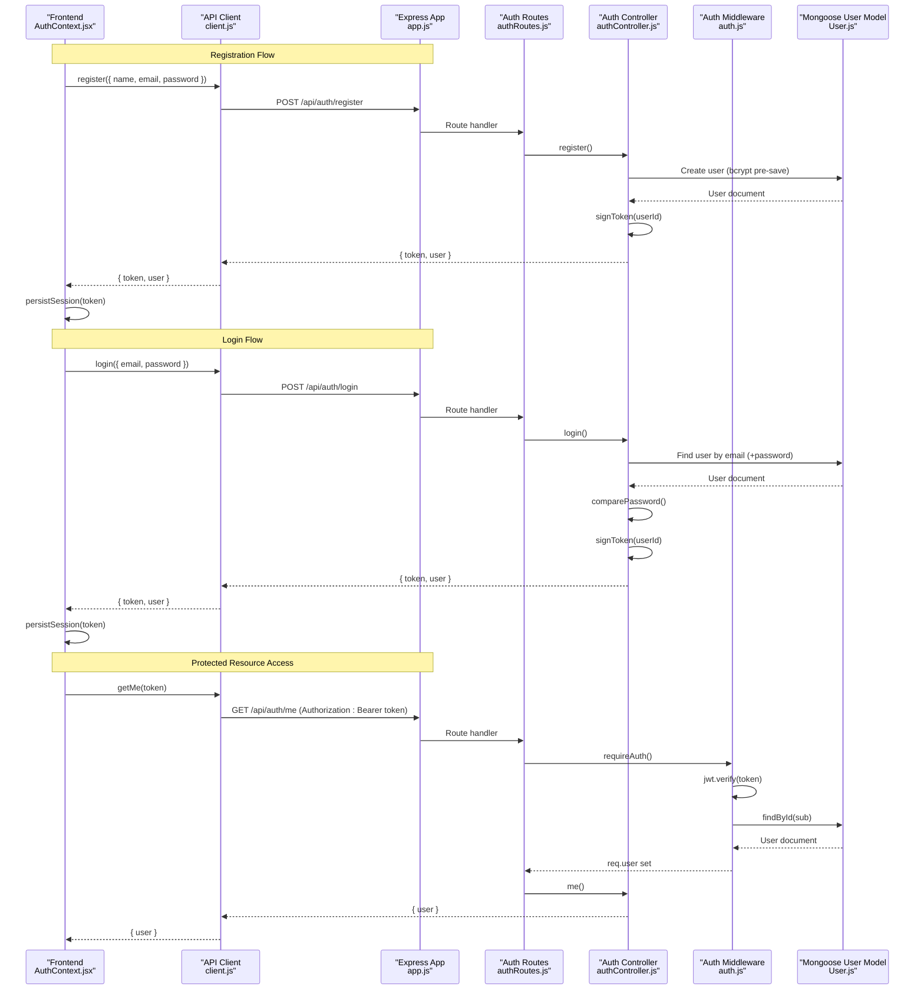
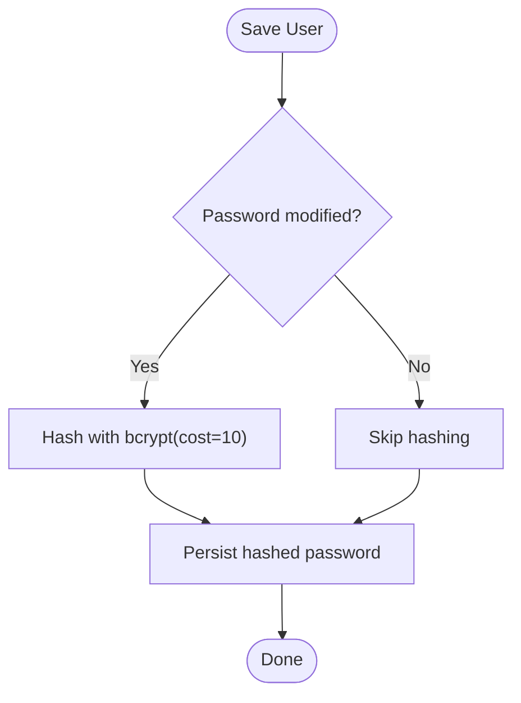
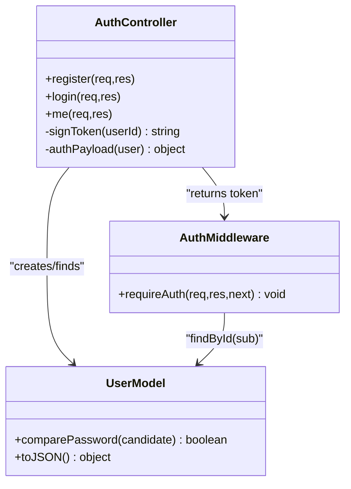
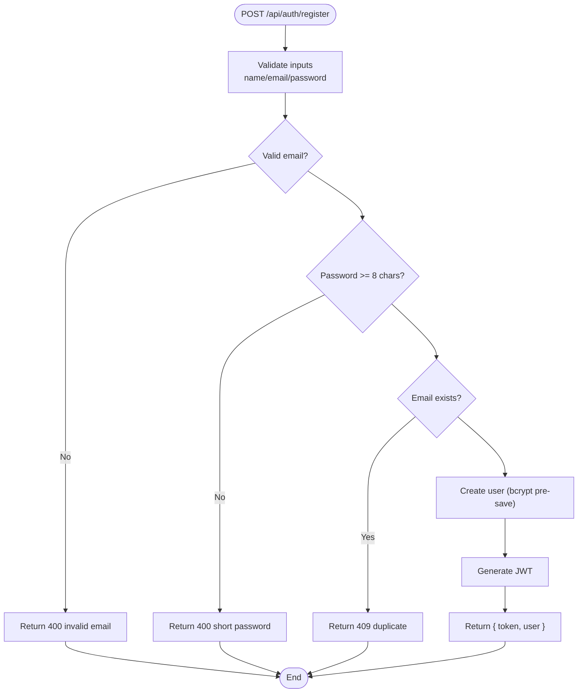
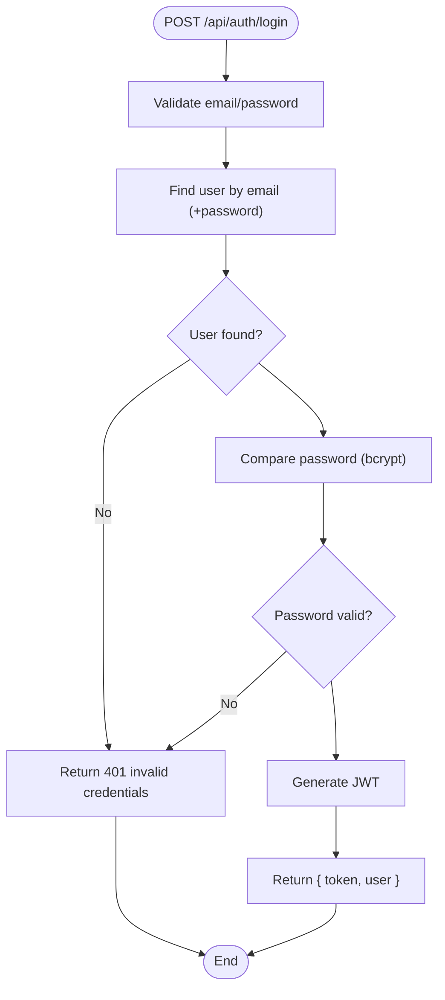
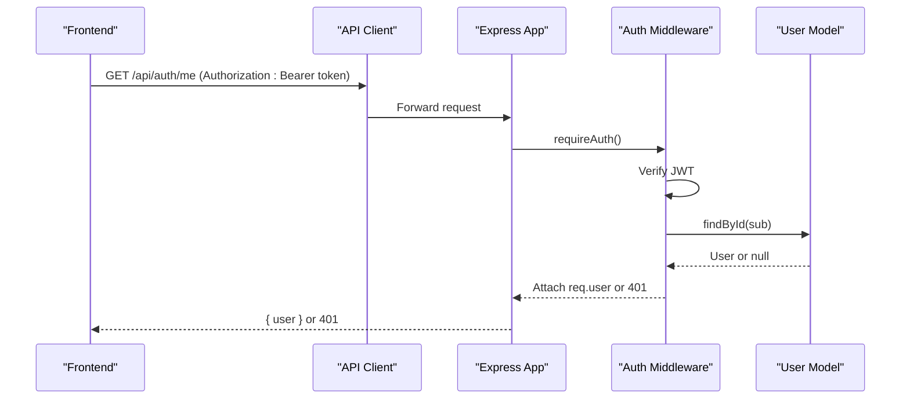
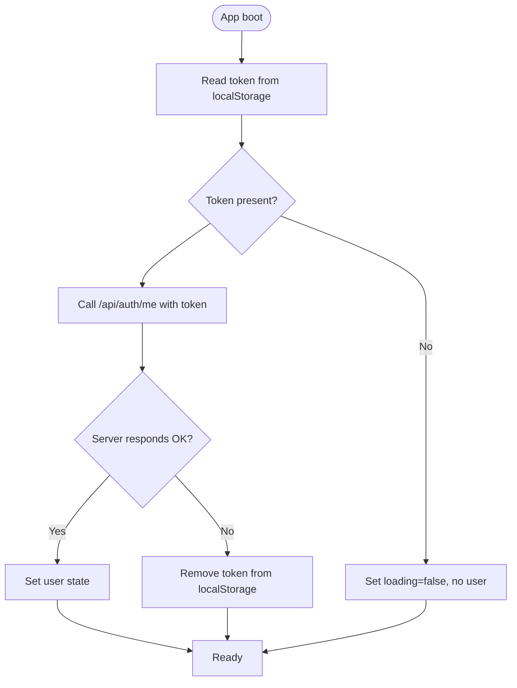
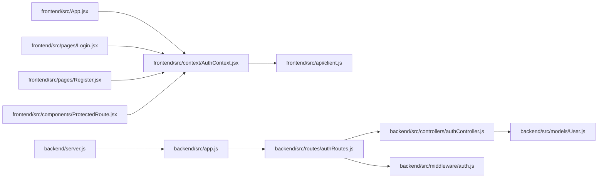

# Authentication System

<cite>
**Referenced Files in This Document**
- [authController.js](file://backend/src/controllers/authController.js)
- [auth.js](file://backend/src/middleware/auth.js)
- [User.js](file://backend/src/models/User.js)
- [authRoutes.js](file://backend/src/routes/authRoutes.js)
- [app.js](file://backend/src/app.js)
- [server.js](file://backend/server.js)
- [client.js](file://frontend/src/api/client.js)
- [AuthContext.jsx](file://frontend/src/context/AuthContext.jsx)
- [ProtectedRoute.jsx](file://frontend/src/components/ProtectedRoute.jsx)
- [Login.jsx](file://frontend/src/pages/Login.jsx)
- [Register.jsx](file://frontend/src/pages/Register.jsx)
- [App.jsx](file://frontend/src/App.jsx)
</cite>

## Table of Contents
1. [Introduction](#introduction)
2. [Project Structure](#project-structure)
3. [Core Components](#core-components)
4. [Architecture Overview](#architecture-overview)
5. [Detailed Component Analysis](#detailed-component-analysis)
6. [Dependency Analysis](#dependency-analysis)
7. [Performance Considerations](#performance-considerations)
8. [Troubleshooting Guide](#troubleshooting-guide)
9. [Conclusion](#conclusion)

## Introduction
This document explains the end-to-end authentication system implemented with a MERN stack. It covers JWT-based registration, login, and protected resource access; password hashing with bcrypt; token generation and validation; session persistence on the client; and frontend context-based authentication state management. It also documents security measures such as input validation, duplicate account prevention, and token expiration handling.

## Project Structure
The project is split into backend (Express + Mongoose) and frontend (React + Vite). The backend exposes an authentication API under /api/auth. The frontend manages authentication state via React Context and persists the JWT in localStorage.

**Diagram sources**
- [App.jsx:1-29](file://frontend/src/App.jsx#L1-L29)
- [AuthContext.jsx:1-73](file://frontend/src/context/AuthContext.jsx#L1-L73)
- [client.js:1-33](file://frontend/src/api/client.js#L1-L33)
- [server.js:1-9](file://backend/server.js#L1-L9)
- [app.js:1-56](file://backend/src/app.js#L1-L56)
- [authRoutes.js:1-13](file://backend/src/routes/authRoutes.js#L1-L13)
- [authController.js:1-74](file://backend/src/controllers/authController.js#L1-L74)
- [auth.js:1-24](file://backend/src/middleware/auth.js#L1-L24)
- [User.js:1-50](file://backend/src/models/User.js#L1-L50)

**Section sources**
- [server.js:1-9](file://backend/server.js#L1-L9)
- [app.js:1-56](file://backend/src/app.js#L1-L56)
- [App.jsx:1-29](file://frontend/src/App.jsx#L1-L29)

## Core Components
- Backend controller: handles registration, login, and current user retrieval; generates JWTs; validates inputs; prevents duplicates.
- Backend middleware: verifies Bearer tokens, decodes JWT, loads user from database, and attaches user to request.
- User model: defines schema, enforces constraints, hashes passwords with bcrypt, and provides comparePassword method.
- Frontend API client: wraps fetch calls, sends Authorization headers, and throws normalized errors.
- Frontend auth context: stores token in localStorage, maintains user state, and exposes login/register/logout.
- Protected route component: guards routes based on authenticated state.

**Section sources**
- [authController.js:1-74](file://backend/src/controllers/authController.js#L1-L74)
- [auth.js:1-24](file://backend/src/middleware/auth.js#L1-L24)
- [User.js:1-50](file://backend/src/models/User.js#L1-L50)
- [client.js:1-33](file://frontend/src/api/client.js#L1-L33)
- [AuthContext.jsx:1-73](file://frontend/src/context/AuthContext.jsx#L1-L73)
- [ProtectedRoute.jsx:1-17](file://frontend/src/components/ProtectedRoute.jsx#L1-L17)

## Architecture Overview
The authentication flow uses JWTs for stateless server-side sessions. On successful registration or login, the server returns a signed JWT and minimal user data. The client stores the token in localStorage and includes it as a Bearer token in subsequent requests. The backend middleware validates the token and ensures the user exists before allowing access to protected endpoints.

**Diagram sources**
- [AuthContext.jsx:1-73](file://frontend/src/context/AuthContext.jsx#L1-L73)
- [client.js:1-33](file://frontend/src/api/client.js#L1-L33)
- [app.js:1-56](file://backend/src/app.js#L1-L56)
- [authRoutes.js:1-13](file://backend/src/routes/authRoutes.js#L1-L13)
- [authController.js:1-74](file://backend/src/controllers/authController.js#L1-L74)
- [auth.js:1-24](file://backend/src/middleware/auth.js#L1-L24)
- [User.js:1-50](file://backend/src/models/User.js#L1-L50)

## Detailed Component Analysis

### Password Hashing and Validation
- Password hashing: The User model uses a pre-save hook to hash plaintext passwords using bcrypt with a cost factor of 10 before persisting to the database.
- Comparison: A model method compares candidate passwords against stored hashes using bcrypt.compare.
- Schema constraints: Enforce required fields, minimum length, uniqueness, lowercase normalization, and email format validation at the schema level.

**Diagram sources**
- [User.js:30-37](file://backend/src/models/User.js#L30-L37)

**Section sources**
- [User.js:4-28](file://backend/src/models/User.js#L4-L28)
- [User.js:30-37](file://backend/src/models/User.js#L30-L37)

### Token Generation and Validation
- Generation: Tokens are created with jsonwebtoken using a secret from environment variables and an expiration configured via environment (default 7 days). The payload contains the user ID.
- Validation: The auth middleware extracts the Bearer token from the Authorization header, verifies it with the same secret, and loads the corresponding user from the database. If verification fails or the user is not found, access is denied.

**Diagram sources**
- [authController.js:6-17](file://backend/src/controllers/authController.js#L6-L17)
- [auth.js:4-22](file://backend/src/middleware/auth.js#L4-L22)
- [User.js:35-47](file://backend/src/models/User.js#L35-L47)

**Section sources**
- [authController.js:6-17](file://backend/src/controllers/authController.js#L6-L17)
- [auth.js:4-22](file://backend/src/middleware/auth.js#L4-L22)

### Registration Flow
- Input validation: Ensures name, email, and password are strings; trims and normalizes email; validates email format; enforces minimum password length.
- Duplicate prevention: Checks if an account with the provided email already exists; also handles MongoDB duplicate key error codes.
- Persistence and response: Creates the user (which triggers bcrypt hashing), then returns a JWT and sanitized user object.

**Diagram sources**
- [authController.js:19-51](file://backend/src/controllers/authController.js#L19-L51)

**Section sources**
- [authController.js:19-51](file://backend/src/controllers/authController.js#L19-L51)

### Login Flow
- Input validation: Ensures email and password are present and strings.
- Lookup and comparison: Finds the user by email and compares the provided password using bcrypt.compare.
- Response: Returns a JWT and sanitized user object upon success.

**Diagram sources**
- [authController.js:53-67](file://backend/src/controllers/authController.js#L53-L67)

**Section sources**
- [authController.js:53-67](file://backend/src/controllers/authController.js#L53-L67)

### Protected Resource Access
- Middleware enforcement: The /api/auth/me route requires authentication via the auth middleware.
- Token extraction and verification: Extracts Bearer token, verifies signature and expiration, and loads the user.
- Error handling: Any invalid or missing token results in a 401 Unauthorized response.

**Diagram sources**
- [auth.js:4-22](file://backend/src/middleware/auth.js#L4-L22)
- [authRoutes.js:8-10](file://backend/src/routes/authRoutes.js#L8-L10)

**Section sources**
- [auth.js:4-22](file://backend/src/middleware/auth.js#L4-L22)
- [authRoutes.js:8-10](file://backend/src/routes/authRoutes.js#L8-L10)

### Session Persistence and Client State Management
- Storage: The frontend stores the JWT in localStorage under a fixed key.
- Initialization: On app start, the auth context reads the token from localStorage and calls the backend to validate it and hydrate user state.
- Lifecycle: Login and register store the token and user; logout clears the token and resets state.
- Routing protection: ProtectedRoute checks the presence of a user and redirects unauthenticated users to the login page.

**Diagram sources**
- [AuthContext.jsx:12-36](file://frontend/src/context/AuthContext.jsx#L12-L36)
- [ProtectedRoute.jsx:4-15](file://frontend/src/components/ProtectedRoute.jsx#L4-L15)

**Section sources**
- [AuthContext.jsx:1-73](file://frontend/src/context/AuthContext.jsx#L1-L73)
- [ProtectedRoute.jsx:1-17](file://frontend/src/components/ProtectedRoute.jsx#L1-L17)

### Security Measures
- Password strength: Minimum length enforced both on the frontend and backend; backend rejects short passwords.
- Duplicate account prevention: Backend checks for existing emails and handles duplicate key errors.
- Secure storage: Passwords are never stored in plaintext; they are hashed with bcrypt.
- Token security: JWTs are signed with a secret from environment variables and include an expiration; middleware verifies signatures and expiration.
- CORS configuration: Allowed origins are controlled via environment variable to restrict cross-origin requests.

**Section sources**
- [authController.js:19-51](file://backend/src/controllers/authController.js#L19-L51)
- [User.js:4-28](file://backend/src/models/User.js#L4-L28)
- [auth.js:4-22](file://backend/src/middleware/auth.js#L4-L22)
- [app.js:8-22](file://backend/src/app.js#L8-L22)

## Dependency Analysis
The following diagram shows how components depend on each other across the stack.

**Diagram sources**
- [App.jsx:1-29](file://frontend/src/App.jsx#L1-L29)
- [AuthContext.jsx:1-73](file://frontend/src/context/AuthContext.jsx#L1-L73)
- [client.js:1-33](file://frontend/src/api/client.js#L1-L33)
- [Login.jsx:1-73](file://frontend/src/pages/Login.jsx#L1-L73)
- [Register.jsx:1-105](file://frontend/src/pages/Register.jsx#L1-L105)
- [ProtectedRoute.jsx:1-17](file://frontend/src/components/ProtectedRoute.jsx#L1-L17)
- [server.js:1-9](file://backend/server.js#L1-L9)
- [app.js:1-56](file://backend/src/app.js#L1-L56)
- [authRoutes.js:1-13](file://backend/src/routes/authRoutes.js#L1-L13)
- [authController.js:1-74](file://backend/src/controllers/authController.js#L1-L74)
- [auth.js:1-24](file://backend/src/middleware/auth.js#L1-L24)
- [User.js:1-50](file://backend/src/models/User.js#L1-L50)

**Section sources**
- [authRoutes.js:1-13](file://backend/src/routes/authRoutes.js#L1-L13)
- [app.js:1-56](file://backend/src/app.js#L1-L56)

## Performance Considerations
- bcrypt cost factor: Using a cost of 10 balances security and performance; consider tuning based on deployment environment.
- Database queries: Ensure indexes exist on frequently queried fields like email to speed up lookups during login and duplicate checks.
- Token lifecycle: Keep JWT expiration reasonable; shorter expirations improve security but may increase re-authentication frequency.
- Network resilience: The API client throws a clear error when the server is unreachable; consider retry logic or user-friendly messaging for transient failures.

[No sources needed since this section provides general guidance]

## Troubleshooting Guide
- Invalid JSON body: The backend’s global error handler returns a 400 with a message when JSON parsing fails.
- Not authorized: Occurs when the Authorization header is missing, malformed, or the token is invalid/expired; verify the Bearer token and environment secret.
- Duplicate account: Registration returns 409 if the email already exists; ensure unique emails and handle the error in the UI.
- Cannot reach the server: The frontend API client throws a network error if the backend is unavailable; check CORS settings and server availability.

**Section sources**
- [app.js:47-53](file://backend/src/app.js#L47-L53)
- [auth.js:4-22](file://backend/src/middleware/auth.js#L4-L22)
- [authController.js:37-50](file://backend/src/controllers/authController.js#L37-L50)
- [client.js:3-25](file://frontend/src/api/client.js#L3-L25)

## Conclusion
This authentication system implements a secure, stateless JWT workflow across a MERN stack. Passwords are hashed with bcrypt, tokens are signed and validated with environment secrets, and the frontend manages authentication state with React Context and localStorage. Input validation, duplicate prevention, and CORS configuration provide foundational security. The middleware-enforced routes protect sensitive endpoints, while the client gracefully handles errors and redirects unauthenticated users.