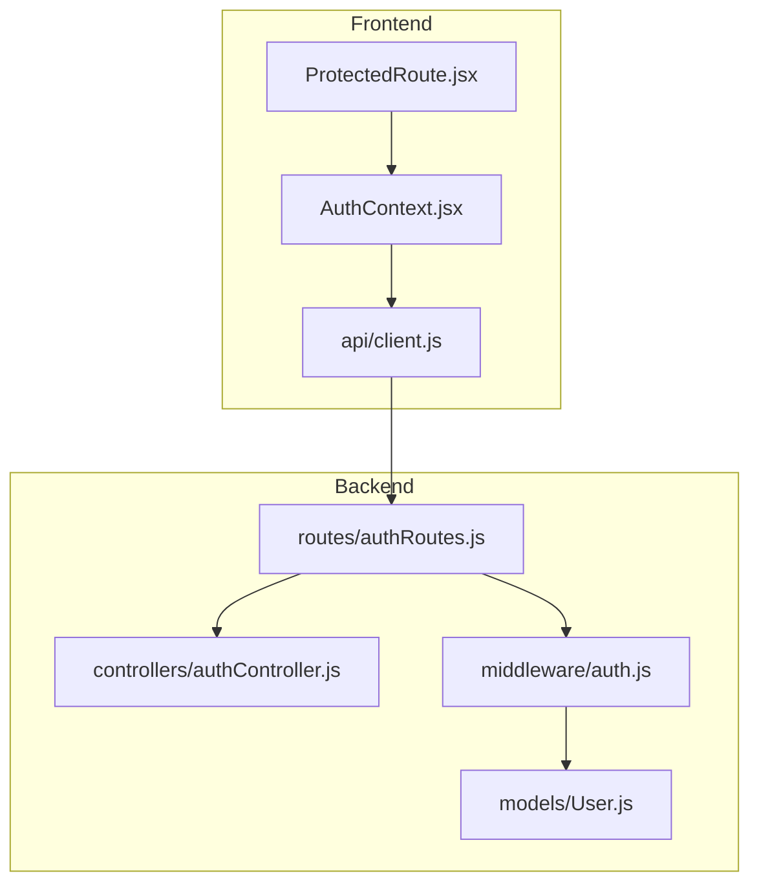
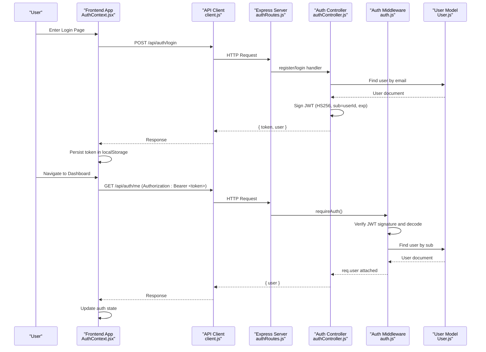
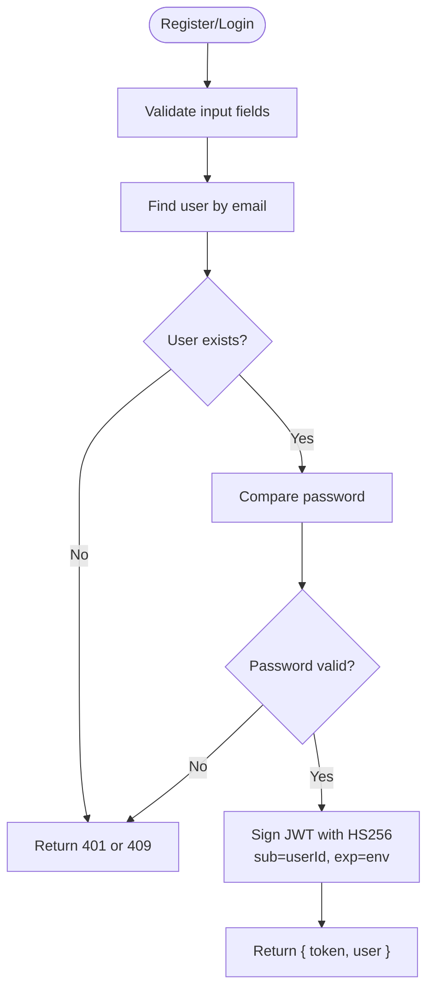
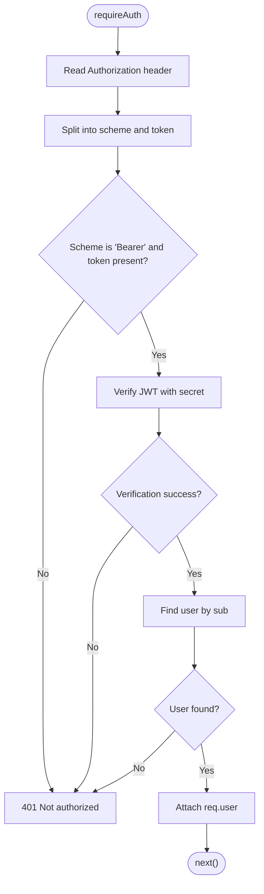
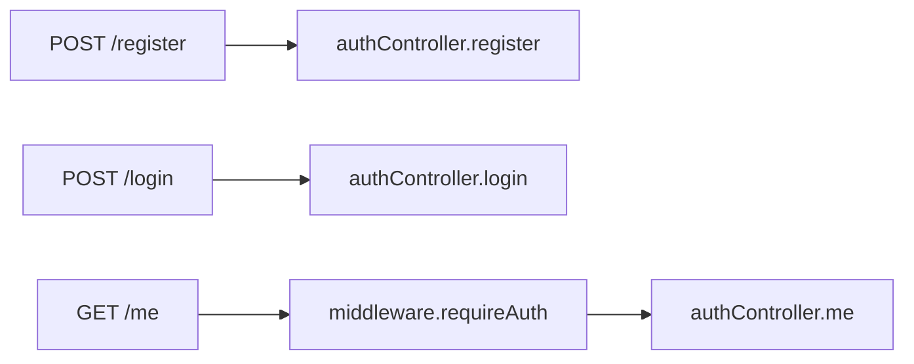
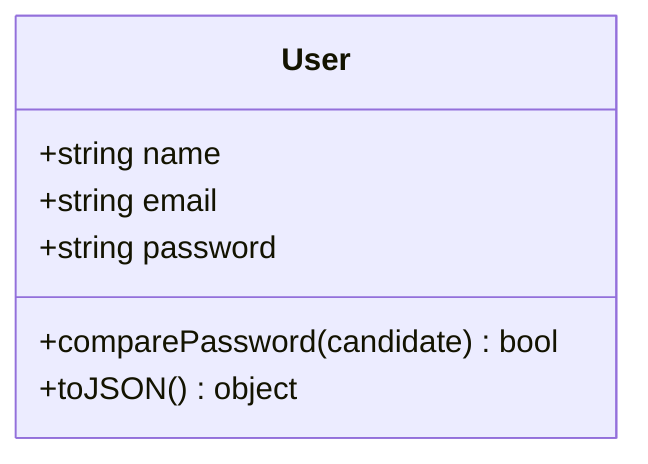
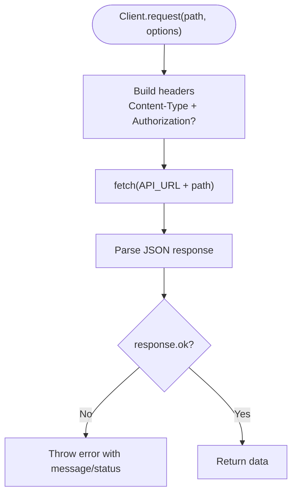
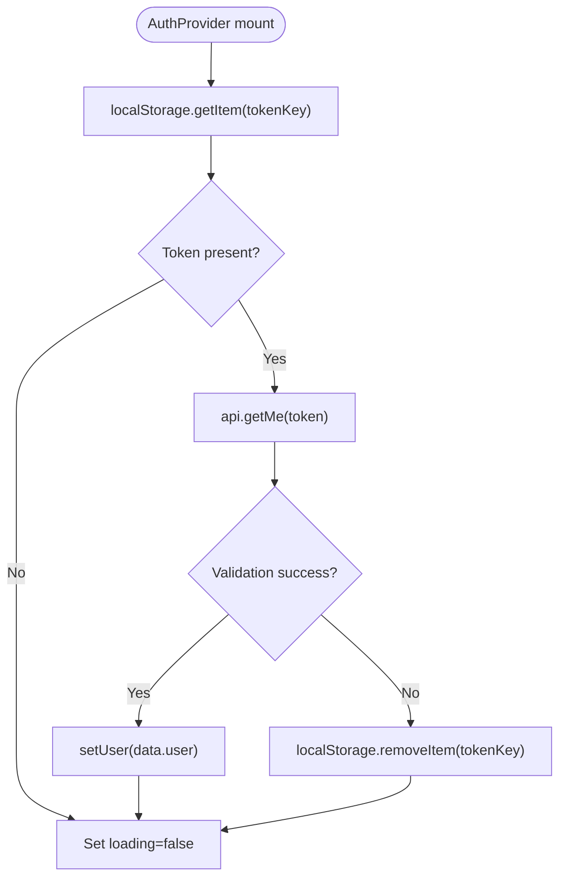
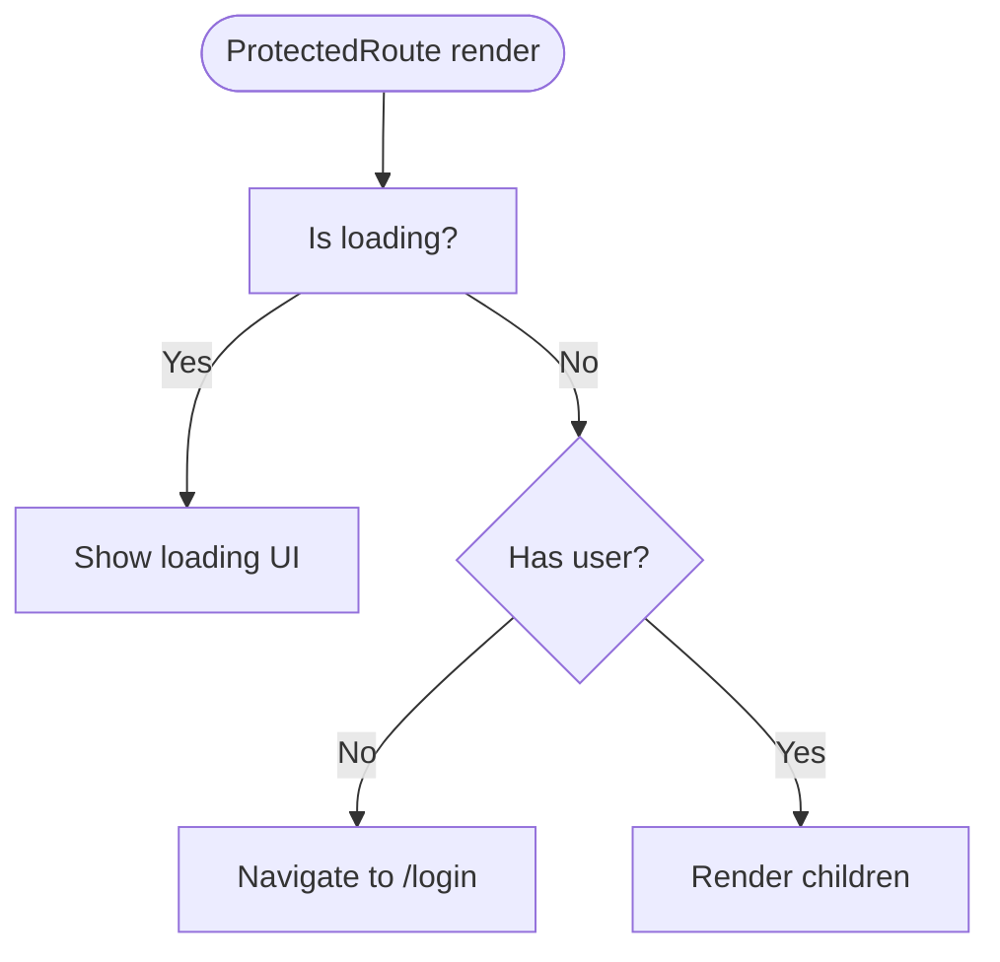
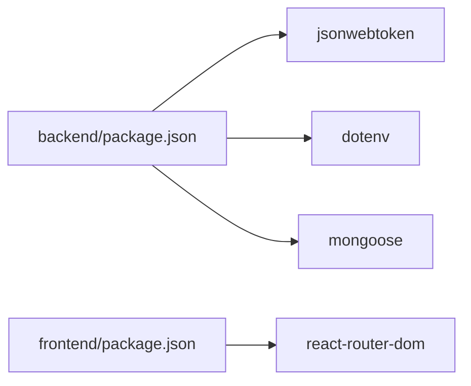

# JWT Token Management

<cite>
**Referenced Files in This Document**
- [authController.js](file://backend/src/controllers/authController.js)
- [auth.js](file://backend/src/middleware/auth.js)
- [User.js](file://backend/src/models/User.js)
- [authRoutes.js](file://backend/src/routes/authRoutes.js)
- [client.js](file://frontend/src/api/client.js)
- [AuthContext.jsx](file://frontend/src/context/AuthContext.jsx)
- [ProtectedRoute.jsx](file://frontend/src/components/ProtectedRoute.jsx)
- [package.json (backend)](file://backend/package.json)
- [package.json (frontend)](file://frontend/package.json)
</cite>

## Table of Contents
1. [Introduction](#introduction)
2. [Project Structure](#project-structure)
3. [Core Components](#core-components)
4. [Architecture Overview](#architecture-overview)
5. [Detailed Component Analysis](#detailed-component-analysis)
6. [Dependency Analysis](#dependency-analysis)
7. [Performance Considerations](#performance-considerations)
8. [Troubleshooting Guide](#troubleshooting-guide)
9. [Conclusion](#conclusion)

## Introduction
This document explains the end-to-end lifecycle of JSON Web Tokens (JWT) in this MERN application, covering token generation, signing, verification, storage, and route protection. It also documents client-side token handling, security best practices, expiration handling, and common troubleshooting steps. The implementation uses a short-lived access token signed with HS256 and stored in browser local storage. There is no refresh token flow implemented yet; future enhancements are suggested where relevant.

## Project Structure
The authentication system spans backend Express routes and middleware, and frontend React context and components:
- Backend:
  - Controllers handle registration, login, and current user endpoints.
  - Middleware validates Bearer tokens and attaches the authenticated user to requests.
  - Routes wire controllers and middleware.
  - User model defines schema, password hashing, and safe serialization.
- Frontend:
  - API client sends Authorization headers for protected calls.
  - Auth context persists tokens and manages session state.
  - Protected route component guards UI based on authentication status.

**Diagram sources**
- [AuthContext.jsx:1-73](file://frontend/src/context/AuthContext.jsx#L1-L73)
- [ProtectedRoute.jsx:1-17](file://frontend/src/components/ProtectedRoute.jsx#L1-L17)
- [client.js:1-33](file://frontend/src/api/client.js#L1-L33)
- [authRoutes.js:1-13](file://backend/src/routes/authRoutes.js#L1-L13)
- [authController.js:1-74](file://backend/src/controllers/authController.js#L1-L74)
- [auth.js:1-24](file://backend/src/middleware/auth.js#L1-L24)
- [User.js:1-50](file://backend/src/models/User.js#L1-L50)

**Section sources**
- [authController.js:1-74](file://backend/src/controllers/authController.js#L1-L74)
- [auth.js:1-24](file://backend/src/middleware/auth.js#L1-L24)
- [User.js:1-50](file://backend/src/models/User.js#L1-L50)
- [authRoutes.js:1-13](file://backend/src/routes/authRoutes.js#L1-L13)
- [client.js:1-33](file://frontend/src/api/client.js#L1-L33)
- [AuthContext.jsx:1-73](file://frontend/src/context/AuthContext.jsx#L1-L73)
- [ProtectedRoute.jsx:1-17](file://frontend/src/components/ProtectedRoute.jsx#L1-L17)

## Core Components
- Token generation and signing:
  - Access tokens are created using HS256 with a secret from environment variables and include the user identifier in the subject claim.
  - Expiration is configured via an environment variable with a default value.
- Authentication middleware:
  - Extracts the Bearer token from the Authorization header.
  - Verifies the token signature and decodes the payload.
  - Loads the user by the subject claim and attaches it to the request.
- Route protection:
  - Protected routes require the middleware before executing controller logic.
- Client-side handling:
  - Stores the token in local storage under a fixed key.
  - Attaches the Authorization header for protected API calls.
  - Restores session on app load by validating the stored token with the server.

**Section sources**
- [authController.js:6-17](file://backend/src/controllers/authController.js#L6-L17)
- [auth.js:4-23](file://backend/src/middleware/auth.js#L4-L23)
- [authRoutes.js:8-10](file://backend/src/routes/authRoutes.js#L8-L10)
- [client.js:3-32](file://frontend/src/api/client.js#L3-L32)
- [AuthContext.jsx:4-56](file://frontend/src/context/AuthContext.jsx#L4-L56)

## Architecture Overview
The following sequence diagram shows the full flow from login to accessing a protected resource.

**Diagram sources**
- [AuthContext.jsx:12-46](file://frontend/src/context/AuthContext.jsx#L12-L46)
- [client.js:28-32](file://frontend/src/api/client.js#L28-L32)
- [authRoutes.js:8-10](file://backend/src/routes/authRoutes.js#L8-L10)
- [authController.js:53-67](file://backend/src/controllers/authController.js#L53-L67)
- [auth.js:4-23](file://backend/src/middleware/auth.js#L4-L23)
- [User.js:39-47](file://backend/src/models/User.js#L39-L47)

## Detailed Component Analysis

### Backend: Token Generation and Signing
- The controller defines a helper that signs a JWT containing the user identifier in the subject claim.
- The secret is read from environment variables; if missing, an error is thrown.
- Expiration is set via environment variable with a sensible default.
- Registration and login return both the token and serialized user data.

**Diagram sources**
- [authController.js:19-67](file://backend/src/controllers/authController.js#L19-L67)
- [authController.js:6-17](file://backend/src/controllers/authController.js#L6-L17)

**Section sources**
- [authController.js:6-17](file://backend/src/controllers/authController.js#L6-L17)
- [authController.js:19-67](file://backend/src/controllers/authController.js#L19-L67)

### Backend: Authentication Middleware
- Extracts the Authorization header and expects a Bearer scheme.
- Verifies the token using the same secret used for signing.
- Retrieves the user by the subject claim and attaches it to the request object.
- Returns 401 for invalid or missing tokens, or when the user does not exist.

**Diagram sources**
- [auth.js:4-23](file://backend/src/middleware/auth.js#L4-L23)

**Section sources**
- [auth.js:4-23](file://backend/src/middleware/auth.js#L4-L23)

### Backend: Route Protection Wiring
- Public routes: POST /register, POST /login.
- Protected route: GET /me requires the authentication middleware before the controller executes.

**Diagram sources**
- [authRoutes.js:8-10](file://backend/src/routes/authRoutes.js#L8-L10)

**Section sources**
- [authRoutes.js:8-10](file://backend/src/routes/authRoutes.js#L8-L10)

### Backend: User Model and Serialization
- Passwords are hashed automatically before saving.
- A method compares candidate passwords against the stored hash.
- JSON serialization strips sensitive fields and exposes a stable id field.

**Diagram sources**
- [User.js:4-47](file://backend/src/models/User.js#L4-L47)

**Section sources**
- [User.js:4-47](file://backend/src/models/User.js#L4-L47)

### Frontend: API Client and Header Injection
- Centralized fetch wrapper adds Content-Type and optional Authorization header.
- Convenience methods call registration, login, and getMe endpoints.
- getMe passes the token to attach the Authorization header.

**Diagram sources**
- [client.js:3-32](file://frontend/src/api/client.js#L3-L32)

**Section sources**
- [client.js:3-32](file://frontend/src/api/client.js#L3-L32)

### Frontend: Session Persistence and Restoration
- On mount, reads the token from local storage.
- Validates the token by calling the getMe endpoint.
- On success, sets user state; on failure, clears the token.
- Provides login/register/logout helpers that persist or clear the token.

**Diagram sources**
- [AuthContext.jsx:12-56](file://frontend/src/context/AuthContext.jsx#L12-L56)

**Section sources**
- [AuthContext.jsx:12-56](file://frontend/src/context/AuthContext.jsx#L12-L56)

### Frontend: Protected Route Guard
- Renders a loading indicator while restoring session.
- Redirects unauthenticated users to the login page.
- Renders children only when a user is present.

**Diagram sources**
- [ProtectedRoute.jsx:4-15](file://frontend/src/components/ProtectedRoute.jsx#L4-L15)

**Section sources**
- [ProtectedRoute.jsx:4-15](file://frontend/src/components/ProtectedRoute.jsx#L4-L15)

## Dependency Analysis
- Backend dependencies relevant to JWT:
  - jsonwebtoken for signing and verifying tokens.
  - dotenv for environment configuration.
  - mongoose for database operations.
- Frontend dependencies:
  - react-router-dom for navigation and protected routing.
  - Vite-based React application.

**Diagram sources**
- [package.json (backend):14-21](file://backend/package.json#L14-L21)
- [package.json (frontend):11-18](file://frontend/package.json#L11-L18)

**Section sources**
- [package.json (backend):14-21](file://backend/package.json#L14-L21)
- [package.json (frontend):11-18](file://frontend/package.json#L11-L18)

## Performance Considerations
- Keep JWT payloads minimal; only include necessary claims such as the user identifier.
- Use short-lived access tokens to reduce exposure windows.
- Avoid storing large objects in local storage; store only the token string.
- Prefer server-side validation and caching strategies for user lookups if needed.
- Ensure CORS and network timeouts are tuned appropriately for production.

[No sources needed since this section provides general guidance]

## Troubleshooting Guide
Common issues and resolutions:
- Missing or incorrect JWT_SECRET:
  - Symptom: Token verification fails or signing throws an error.
  - Resolution: Ensure the environment variable is set and matches between signing and verification.
- Expired tokens:
  - Symptom: Requests return unauthorized due to expired access tokens.
  - Resolution: Implement token refresh flow or prompt re-login.
- Invalid Authorization header format:
  - Symptom: Middleware rejects requests without proper Bearer scheme.
  - Resolution: Ensure the client sends Authorization: Bearer <token>.
- LocalStorage token mismatch:
  - Symptom: Stored token does not match server expectations.
  - Resolution: Clear local storage and re-authenticate.
- Network errors:
  - Symptom: Frontend cannot reach the backend.
  - Resolution: Verify API URL and server availability.

**Section sources**
- [authController.js:6-12](file://backend/src/controllers/authController.js#L6-L12)
- [auth.js:4-23](file://backend/src/middleware/auth.js#L4-L23)
- [client.js:3-32](file://frontend/src/api/client.js#L3-L32)
- [AuthContext.jsx:12-56](file://frontend/src/context/AuthContext.jsx#L12-L56)

## Conclusion
This application implements a straightforward JWT-based authentication flow:
- Short-lived HS256 access tokens are generated on successful login/registration.
- The backend middleware verifies tokens and enforces route protection.
- The frontend persists tokens in local storage and attaches them to protected requests.
For improved security and resilience, consider adding refresh tokens, secure cookie storage, CSRF protections, and robust error handling.

[No sources needed since this section summarizes without analyzing specific files]