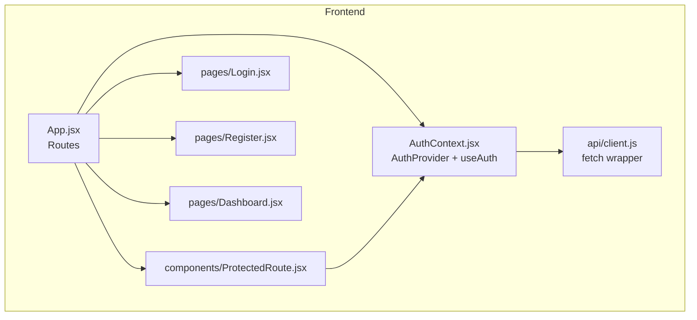
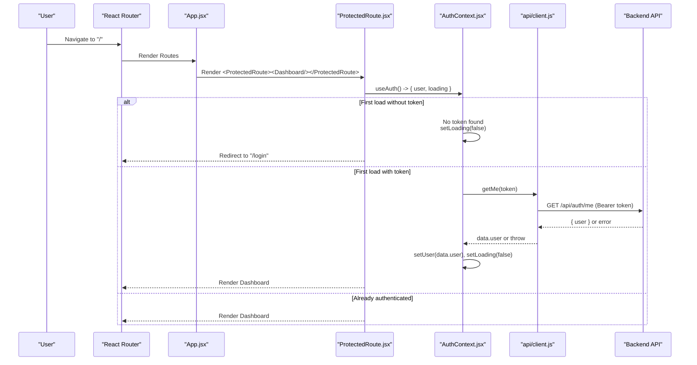
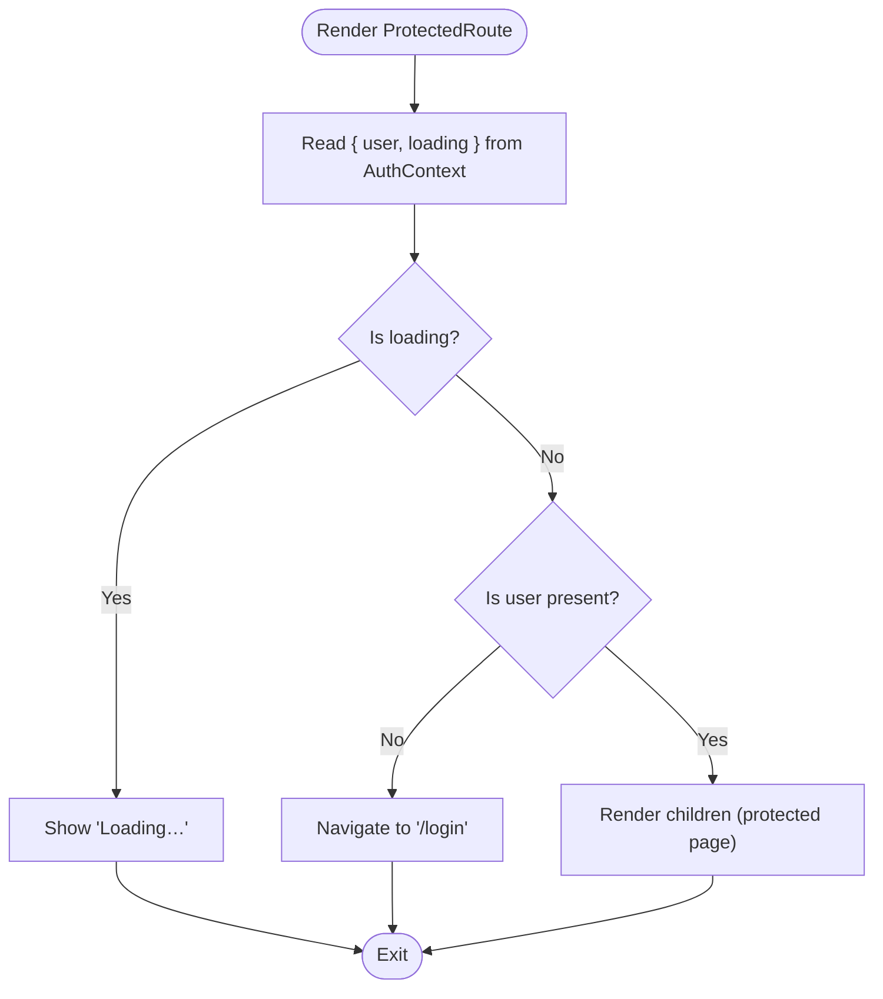
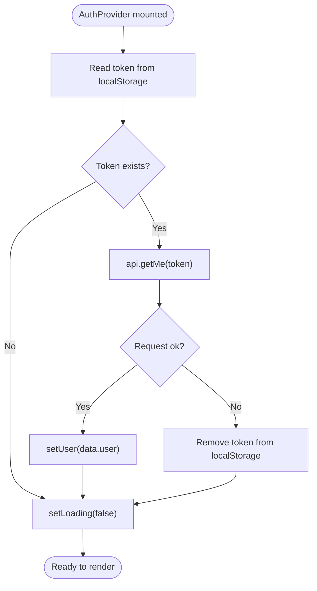
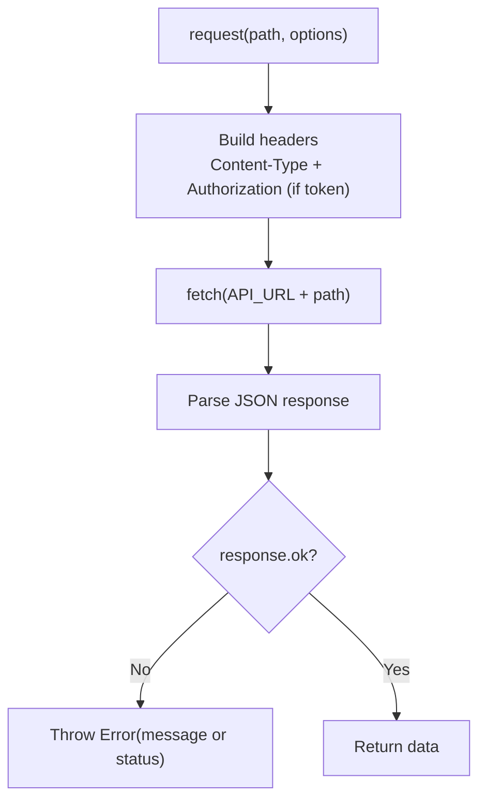
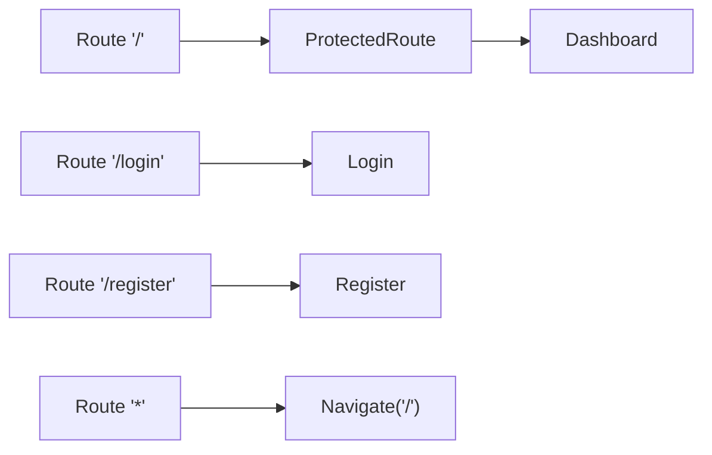
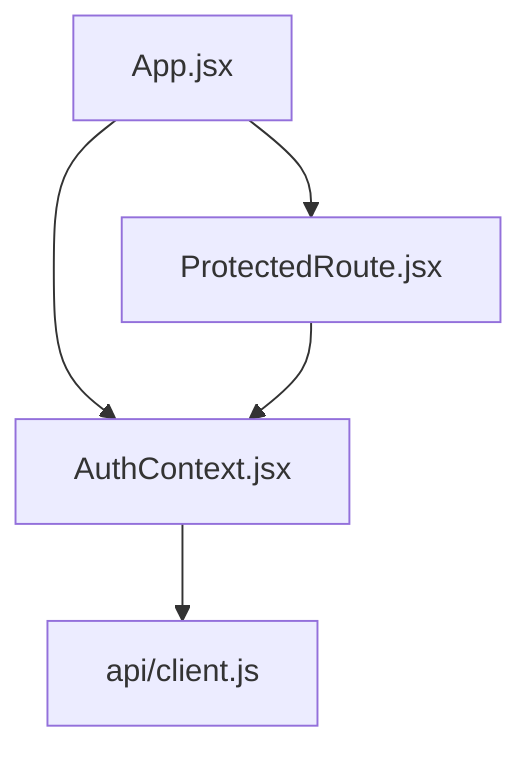

# Protected Routes

<cite>
**Referenced Files in This Document**
- [ProtectedRoute.jsx](file://frontend/src/components/ProtectedRoute.jsx)
- [AuthContext.jsx](file://frontend/src/context/AuthContext.jsx)
- [client.js](file://frontend/src/api/client.js)
- [App.jsx](file://frontend/src/App.jsx)
- [README.md](file://README.md)
</cite>

## Table of Contents
1. [Introduction](#introduction)
2. [Project Structure](#project-structure)
3. [Core Components](#core-components)
4. [Architecture Overview](#architecture-overview)
5. [Detailed Component Analysis](#detailed-component-analysis)
6. [Dependency Analysis](#dependency-analysis)
7. [Performance Considerations](#performance-considerations)
8. [Troubleshooting Guide](#troubleshooting-guide)
9. [Conclusion](#conclusion)

## Introduction
This document explains the client-side protected routes implementation for authentication using React Router and a React Context-based auth state. It focuses on how the ProtectedRoute component guards access to authenticated pages, how the AuthContext manages user sessions and token validation, and how unauthenticated users are redirected. It also includes guidance for implementing protected routes, handling loading states, and managing authentication errors gracefully.

## Project Structure
The frontend is organized into:
- API client for HTTP requests with Bearer token support
- Authentication context for session management and token persistence
- A ProtectedRoute component that guards routes
- Pages for login, registration, and dashboard
- App-level routing configuration

**Diagram sources**
- [App.jsx:1-29](file://frontend/src/App.jsx#L1-L29)
- [AuthContext.jsx:1-73](file://frontend/src/context/AuthContext.jsx#L1-L73)
- [client.js:1-33](file://frontend/src/api/client.js#L1-L33)
- [ProtectedRoute.jsx:1-17](file://frontend/src/components/ProtectedRoute.jsx#L1-L17)

**Section sources**
- [README.md:10-32](file://README.md#L10-L32)

## Core Components
- ProtectedRoute: Guards route rendering based on authentication state from AuthContext. Shows a loading indicator while the session is being restored, redirects to /login if no user is present, and renders children when authenticated.
- AuthContext: Provides user state, loading state, and actions (login, register, logout). On mount, it restores the session by reading a stored token and validating it via the backend’s getMe endpoint.
- API Client: Wraps fetch calls, attaches Authorization headers when a token is provided, and throws descriptive errors for network or server failures.
- App Routing: Configures public routes (/login, /register) and wraps the Dashboard with ProtectedRoute so only authenticated users can access it.

Key responsibilities:
- Session restoration and validation on app load
- Token persistence in localStorage
- Redirecting unauthenticated users
- Rendering a loading state during initial auth check

**Section sources**
- [ProtectedRoute.jsx:1-17](file://frontend/src/components/ProtectedRoute.jsx#L1-L17)
- [AuthContext.jsx:1-73](file://frontend/src/context/AuthContext.jsx#L1-L73)
- [client.js:1-33](file://frontend/src/api/client.js#L1-L33)
- [App.jsx:1-29](file://frontend/src/App.jsx#L1-L29)

## Architecture Overview
The protected route flow integrates React Router, AuthContext, and the API client to ensure only authenticated users can access protected pages.

**Diagram sources**
- [App.jsx:8-25](file://frontend/src/App.jsx#L8-L25)
- [ProtectedRoute.jsx:4-15](file://frontend/src/components/ProtectedRoute.jsx#L4-L15)
- [AuthContext.jsx:12-36](file://frontend/src/context/AuthContext.jsx#L12-L36)
- [client.js:28-32](file://frontend/src/api/client.js#L28-L32)

## Detailed Component Analysis

### ProtectedRoute Component
ProtectedRoute is a small wrapper that decides whether to render the requested page or redirect to login. It reads the current authentication state from AuthContext and handles three cases:
- While the session is being restored (loading), it shows a simple loading UI.
- If there is no user, it redirects to /login using React Router’s Navigate component.
- If a user exists, it renders the protected child components.

Implementation highlights:
- Uses React Router’s Navigate for programmatic redirection.
- Reads both user and loading flags from AuthContext to avoid flicker and premature rendering.
- Renders children only after confirming the user is authenticated.

**Diagram sources**
- [ProtectedRoute.jsx:4-15](file://frontend/src/components/ProtectedRoute.jsx#L4-L15)

**Section sources**
- [ProtectedRoute.jsx:1-17](file://frontend/src/components/ProtectedRoute.jsx#L1-L17)

### AuthContext and Session Management
AuthContext provides:
- user: The authenticated user object or null.
- loading: Boolean indicating whether the initial session check is in progress.
- login, register, logout: Actions to manage authentication.

Session restoration logic:
- On mount, it checks for a stored token in localStorage.
- If no token exists, it sets loading to false immediately.
- If a token exists, it calls api.getMe(token) to validate the token with the backend.
- On success, it stores the user in state; on failure, it clears the token from localStorage.
- In all cases, it sets loading to false once the async operation completes.

Token persistence:
- After successful login or registration, the token is saved to localStorage along with the user object.
- Logout removes the token and clears the user state.

Error handling:
- Network or server errors during getMe cause the token to be removed, ensuring the app does not remain in an inconsistent authenticated state.

**Diagram sources**
- [AuthContext.jsx:12-36](file://frontend/src/context/AuthContext.jsx#L12-L36)
- [AuthContext.jsx:38-56](file://frontend/src/context/AuthContext.jsx#L38-L56)

**Section sources**
- [AuthContext.jsx:1-73](file://frontend/src/context/AuthContext.jsx#L1-L73)

### API Client and Token Validation
The API client centralizes HTTP requests and ensures consistent behavior:
- Base URL is configurable via environment variables.
- request function attaches Authorization header when a token is provided.
- Non-ok responses throw descriptive errors, including status codes and server messages.
- Network errors are caught and converted into a friendly message.

Endpoints used for authentication:
- POST /api/auth/register
- POST /api/auth/login
- GET /api/auth/me (requires Bearer token)

**Diagram sources**
- [client.js:3-26](file://frontend/src/api/client.js#L3-L26)
- [client.js:28-32](file://frontend/src/api/client.js#L28-L32)

**Section sources**
- [client.js:1-33](file://frontend/src/api/client.js#L1-L33)

### App Routing and Protected Route Usage
App.jsx configures routes and applies protection:
- Public routes: /login and /register.
- Protected route: / is wrapped with ProtectedRoute to require authentication.
- Fallback route: Any unknown path redirects to /.

Example usage pattern:
- Wrap any protected page with ProtectedRoute to enforce authentication.
- Keep public pages outside of ProtectedRoute.

**Diagram sources**
- [App.jsx:8-25](file://frontend/src/App.jsx#L8-L25)

**Section sources**
- [App.jsx:1-29](file://frontend/src/App.jsx#L1-L29)

## Dependency Analysis
The following diagram shows how the core files depend on each other:

**Diagram sources**
- [App.jsx:1-29](file://frontend/src/App.jsx#L1-L29)
- [ProtectedRoute.jsx:1-17](file://frontend/src/components/ProtectedRoute.jsx#L1-L17)
- [AuthContext.jsx:1-73](file://frontend/src/context/AuthContext.jsx#L1-L73)
- [client.js:1-33](file://frontend/src/api/client.js#L1-L33)

**Section sources**
- [App.jsx:1-29](file://frontend/src/App.jsx#L1-L29)
- [ProtectedRoute.jsx:1-17](file://frontend/src/components/ProtectedRoute.jsx#L1-L17)
- [AuthContext.jsx:1-73](file://frontend/src/context/AuthContext.jsx#L1-L73)
- [client.js:1-33](file://frontend/src/api/client.js#L1-L33)

## Performance Considerations
- Minimize re-renders: AuthContext uses useMemo to memoize the context value, reducing unnecessary updates.
- Avoid layout shifts: ProtectedRoute shows a lightweight loading indicator while restoring the session.
- Reduce network calls: The token is validated only once on app load; subsequent navigations rely on local state.
- Efficient redirects: Using React Router’s Navigate prevents rendering unauthorized content.

[No sources needed since this section provides general guidance]

## Troubleshooting Guide
Common issues and resolutions:
- Backend unreachable:
  - Symptom: Errors like “Cannot reach the server” during login or session restore.
  - Cause: Backend not running or wrong VITE_API_URL.
  - Resolution: Ensure the backend is running and VITE_API_URL points to the correct base URL.

- Invalid or expired token:
  - Symptom: Immediate redirect to /login after refresh.
  - Cause: Token missing, invalid, or expired.
  - Resolution: Re-authenticate; the context clears invalid tokens automatically.

- CORS errors:
  - Symptom: Network requests blocked due to cross-origin policy.
  - Cause: Backend CORS misconfiguration.
  - Resolution: Configure allowed origins on the backend to include the frontend origin.

- Unexpected redirects:
  - Symptom: Users see /login even after logging in.
  - Cause: Token not persisted or getMe fails.
  - Resolution: Verify localStorage contains the token and that /api/auth/me returns a valid user.

**Section sources**
- [client.js:3-26](file://frontend/src/api/client.js#L3-L26)
- [AuthContext.jsx:12-36](file://frontend/src/context/AuthContext.jsx#L12-L36)
- [README.md:121-125](file://README.md#L121-L125)

## Conclusion
The protected routes implementation combines React Router, a React Context for authentication state, and a centralized API client. ProtectedRoute enforces access control by checking the presence of a valid user, while AuthContext manages token persistence and validation. Together, they provide a robust foundation for guarding authenticated pages, handling loading states, and managing errors gracefully.

[No sources needed since this section summarizes without analyzing specific files]