# User Login

<cite>
**Referenced Files in This Document**
- [authController.js](file://backend/src/controllers/authController.js)
- [authRoutes.js](file://backend/src/routes/authRoutes.js)
- [auth.js](file://backend/src/middleware/auth.js)
- [User.js](file://backend/src/models/User.js)
- [Login.jsx](file://frontend/src/pages/Login.jsx)
- [AuthContext.jsx](file://frontend/src/context/AuthContext.jsx)
- [client.js](file://frontend/src/api/client.js)
- [README.md](file://README.md)
</cite>

## Table of Contents
1. [Introduction](#introduction)
2. [Project Structure](#project-structure)
3. [Core Components](#core-components)
4. [Architecture Overview](#architecture-overview)
5. [Detailed Component Analysis](#detailed-component-analysis)
6. [Dependency Analysis](#dependency-analysis)
7. [Performance Considerations](#performance-considerations)
8. [Troubleshooting Guide](#troubleshooting-guide)
9. [Conclusion](#conclusion)

## Introduction
This document explains the user login system end-to-end: how credentials are submitted from the React frontend, validated and authenticated on the Express backend, how a JSON Web Token (JWT) is generated and returned, and how the frontend persists and uses the token for subsequent requests. It also covers password hashing with bcrypt, token payload structure, expiration handling, security considerations, endpoint specifications, error responses, and integration with frontend authentication state management.

## Project Structure
The login flow spans both backend and frontend modules:

- Backend
  - Routes define `/api/auth/login` and related endpoints.
  - Controller handles validation, user lookup, password verification, and JWT issuance.
  - Middleware protects routes by verifying Bearer tokens.
  - Model defines the User schema, bcrypt hashing, and safe JSON serialization.
- Frontend
  - Login page collects credentials and calls the API via a fetch wrapper.
  - Auth context persists the token, manages user state, and exposes login/logout.
  - API client attaches Authorization headers and centralizes error handling.

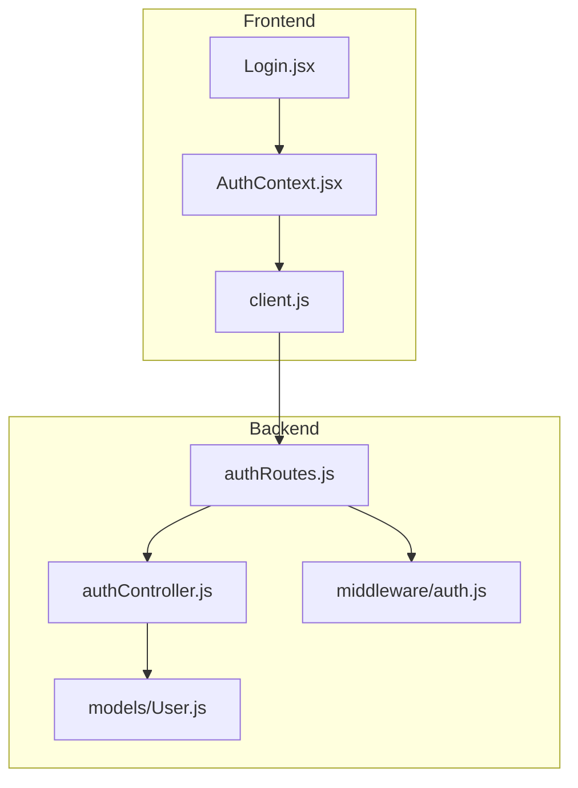

**Diagram sources**
- [authRoutes.js:1-13](file://backend/src/routes/authRoutes.js#L1-L13)
- [authController.js:1-74](file://backend/src/controllers/authController.js#L1-L74)
- [auth.js:1-24](file://backend/src/middleware/auth.js#L1-L24)
- [User.js:1-50](file://backend/src/models/User.js#L1-L50)
- [Login.jsx:1-73](file://frontend/src/pages/Login.jsx#L1-L73)
- [AuthContext.jsx:1-73](file://frontend/src/context/AuthContext.jsx#L1-L73)
- [client.js:1-33](file://frontend/src/api/client.js#L1-L33)

**Section sources**
- [README.md:10-32](file://README.md#L10-L32)

## Core Components
- Authentication controller: validates input, finds user, compares passwords, issues JWT, returns token and user payload.
- Password hashing: bcrypt used in model pre-save hook; comparePassword method verifies candidates.
- JWT middleware: extracts Bearer token, verifies signature and expiry, loads user into request.
- Routes: expose POST /login and GET /me with auth guard.
- Frontend login page: collects email/password, calls API, navigates on success, shows errors.
- Auth context: persists token to localStorage, restores session, provides login/register/logout.
- API client: centralized fetch wrapper that attaches Authorization header and normalizes errors.

**Section sources**
- [authController.js:1-74](file://backend/src/controllers/authController.js#L1-L74)
- [User.js:1-50](file://backend/src/models/User.js#L1-L50)
- [auth.js:1-24](file://backend/src/middleware/auth.js#L1-L24)
- [authRoutes.js:1-13](file://backend/src/routes/authRoutes.js#L1-L13)
- [Login.jsx:1-73](file://frontend/src/pages/Login.jsx#L1-L73)
- [AuthContext.jsx:1-73](file://frontend/src/context/AuthContext.jsx#L1-L73)
- [client.js:1-33](file://frontend/src/api/client.js#L1-L33)

## Architecture Overview
The login sequence connects the React UI to the Express API and MongoDB-backed user store.

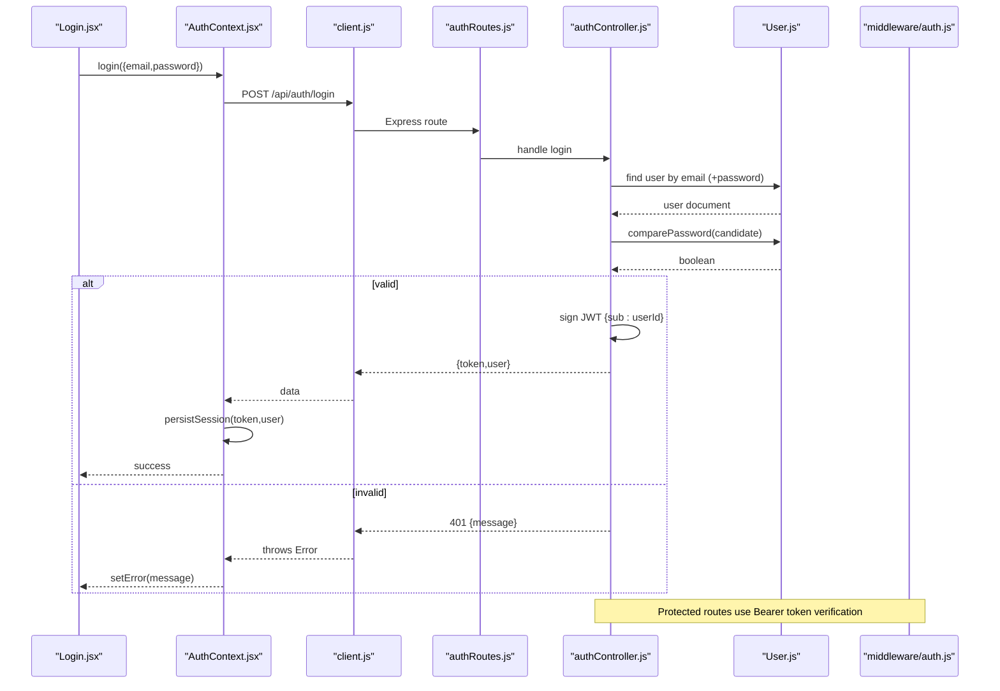

**Diagram sources**
- [Login.jsx:17-30](file://frontend/src/pages/Login.jsx#L17-L30)
- [AuthContext.jsx:43-46](file://frontend/src/context/AuthContext.jsx#L43-L46)
- [client.js:28-32](file://frontend/src/api/client.js#L28-L32)
- [authRoutes.js:8-10](file://backend/src/routes/authRoutes.js#L8-L10)
- [authController.js:53-67](file://backend/src/controllers/authController.js#L53-L67)
- [User.js:30-37](file://backend/src/models/User.js#L30-L37)
- [auth.js:4-23](file://backend/src/middleware/auth.js#L4-L23)

## Detailed Component Analysis

### Authentication Flow: Credential Submission to Token Response
- The Login page prevents default form submission, clears previous errors, sets submitting state, and calls the context’s login function with email and password.
- AuthContext invokes the API client’s login method, which POSTs to /api/auth/login with JSON body and no token.
- The backend route wraps the controller with async error handling.
- The controller validates presence and types of email and password, then looks up the user by normalized email and includes the hashed password field.
- If the user does not exist or the password comparison fails, it returns 401 with a message.
- On success, it signs a JWT containing the user ID and returns an object with token and user.
- The frontend stores the token in localStorage and updates global user state.

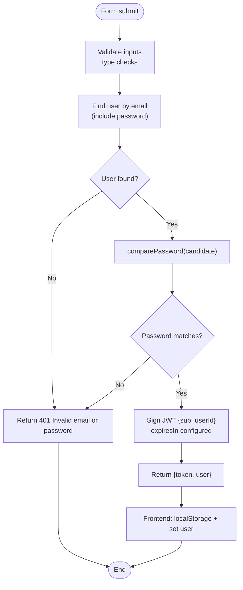

**Diagram sources**
- [Login.jsx:17-30](file://frontend/src/pages/Login.jsx#L17-L30)
- [AuthContext.jsx:43-46](file://frontend/src/context/AuthContext.jsx#L43-L46)
- [client.js:28-32](file://frontend/src/api/client.js#L28-L32)
- [authController.js:53-67](file://backend/src/controllers/authController.js#L53-L67)
- [User.js:30-37](file://backend/src/models/User.js#L30-L37)

**Section sources**
- [Login.jsx:17-30](file://frontend/src/pages/Login.jsx#L17-L30)
- [AuthContext.jsx:43-46](file://frontend/src/context/AuthContext.jsx#L43-L46)
- [client.js:28-32](file://frontend/src/api/client.js#L28-L32)
- [authRoutes.js:8-10](file://backend/src/routes/authRoutes.js#L8-L10)
- [authController.js:53-67](file://backend/src/controllers/authController.js#L53-L67)

### Password Verification with bcrypt
- The User model hashes passwords before saving using bcrypt with a cost factor.
- A custom method compares a candidate password against the stored hash.
- The login controller uses this method to verify credentials securely without exposing raw passwords.

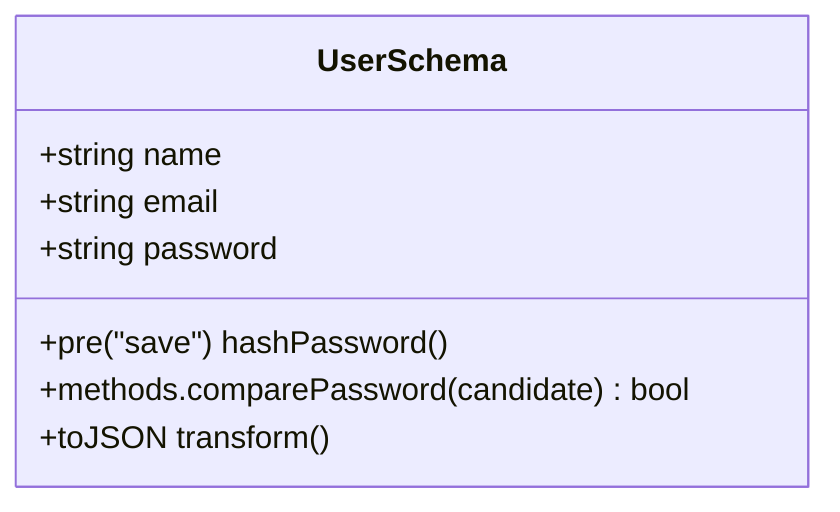

**Diagram sources**
- [User.js:4-47](file://backend/src/models/User.js#L4-L47)

**Section sources**
- [User.js:30-37](file://backend/src/models/User.js#L30-L37)
- [authController.js:60-64](file://backend/src/controllers/authController.js#L60-L64)

### JWT Token Generation and Payload
- Tokens are signed with a secret from environment variables and include a subject claim containing the user ID.
- Expiration is configurable via environment variable with a sensible default.
- The response payload contains both the token and a sanitized user object (without sensitive fields).

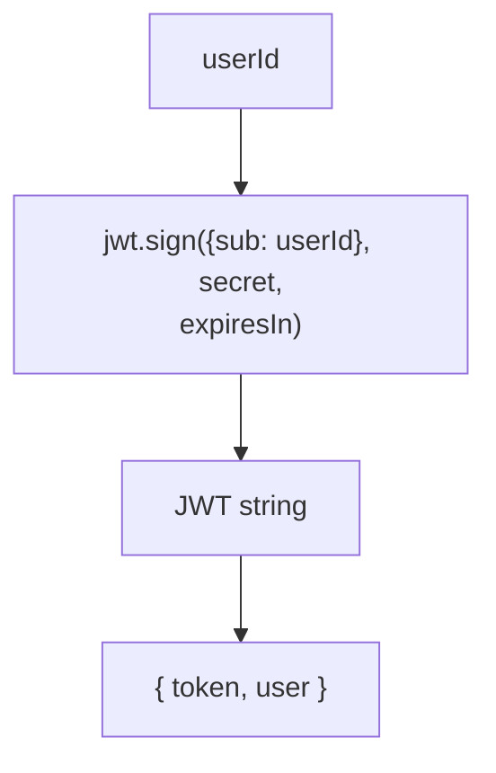

**Diagram sources**
- [authController.js:6-17](file://backend/src/controllers/authController.js#L6-L17)
- [User.js:39-47](file://backend/src/models/User.js#L39-L47)

**Section sources**
- [authController.js:6-17](file://backend/src/controllers/authController.js#L6-L17)
- [README.md:55-64](file://README.md#L55-L64)

### Token Expiration Handling
- The server sets token lifetime based on configuration; if unset, a default applies.
- The frontend does not parse expiration locally; it relies on the server to reject expired tokens when accessing protected endpoints.
- When the server rejects a token (invalid or expired), the frontend clears the stored token and resets user state.

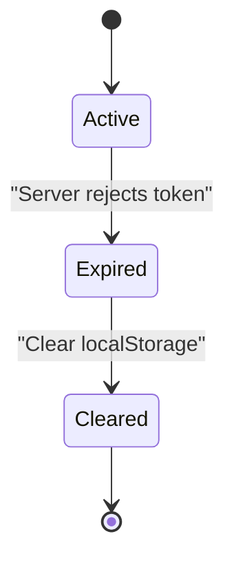

**Diagram sources**
- [authController.js:10-12](file://backend/src/controllers/authController.js#L10-L12)
- [AuthContext.jsx:21-31](file://frontend/src/context/AuthContext.jsx#L21-L31)

**Section sources**
- [authController.js:10-12](file://backend/src/controllers/authController.js#L10-L12)
- [AuthContext.jsx:21-31](file://frontend/src/context/AuthContext.jsx#L21-L31)

### Security Measures Against Common Attacks
- Passwords are never stored or returned in plaintext; they are hashed with bcrypt and excluded from JSON output.
- Email normalization reduces case-sensitivity issues and helps prevent duplicate accounts.
- Input validation ensures required fields are present and well-formed.
- JWT verification enforces correct scheme and secret; invalid or missing tokens result in 401.
- Environment-based secrets avoid hardcoding sensitive values.

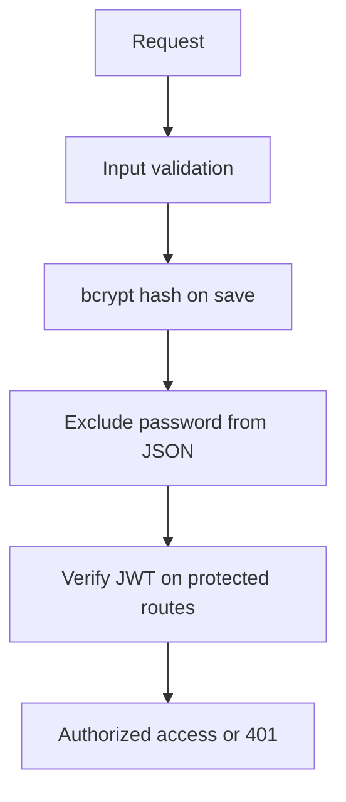

**Diagram sources**
- [User.js:30-47](file://backend/src/models/User.js#L30-L47)
- [authController.js:22-35](file://backend/src/controllers/authController.js#L22-L35)
- [auth.js:4-23](file://backend/src/middleware/auth.js#L4-L23)

**Section sources**
- [User.js:30-47](file://backend/src/models/User.js#L30-L47)
- [authController.js:22-35](file://backend/src/controllers/authController.js#L22-L35)
- [auth.js:4-23](file://backend/src/middleware/auth.js#L4-L23)

### Login Endpoint Specifications
- Method: POST
- Path: /api/auth/login
- Request body: JSON with email and password
- Success response: 200 with token and user
- Error responses:
  - 400: Missing or invalid fields
  - 401: Invalid email or password
  - 500: Unexpected server error

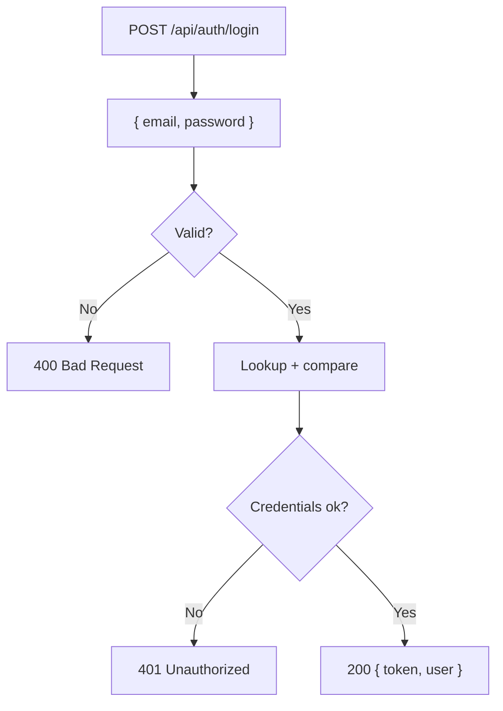

**Diagram sources**
- [authRoutes.js:8-9](file://backend/src/routes/authRoutes.js#L8-L9)
- [authController.js:53-67](file://backend/src/controllers/authController.js#L53-L67)

**Section sources**
- [authRoutes.js:8-9](file://backend/src/routes/authRoutes.js#L8-L9)
- [authController.js:53-67](file://backend/src/controllers/authController.js#L53-L67)
- [README.md:76-85](file://README.md#L76-L85)

### Error Responses for Invalid Credentials
- Missing or malformed fields return 400 with a descriptive message.
- Incorrect credentials return 401 with a generic message to avoid leaking information about whether the email exists.
- Network failures or unparseable responses throw a client-side error that surfaces to the UI.

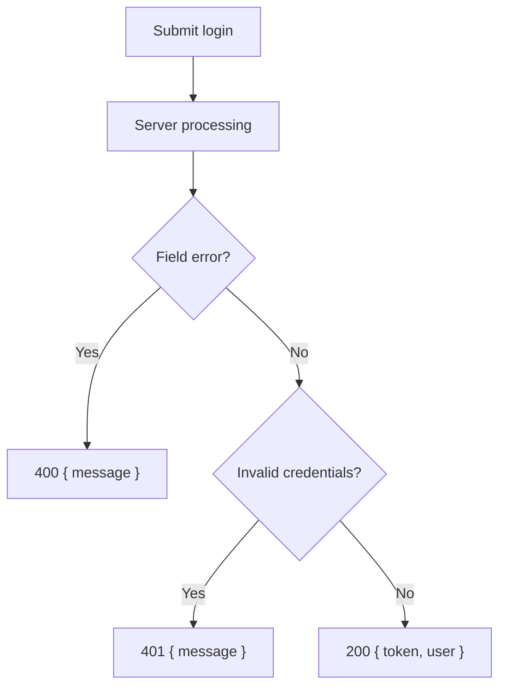

**Diagram sources**
- [authController.js:22-35](file://backend/src/controllers/authController.js#L22-L35)
- [authController.js:53-67](file://backend/src/controllers/authController.js#L53-L67)
- [client.js:15-25](file://frontend/src/api/client.js#L15-L25)

**Section sources**
- [authController.js:22-35](file://backend/src/controllers/authController.js#L22-L35)
- [authController.js:53-67](file://backend/src/controllers/authController.js#L53-L67)
- [client.js:15-25](file://frontend/src/api/client.js#L15-L25)

### Integration with Frontend Authentication State Management
- AuthContext persists the token under a stable key and sets the current user.
- On app load, it attempts to restore the session by calling the protected me endpoint with the stored token.
- Successful restoration updates user state; failure clears the token and leaves the user null.
- Login triggers API call, persists token, and navigates to the home page.
- Logout clears persisted token and user state.

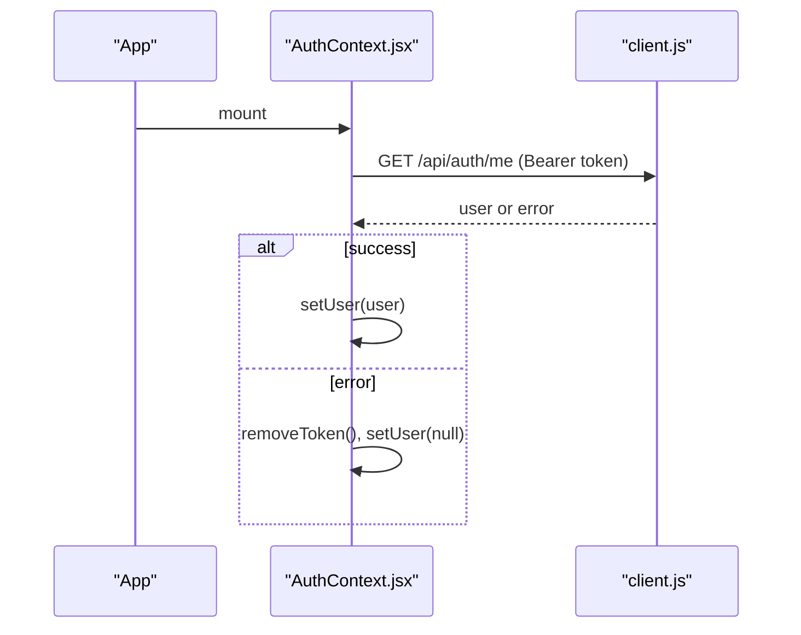

**Diagram sources**
- [AuthContext.jsx:12-36](file://frontend/src/context/AuthContext.jsx#L12-L36)
- [client.js:28-32](file://frontend/src/api/client.js#L28-L32)

**Section sources**
- [AuthContext.jsx:12-36](file://frontend/src/context/AuthContext.jsx#L12-L36)
- [AuthContext.jsx:38-56](file://frontend/src/context/AuthContext.jsx#L38-L56)
- [client.js:28-32](file://frontend/src/api/client.js#L28-L32)

## Dependency Analysis
The following diagram maps module dependencies involved in login and protected routes.

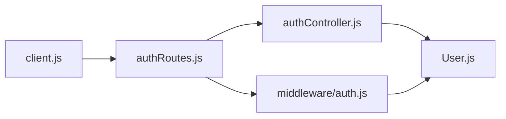

**Diagram sources**
- [client.js:28-32](file://frontend/src/api/client.js#L28-L32)
- [authRoutes.js:1-13](file://backend/src/routes/authRoutes.js#L1-L13)
- [authController.js:1-74](file://backend/src/controllers/authController.js#L1-L74)
- [User.js:1-50](file://backend/src/models/User.js#L1-L50)
- [auth.js:1-24](file://backend/src/middleware/auth.js#L1-L24)

**Section sources**
- [authRoutes.js:1-13](file://backend/src/routes/authRoutes.js#L1-L13)
- [authController.js:1-74](file://backend/src/controllers/authController.js#L1-L74)
- [auth.js:1-24](file://backend/src/middleware/auth.js#L1-L24)
- [User.js:1-50](file://backend/src/models/User.js#L1-L50)
- [client.js:1-33](file://frontend/src/api/client.js#L1-L33)

## Performance Considerations
- bcrypt cost factor balances security and latency; ensure it is tuned for your deployment environment.
- Avoid unnecessary re-hashing by checking modification flags in pre-save hooks.
- Keep token payloads minimal (e.g., only user ID) to reduce signing overhead.
- Use connection pooling and caching strategies for database connections in serverless environments.

[No sources needed since this section provides general guidance]

## Troubleshooting Guide
- Cannot reach the server: The API client throws a network error if fetch fails; ensure the backend is running and CORS is configured correctly.
- Not authorized on protected routes: Verify the Authorization header is set to Bearer <token> and that the token is valid and not expired.
- Invalid email or password: Confirm credentials match stored records; remember emails are normalized to lowercase.
- Session not restored after reload: Ensure the token exists in localStorage and the me endpoint responds successfully.

**Section sources**
- [client.js:15-25](file://frontend/src/api/client.js#L15-L25)
- [auth.js:4-23](file://backend/src/middleware/auth.js#L4-L23)
- [authController.js:53-67](file://backend/src/controllers/authController.js#L53-L67)
- [AuthContext.jsx:21-31](file://frontend/src/context/AuthContext.jsx#L21-L31)

## Conclusion
The login system combines secure password hashing, strict input validation, and JWT-based authorization. The frontend maintains a clean separation between UI, state, and HTTP concerns, while the backend encapsulates business logic in controllers, models, and middleware. Together, they provide a robust, maintainable authentication flow suitable for production deployments.

[No sources needed since this section summarizes without analyzing specific files]