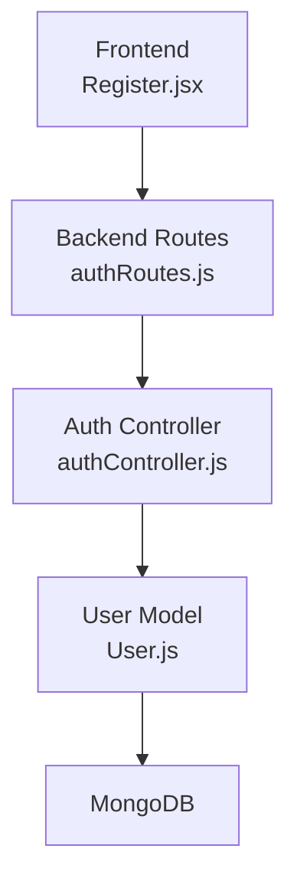
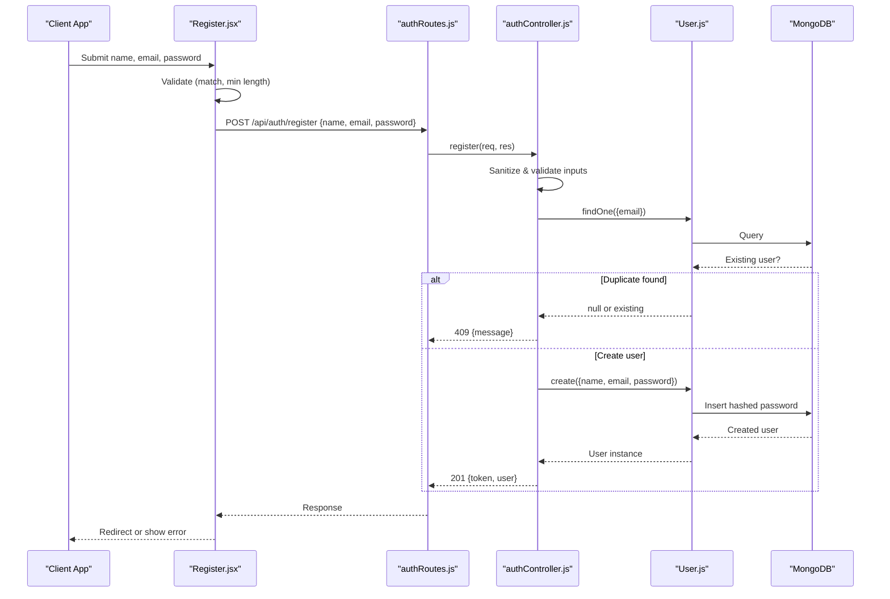
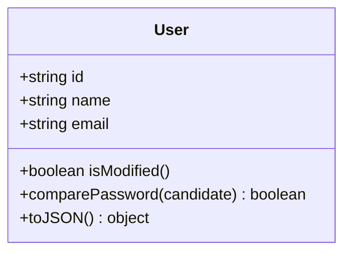
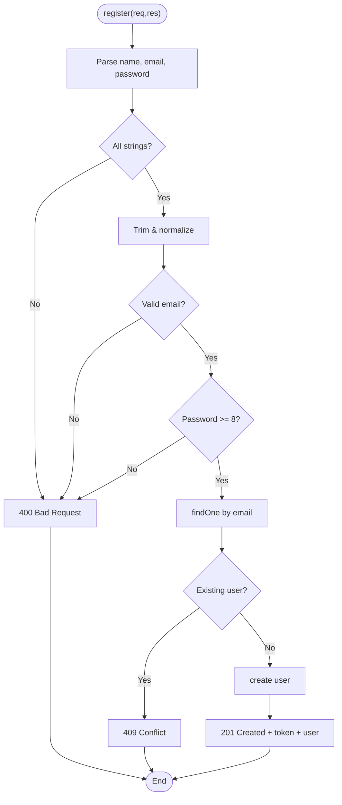
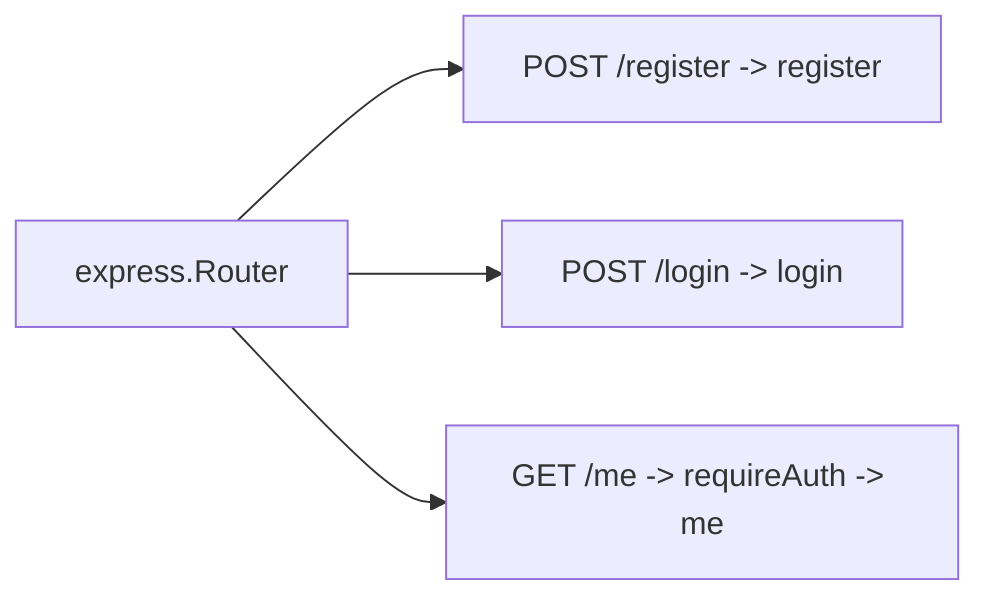
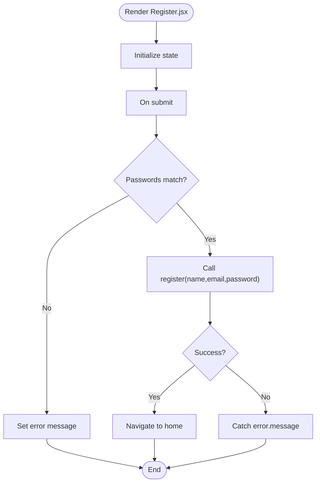
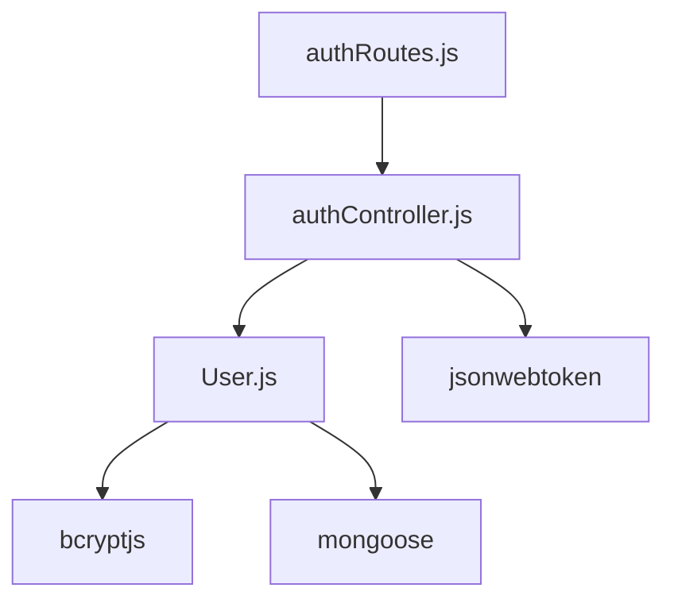

# User Registration

<cite>
**Referenced Files in This Document**
- [User.js](file://backend/src/models/User.js)
- [authController.js](file://backend/src/controllers/authController.js)
- [authRoutes.js](file://backend/src/routes/authRoutes.js)
- [Register.jsx](file://frontend/src/pages/Register.jsx)
- [README.md](file://README.md)
</cite>

## Table of Contents
1. [Introduction](#introduction)
2. [Project Structure](#project-structure)
3. [Core Components](#core-components)
4. [Architecture Overview](#architecture-overview)
5. [Detailed Component Analysis](#detailed-component-analysis)
6. [Dependency Analysis](#dependency-analysis)
7. [Performance Considerations](#performance-considerations)
8. [Troubleshooting Guide](#troubleshooting-guide)
9. [Conclusion](#conclusion)
10. [Appendices](#appendices)

## Introduction
This document explains the user registration functionality end-to-end: how the frontend collects and validates input, how the backend sanitizes and validates data, enforces duplicate prevention, hashes passwords securely, and returns structured responses. It also documents the User model schema, request/response formats, error handling patterns, and security considerations. Finally, it provides guidance for extending the registration flow with new fields or endpoints.

## Project Structure
The registration feature spans both the backend (Express API) and frontend (React + Vite):
- Backend routes expose `/api/auth/register`.
- The controller performs validation, duplicate checks, persistence, and token issuance.
- The User model defines schema constraints and password hashing.
- The frontend Register page collects inputs, validates locally, calls the API, and handles errors.

**Diagram sources**
- [Register.jsx:1-105](file://frontend/src/pages/Register.jsx#L1-L105)
- [authRoutes.js:1-13](file://backend/src/routes/authRoutes.js#L1-L13)
- [authController.js:1-74](file://backend/src/controllers/authController.js#L1-L74)
- [User.js:1-50](file://backend/src/models/User.js#L1-L50)

**Section sources**
- [README.md:10-32](file://README.md#L10-L32)

## Core Components
- User model: Defines fields, validations, bcrypt hashing, JSON transformation, and password comparison utility.
- Auth controller: Implements register and login logic, including input validation, duplicate prevention, and JWT issuance.
- Auth routes: Expose HTTP endpoints and wrap handlers with async error handling.
- Frontend Register page: Collects form data, performs client-side validation, and manages UI state.

Key responsibilities:
- Input sanitization and validation on both client and server.
- Duplicate account prevention via email uniqueness.
- Secure password storage using bcrypt.
- Consistent error response format.

**Section sources**
- [User.js:1-50](file://backend/src/models/User.js#L1-L50)
- [authController.js:1-74](file://backend/src/controllers/authController.js#L1-L74)
- [authRoutes.js:1-13](file://backend/src/routes/authRoutes.js#L1-L13)
- [Register.jsx:1-105](file://frontend/src/pages/Register.jsx#L1-L105)

## Architecture Overview
The registration flow connects the React frontend to the Express backend and persists a hashed user record in MongoDB.

**Diagram sources**
- [Register.jsx:19-38](file://frontend/src/pages/Register.jsx#L19-L38)
- [authRoutes.js:8-10](file://backend/src/routes/authRoutes.js#L8-L10)
- [authController.js:19-50](file://backend/src/controllers/authController.js#L19-L50)
- [User.js:30-37](file://backend/src/models/User.js#L30-L37)

## Detailed Component Analysis

### User Model Schema and Security
The User model defines the data structure and security behaviors:
- Fields:
  - name: string, required, trimmed, max length 80.
  - email: string, required, unique, lowercase, trimmed, validated against an email pattern.
  - password: string, required, minimum length 8, excluded from default JSON output.
- Pre-save hook: Hashes the password with bcrypt when modified.
- Instance method: comparePassword to verify candidate passwords.
- JSON transform: Removes internal fields and password; exposes id instead of _id.

**Diagram sources**
- [User.js:4-28](file://backend/src/models/User.js#L4-L28)
- [User.js:30-47](file://backend/src/models/User.js#L30-L47)

Validation rules summary:
- Name: required, trimmed, maxlength 80.
- Email: required, unique, lowercase, trimmed, regex match.
- Password: required, minlength 8, not returned in JSON.

Security notes:
- Passwords are hashed before saving.
- Password field is excluded from serialized responses.
- Unique index on email prevents duplicate accounts at the database level.

**Section sources**
- [User.js:4-28](file://backend/src/models/User.js#L4-L28)
- [User.js:30-47](file://backend/src/models/User.js#L30-L47)

### Registration Controller Logic
The register function implements the core business logic:
- Extracts name, email, password from request body.
- Type-checks all three fields.
- Trims and normalizes name/email.
- Validates email format using a regex.
- Enforces minimum password length.
- Checks for existing account by email.
- Creates the user and returns a token and sanitized user payload.
- Handles duplicate key errors from the database.

**Diagram sources**
- [authController.js:19-50](file://backend/src/controllers/authController.js#L19-L50)

Error handling highlights:
- Missing/invalid fields: 400 with message.
- Duplicate email: 409 with message.
- Database duplicate key: caught and converted to 409.
- Other errors: rethrown for global handler.

**Section sources**
- [authController.js:19-50](file://backend/src/controllers/authController.js#L19-L50)

### Routes and Middleware
- POST /api/auth/register maps to the register controller wrapped with asyncHandler.
- Additional routes include login and protected me endpoint.

**Diagram sources**
- [authRoutes.js:1-13](file://backend/src/routes/authRoutes.js#L1-L13)

**Section sources**
- [authRoutes.js:1-13](file://backend/src/routes/authRoutes.js#L1-L13)

### Frontend Registration Page
The Register component:
- Manages local state for name, email, password, confirmPassword, error, submitting.
- Redirects if already authenticated.
- Validates that passwords match and submits to the backend.
- Displays errors and navigates on success.

**Diagram sources**
- [Register.jsx:5-38](file://frontend/src/pages/Register.jsx#L5-L38)

Client-side validation:
- Confirm password must equal password.
- HTML attributes enforce required and minLength=8.

**Section sources**
- [Register.jsx:5-38](file://frontend/src/pages/Register.jsx#L5-L38)

## Dependency Analysis
Registration depends on:
- Express router for routing.
- Async wrapper for error-safe controllers.
- Mongoose model for validation and persistence.
- bcryptjs for secure password hashing.
- jsonwebtoken for issuing access tokens.

**Diagram sources**
- [authRoutes.js:1-13](file://backend/src/routes/authRoutes.js#L1-L13)
- [authController.js:1-2](file://backend/src/controllers/authController.js#L1-L2)
- [User.js:1-2](file://backend/src/models/User.js#L1-L2)

**Section sources**
- [authRoutes.js:1-13](file://backend/src/routes/authRoutes.js#L1-L13)
- [authController.js:1-2](file://backend/src/controllers/authController.js#L1-L2)
- [User.js:1-2](file://backend/src/models/User.js#L1-L2)

## Performance Considerations
- bcrypt hashing cost: Default salt rounds (10) provide a balance between security and latency. Adjust only if necessary and monitor response times.
- Database queries: Single findOne per registration attempt; ensure proper indexing on email (enforced by unique constraint).
- Token generation: Lightweight; ensure JWT_SECRET is set to avoid runtime errors.

[No sources needed since this section provides general guidance]

## Troubleshooting Guide
Common issues and resolutions:
- Missing environment variables:
  - Ensure JWT_SECRET is configured; otherwise token signing fails.
  - Ensure MONGODB_URI points to a reachable MongoDB instance.
- Duplicate email registration:
  - Occurs when attempting to register with an existing email; expect 409.
- Validation failures:
  - Non-string inputs or invalid email format return 400.
  - Short passwords (< 8 characters) return 400.
- CORS issues:
  - Configure CLIENT_ORIGIN appropriately for your frontend domain.

Operational tips:
- Use the health endpoint to verify backend availability.
- Inspect network responses for consistent error payloads.

**Section sources**
- [README.md:55-64](file://README.md#L55-L64)
- [README.md:76-85](file://README.md#L76-L85)
- [authController.js:6-12](file://backend/src/controllers/authController.js#L6-L12)

## Conclusion
The registration flow combines robust client and server validation, secure password hashing, duplicate prevention, and consistent error handling. The User model centralizes schema and security concerns, while the controller orchestrates the workflow and returns standardized responses. Extending the system involves updating the model schema, controller validation, and frontend form accordingly.

[No sources needed since this section summarizes without analyzing specific files]

## Appendices

### Request and Response Schemas
- Registration request:
  - Method: POST
  - Endpoint: /api/auth/register
  - Body: { name: string, email: string, password: string }
  - Success: 201 with { token: string, user: object }
  - Errors: 400 (validation), 409 (duplicate), 500 (server)

- Login request:
  - Method: POST
  - Endpoint: /api/auth/login
  - Body: { email: string, password: string }
  - Success: 200 with { token: string, user: object }
  - Errors: 400 (validation), 401 (invalid credentials)

- Protected user info:
  - Method: GET
  - Endpoint: /api/auth/me
  - Headers: Authorization: Bearer <token>
  - Success: 200 with { user: object }
  - Errors: 401 (unauthorized)

Notes:
- Error responses follow the shape { message: string }.
- The user object excludes sensitive fields like password.

**Section sources**
- [README.md:76-85](file://README.md#L76-L85)
- [authController.js:15-17](file://backend/src/controllers/authController.js#L15-L17)
- [User.js:39-47](file://backend/src/models/User.js#L39-L47)

### Implementing New Registration Endpoints
To add new fields or endpoints:
- Extend the User model:
  - Add new fields with appropriate validators and defaults.
  - Update toJSON transform if exposing new fields.
- Update the controller:
  - Accept new fields in the request body.
  - Add validation and sanitization logic.
  - Persist new fields during user creation.
- Update the frontend:
  - Add form inputs and validation for new fields.
  - Include new fields in the API call payload.

Example extension points:
- Adding a phone number field:
  - Model: Add phone with trim and optional validation.
  - Controller: Validate phone format and sanitize.
  - Frontend: Add phone input and validation.

- Adding a role field:
  - Model: Add enum role with default value.
  - Controller: Validate role against allowed values.
  - Frontend: Optionally allow role selection based on permissions.

**Section sources**
- [User.js:4-28](file://backend/src/models/User.js#L4-L28)
- [User.js:39-47](file://backend/src/models/User.js#L39-L47)
- [authController.js:19-50](file://backend/src/controllers/authController.js#L19-L50)
- [Register.jsx:19-38](file://frontend/src/pages/Register.jsx#L19-L38)