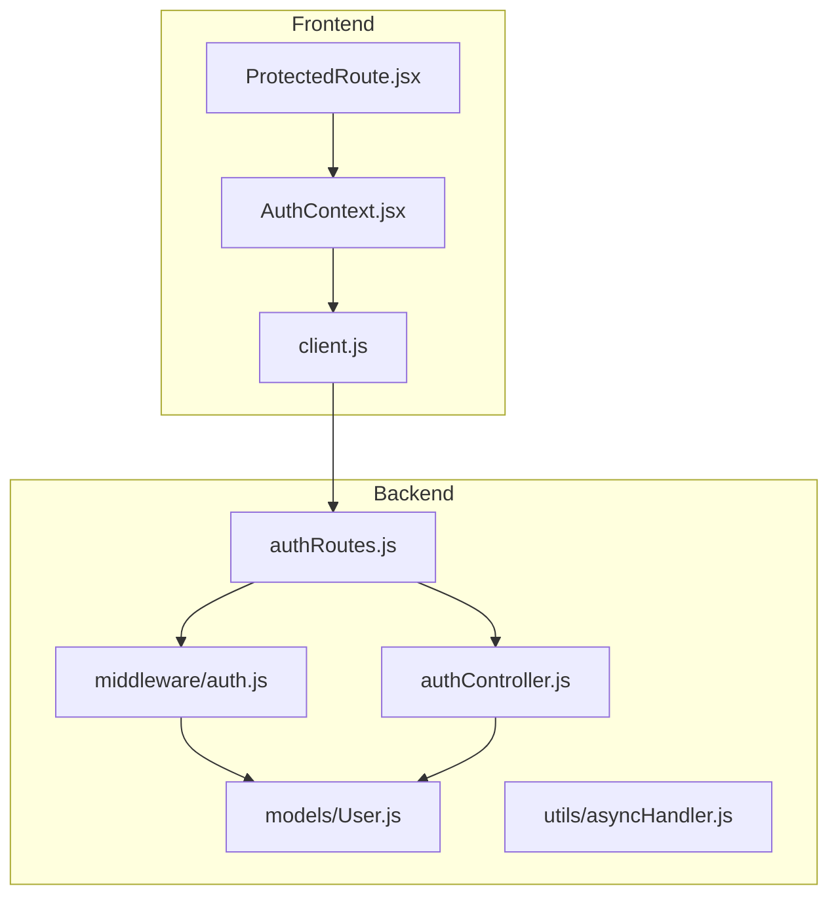
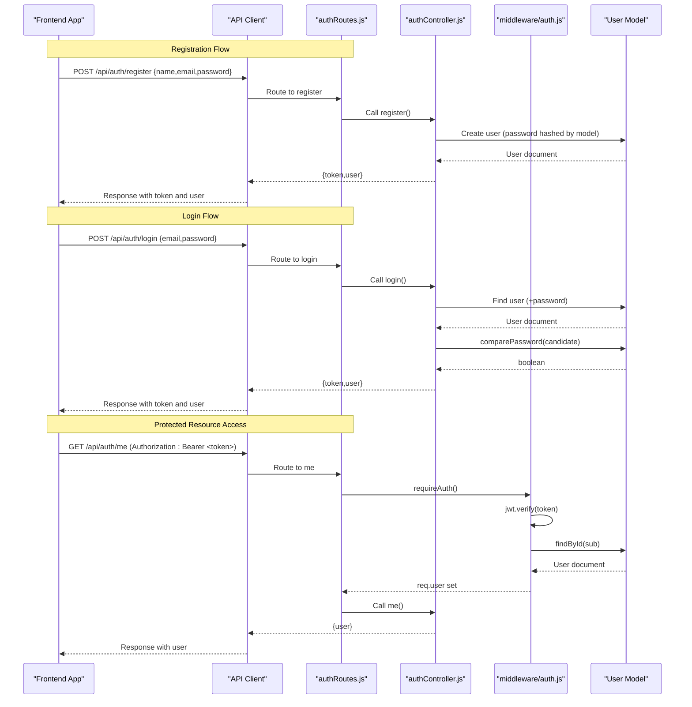
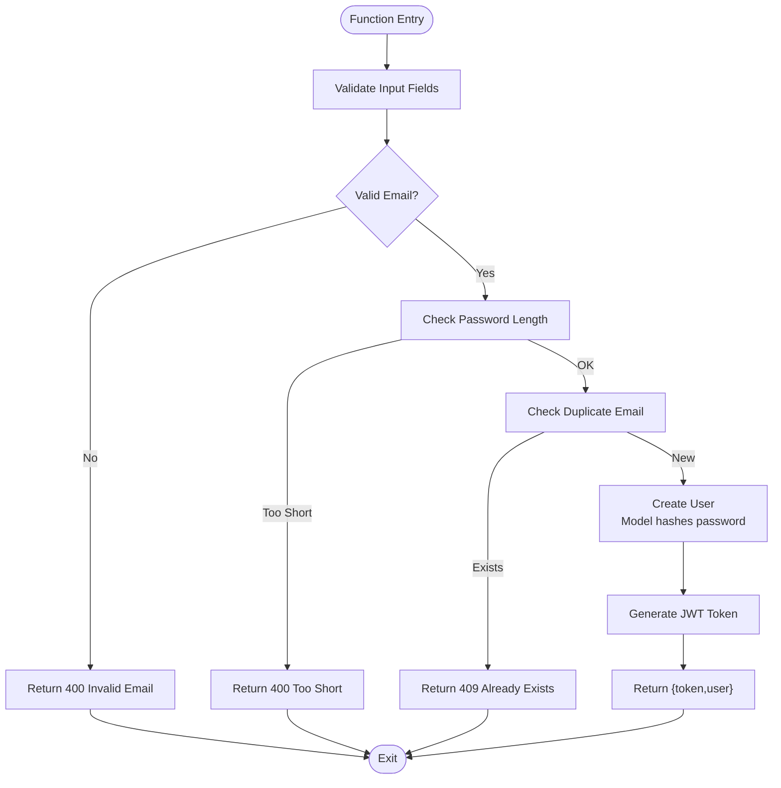
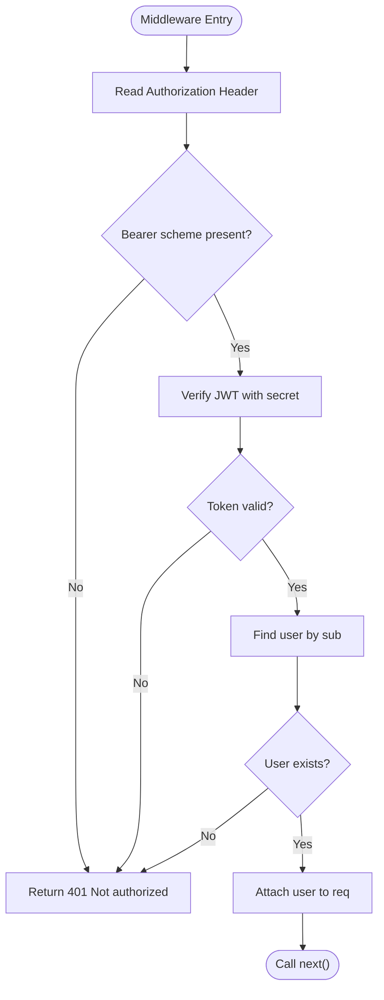
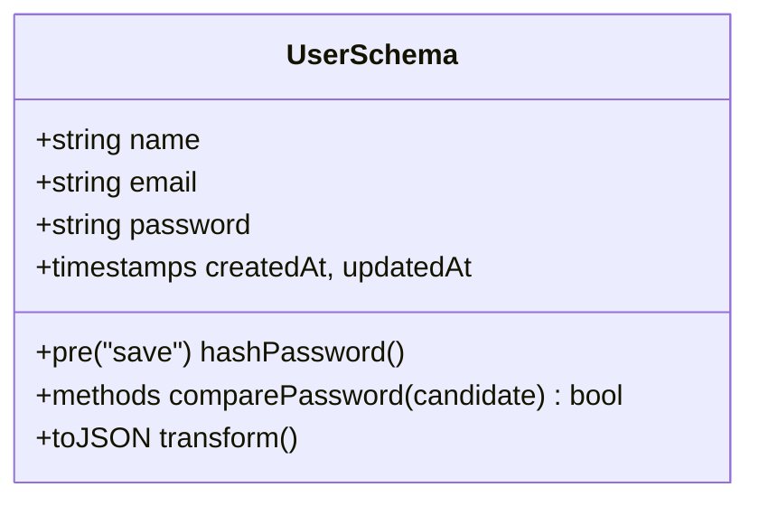
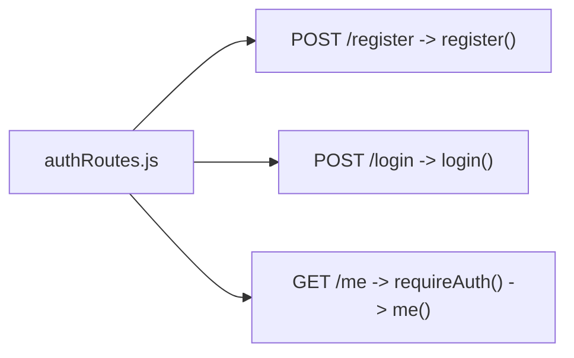
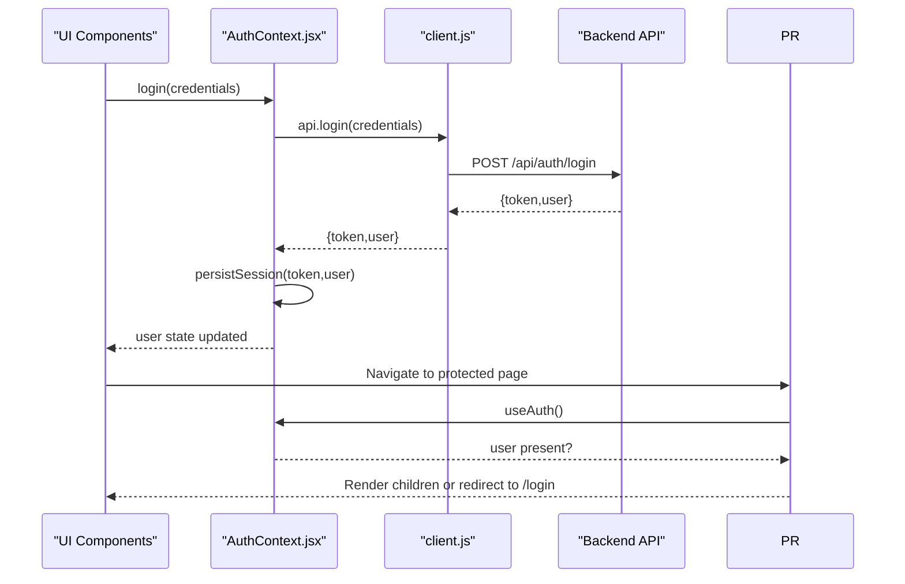
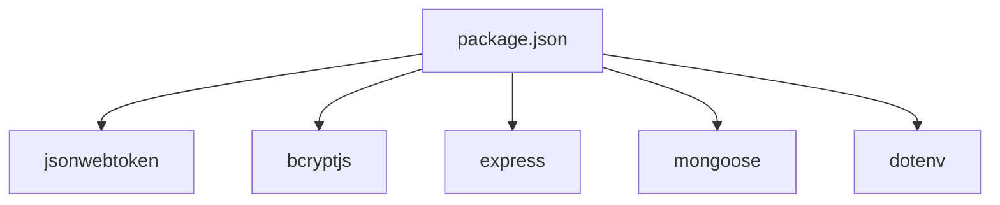

# Authentication System

<cite>
**Referenced Files in This Document**
- [authController.js](file://backend/src/controllers/authController.js)
- [auth.js](file://backend/src/middleware/auth.js)
- [User.js](file://backend/src/models/User.js)
- [authRoutes.js](file://backend/src/routes/authRoutes.js)
- [asyncHandler.js](file://backend/src/utils/asyncHandler.js)
- [client.js](file://frontend/src/api/client.js)
- [AuthContext.jsx](file://frontend/src/context/AuthContext.jsx)
- [ProtectedRoute.jsx](file://frontend/src/components/ProtectedRoute.jsx)
- [package.json](file://backend/package.json)
</cite>

## Table of Contents
1. [Introduction](#introduction)
2. [Project Structure](#project-structure)
3. [Core Components](#core-components)
4. [Architecture Overview](#architecture-overview)
5. [Detailed Component Analysis](#detailed-component-analysis)
6. [Dependency Analysis](#dependency-analysis)
7. [Performance Considerations](#performance-considerations)
8. [Troubleshooting Guide](#troubleshooting-guide)
9. [Conclusion](#conclusion)

## Introduction
This document explains the authentication system implemented across a MERN stack application. It covers JWT token generation and validation, password hashing with bcrypt, and the complete flow from user registration to accessing protected resources. It also documents the authentication middleware that intercepts requests, validates tokens, and handles errors for expired or invalid tokens. The controller methods for registration, login, and profile retrieval are analyzed, along with request/response flows, token structure, security best practices, route protection, session management strategies, and common patterns used throughout the application.

## Project Structure
The authentication logic is split between backend (Express + Mongoose) and frontend (React). Key files:
- Backend controllers handle business logic for auth endpoints.
- Middleware enforces authentication on protected routes.
- Models define data schemas and secure password handling.
- Routes wire endpoints to controllers and middleware.
- Frontend context manages session state and persists tokens.
- A protected route component guards client-side navigation.

**Diagram sources**
- [authRoutes.js:1-13](file://backend/src/routes/authRoutes.js#L1-L13)
- [authController.js:1-74](file://backend/src/controllers/authController.js#L1-L74)
- [auth.js:1-24](file://backend/src/middleware/auth.js#L1-L24)
- [User.js:1-50](file://backend/src/models/User.js#L1-L50)
- [asyncHandler.js:1-3](file://backend/src/utils/asyncHandler.js#L1-L3)
- [client.js:1-33](file://frontend/src/api/client.js#L1-L33)
- [AuthContext.jsx:1-73](file://frontend/src/context/AuthContext.jsx#L1-L73)
- [ProtectedRoute.jsx:1-17](file://frontend/src/components/ProtectedRoute.jsx#L1-L17)

**Section sources**
- [authRoutes.js:1-13](file://backend/src/routes/authRoutes.js#L1-L13)
- [authController.js:1-74](file://backend/src/controllers/authController.js#L1-L74)
- [auth.js:1-24](file://backend/src/middleware/auth.js#L1-L24)
- [User.js:1-50](file://backend/src/models/User.js#L1-L50)
- [asyncHandler.js:1-3](file://backend/src/utils/asyncHandler.js#L1-L3)
- [client.js:1-33](file://frontend/src/api/client.js#L1-L33)
- [AuthContext.jsx:1-73](file://frontend/src/context/AuthContext.jsx#L1-L73)
- [ProtectedRoute.jsx:1-17](file://frontend/src/components/ProtectedRoute.jsx#L1-L17)

## Core Components
- Authentication controller: Implements registration, login, and profile retrieval; generates JWT tokens and returns user payloads.
- Authentication middleware: Validates Bearer tokens, decodes payload, loads user, and attaches it to the request.
- User model: Defines schema, pre-save bcrypt hashing, password comparison method, and safe JSON serialization.
- Routes: Register public endpoints and protect the profile endpoint with the auth middleware.
- Async handler: Wraps async functions to propagate errors to Express error handling.
- Frontend API client: Sends HTTP requests with optional Authorization headers and normalizes responses.
- Auth context: Persists tokens, manages user state, and provides login/register/logout operations.
- Protected route: Guards client-side routes based on authenticated state.

**Section sources**
- [authController.js:1-74](file://backend/src/controllers/authController.js#L1-L74)
- [auth.js:1-24](file://backend/src/middleware/auth.js#L1-L24)
- [User.js:1-50](file://backend/src/models/User.js#L1-L50)
- [authRoutes.js:1-13](file://backend/src/routes/authRoutes.js#L1-L13)
- [asyncHandler.js:1-3](file://backend/src/utils/asyncHandler.js#L1-L3)
- [client.js:1-33](file://frontend/src/api/client.js#L1-L33)
- [AuthContext.jsx:1-73](file://frontend/src/context/AuthContext.jsx#L1-L73)
- [ProtectedRoute.jsx:1-17](file://frontend/src/components/ProtectedRoute.jsx#L1-L17)

## Architecture Overview
The authentication architecture follows a standard JWT-based pattern:
- Registration creates a user with a hashed password and returns a JWT token alongside user data.
- Login verifies credentials, then issues a JWT token.
- Protected routes require a valid Bearer token in the Authorization header.
- The frontend stores the token in localStorage and includes it in subsequent requests.
- The auth middleware validates the token, fetches the user, and attaches it to the request object.

**Diagram sources**
- [authRoutes.js:8-10](file://backend/src/routes/authRoutes.js#L8-L10)
- [authController.js:19-71](file://backend/src/controllers/authController.js#L19-L71)
- [auth.js:4-23](file://backend/src/middleware/auth.js#L4-L23)
- [User.js:30-37](file://backend/src/models/User.js#L30-L37)
- [client.js:28-32](file://frontend/src/api/client.js#L28-L32)

## Detailed Component Analysis

### Authentication Controller
Responsibilities:
- Validate input fields for registration and login.
- Enforce email format and minimum password length.
- Prevent duplicate accounts.
- Generate JWT tokens using a secret and expiration.
- Return standardized payloads containing token and user data.

Key behaviors:
- Token signing uses a configurable secret and default expiration if not provided.
- Registration sanitizes name and email, checks uniqueness, and handles database conflicts.
- Login selects the password field explicitly and compares candidate passwords securely.
- Profile endpoint returns the authenticated user attached by middleware.

**Diagram sources**
- [authController.js:19-51](file://backend/src/controllers/authController.js#L19-L51)
- [User.js:30-37](file://backend/src/models/User.js#L30-L37)

Security considerations:
- Passwords are never stored in plaintext; they are hashed before persistence.
- Tokens are signed with a secret and include an expiration.
- Error messages avoid leaking sensitive details.

**Section sources**
- [authController.js:1-74](file://backend/src/controllers/authController.js#L1-L74)

### Authentication Middleware
Responsibilities:
- Extract Bearer token from Authorization header.
- Verify token signature and decode payload.
- Load user by ID from the token’s subject claim.
- Attach user to request and proceed to next handler.
- Return 401 Unauthorized for missing, malformed, or invalid tokens.

Error handling:
- Missing or malformed Authorization header results in 401.
- Invalid or expired tokens result in 401.
- Nonexistent user after verification results in 401.

**Diagram sources**
- [auth.js:4-23](file://backend/src/middleware/auth.js#L4-L23)

**Section sources**
- [auth.js:1-24](file://backend/src/middleware/auth.js#L1-L24)

### User Model and Password Hashing
Responsibilities:
- Define user schema with required fields, constraints, and normalization.
- Automatically hash passwords on save using bcrypt with a cost factor.
- Provide a method to compare candidate passwords against stored hashes.
- Serialize user objects safely by excluding internal fields and mapping IDs.

Security considerations:
- Password field is excluded by default in queries and JSON output.
- Pre-save hook ensures consistent hashing behavior.
- Comparison method uses bcrypt.compare for timing-safe checks.

**Diagram sources**
- [User.js:4-47](file://backend/src/models/User.js#L4-L47)

**Section sources**
- [User.js:1-50](file://backend/src/models/User.js#L1-L50)

### Routes and Route Protection
Responsibilities:
- Expose public endpoints for registration and login.
- Protect the profile endpoint with the authentication middleware.
- Wrap handlers with async error propagation.

Protection strategy:
- The /me route applies requireAuth before the controller method executes.
- Public routes do not apply the middleware.

**Diagram sources**
- [authRoutes.js:8-10](file://backend/src/routes/authRoutes.js#L8-L10)

**Section sources**
- [authRoutes.js:1-13](file://backend/src/routes/authRoutes.js#L1-L13)
- [asyncHandler.js:1-3](file://backend/src/utils/asyncHandler.js#L1-L3)

### Frontend Session Management and Protected Navigation
Responsibilities:
- Persist the JWT token in localStorage under a defined key.
- On app load, validate the persisted token by calling the profile endpoint.
- Provide login/register/logout actions that update local state and storage.
- Guard client-side routes using a protected route component.

Session lifecycle:
- After successful login or registration, store token and user.
- If token validation fails, clear stored token and mark user as unauthenticated.
- ProtectedRoute redirects unauthenticated users to the login page.

**Diagram sources**
- [AuthContext.jsx:8-56](file://frontend/src/context/AuthContext.jsx#L8-L56)
- [client.js:28-32](file://frontend/src/api/client.js#L28-L32)
- [ProtectedRoute.jsx:4-16](file://frontend/src/components/ProtectedRoute.jsx#L4-L16)

**Section sources**
- [AuthContext.jsx:1-73](file://frontend/src/context/AuthContext.jsx#L1-L73)
- [client.js:1-33](file://frontend/src/api/client.js#L1-L33)
- [ProtectedRoute.jsx:1-17](file://frontend/src/components/ProtectedRoute.jsx#L1-L17)

## Dependency Analysis
External dependencies relevant to authentication:
- jsonwebtoken: Used for signing and verifying JWTs.
- bcryptjs: Used for hashing and comparing passwords.
- express: Web framework for routing and middleware.
- mongoose: ODM for MongoDB interactions.
- dotenv: Environment variable loading (commonly used with these packages).

**Diagram sources**
- [package.json:14-21](file://backend/package.json#L14-L21)

**Section sources**
- [package.json:1-23](file://backend/package.json#L1-L23)

## Performance Considerations
- Password hashing cost: The bcrypt cost factor balances security and performance; adjust based on server capacity.
- Token size: Keep JWT payloads minimal (e.g., only user identifier) to reduce overhead.
- Database queries: Use selective field projection where possible (e.g., selecting password only when needed).
- Middleware efficiency: Avoid unnecessary computations in the auth middleware; verify tokens quickly and cache user lookups if appropriate.

[No sources needed since this section provides general guidance]

## Troubleshooting Guide
Common issues and resolutions:
- Missing or malformed Authorization header: Ensure clients send Authorization: Bearer <token>.
- Invalid or expired tokens: Verify the token was issued with the correct secret and has not expired; refresh or re-authenticate.
- Duplicate email during registration: Normalize emails and check uniqueness before creating users.
- Password validation failures: Enforce minimum length and strong password policies on both client and server.
- CORS or network errors: Confirm the frontend API URL and backend availability; handle fetch errors gracefully.

Operational tips:
- Log token verification errors without exposing secrets.
- Return consistent error shapes to simplify client handling.
- Use environment variables for secrets and configuration.

**Section sources**
- [auth.js:4-23](file://backend/src/middleware/auth.js#L4-L23)
- [authController.js:19-71](file://backend/src/controllers/authController.js#L19-L71)
- [client.js:1-33](file://frontend/src/api/client.js#L1-L33)

## Conclusion
This authentication system implements a robust, secure flow using JWTs and bcrypt. The controller handles registration, login, and profile retrieval; the middleware protects routes by validating tokens and attaching users to requests; the model secures passwords and serializes safe user objects; and the frontend manages sessions and guards routes. Following the documented patterns and best practices will help maintain security, reliability, and scalability across the application.

[No sources needed since this section summarizes without analyzing specific files]