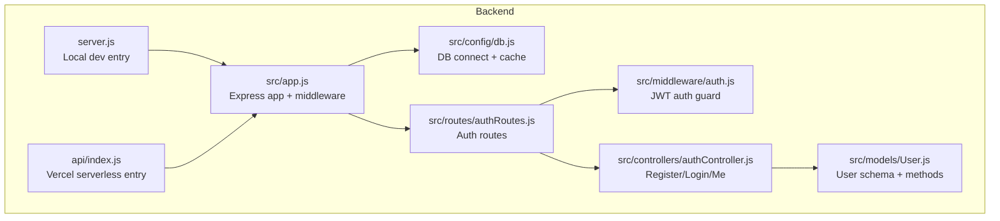
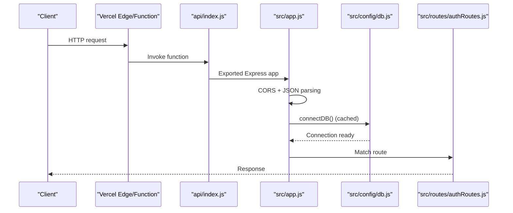
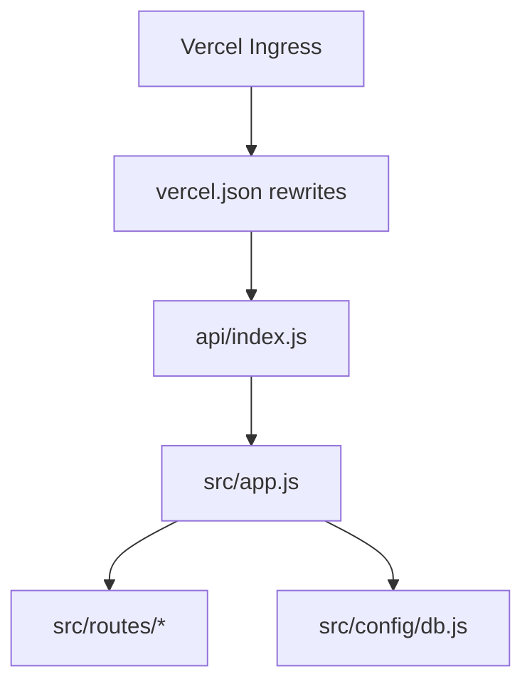
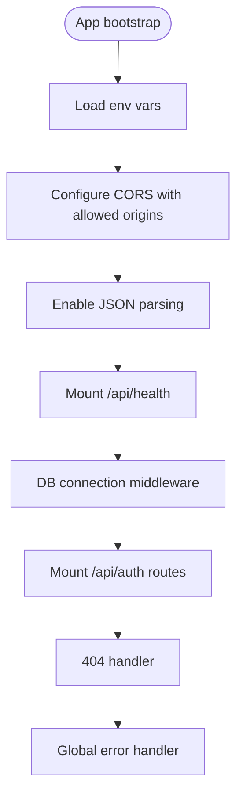
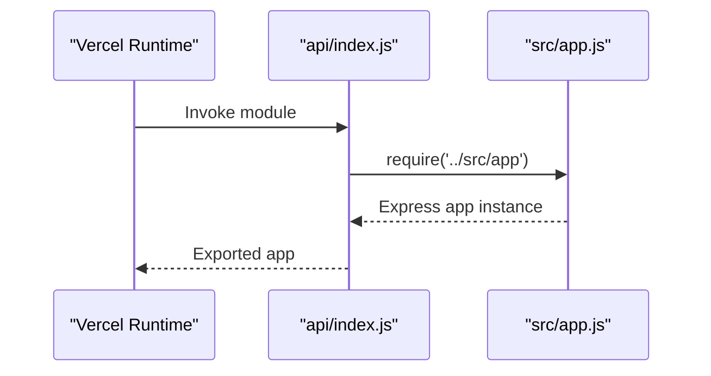
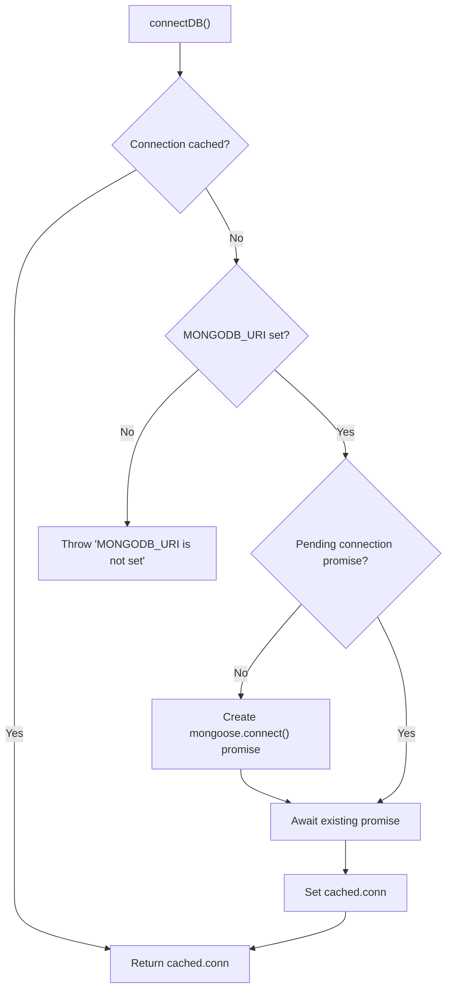
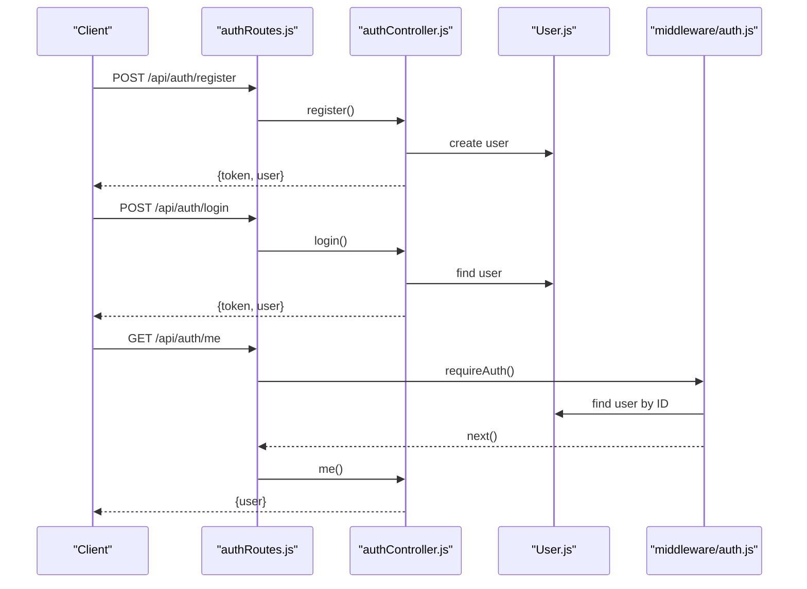
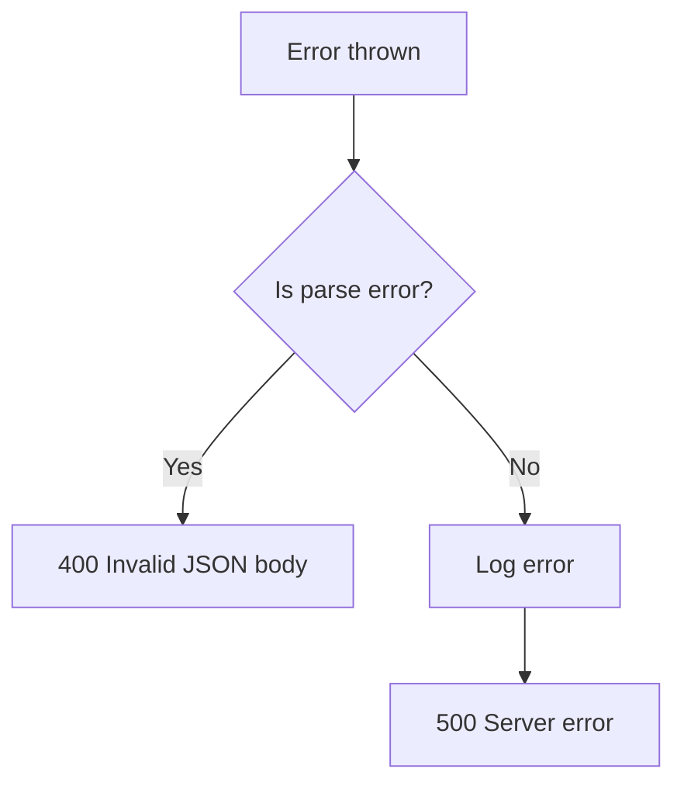
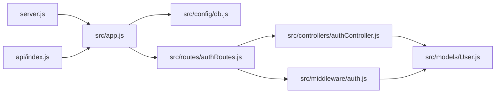

# Backend Architecture

<cite>
**Referenced Files in This Document**
- [server.js](file://backend/server.js)
- [app.js](file://backend/src/app.js)
- [index.js](file://backend/api/index.js)
- [vercel.json](file://backend/vercel.json)
- [package.json](file://backend/package.json)
- [db.js](file://backend/src/config/db.js)
- [authRoutes.js](file://backend/src/routes/authRoutes.js)
- [auth.js](file://backend/src/middleware/auth.js)
- [authController.js](file://backend/src/controllers/authController.js)
- [User.js](file://backend/src/models/User.js)
</cite>

## Table of Contents
1. [Introduction](#introduction)
2. [Project Structure](#project-structure)
3. [Core Components](#core-components)
4. [Architecture Overview](#architecture-overview)
5. [Detailed Component Analysis](#detailed-component-analysis)
6. [Dependency Analysis](#dependency-analysis)
7. [Performance Considerations](#performance-considerations)
8. [Troubleshooting Guide](#troubleshooting-guide)
9. [Conclusion](#conclusion)

## Introduction
This document describes the backend server implementation for a MERN authentication API. It explains the Express.js application structure, dual-mode operation for local development and Vercel serverless functions, initialization flow, middleware configuration (CORS and JSON parsing), error handling patterns, routing organization, and infrastructure considerations including connection pooling for serverless environments and deployment topology.

## Project Structure
The backend is organized into clear layers:
- Entry points:
  - Local development server entry point
  - Serverless function entry point for Vercel
- Application core:
  - Express app setup, middleware, routes, and global error handling
- Configuration:
  - Database connection with caching for serverless reuse
- Feature modules:
  - Authentication routes, middleware, controllers, and data model

**Diagram sources**
- [server.js:1-9](file://backend/server.js#L1-L9)
- [index.js:1-5](file://backend/api/index.js#L1-L5)
- [app.js:1-56](file://backend/src/app.js#L1-L56)
- [db.js:1-38](file://backend/src/config/db.js#L1-L38)
- [authRoutes.js:1-13](file://backend/src/routes/authRoutes.js#L1-L13)
- [auth.js:1-24](file://backend/src/middleware/auth.js#L1-L24)
- [authController.js:1-74](file://backend/src/controllers/authController.js#L1-L74)
- [User.js:1-50](file://backend/src/models/User.js#L1-L50)

**Section sources**
- [server.js:1-9](file://backend/server.js#L1-L9)
- [index.js:1-5](file://backend/api/index.js#L1-L5)
- [app.js:1-56](file://backend/src/app.js#L1-L56)
- [package.json:1-23](file://backend/package.json#L1-L23)

## Core Components
- Local development entry point boots an HTTP server on a configurable port and starts the Express app.
- The Express app configures CORS, JSON parsing, health check, database connection middleware, routes, 404 handler, and global error handler.
- The serverless entry point exports the same Express app for Vercel to invoke as a function.
- Database connection uses a global cache to avoid reconnecting on every serverless invocation.
- Authentication routes expose register, login, and profile endpoints protected by JWT verification.

Key responsibilities:
- server.js: Start local server and load environment variables.
- src/app.js: Central Express app, middleware stack, routing, and error handling.
- api/index.js: Serverless export of the Express app.
- src/config/db.js: Connection pooling/cache for MongoDB via Mongoose.
- src/routes/authRoutes.js: Route definitions for authentication.
- src/middleware/auth.js: JWT-based authorization guard.
- src/controllers/authController.js: Business logic for registration, login, and current user retrieval.
- src/models/User.js: User schema, password hashing, and serialization helpers.

**Section sources**
- [server.js:1-9](file://backend/server.js#L1-L9)
- [app.js:1-56](file://backend/src/app.js#L1-L56)
- [index.js:1-5](file://backend/api/index.js#L1-L5)
- [db.js:1-38](file://backend/src/config/db.js#L1-L38)
- [authRoutes.js:1-13](file://backend/src/routes/authRoutes.js#L1-L13)
- [auth.js:1-24](file://backend/src/middleware/auth.js#L1-L24)
- [authController.js:1-74](file://backend/src/controllers/authController.js#L1-L74)
- [User.js:1-50](file://backend/src/models/User.js#L1-L50)

## Architecture Overview
The backend supports two runtime modes:
- Local development: node server.js runs an HTTP server listening on a port.
- Production serverless: Vercel invokes api/index.js, which exports the Express app instance.

**Diagram sources**
- [index.js:1-5](file://backend/api/index.js#L1-L5)
- [app.js:1-56](file://backend/src/app.js#L1-L56)
- [db.js:1-38](file://backend/src/config/db.js#L1-L38)
- [authRoutes.js:1-13](file://backend/src/routes/authRoutes.js#L1-L13)

### Deployment Topology
- Vercel rewrites all incoming requests to the API entry point using rewrites configuration.
- The serverless function loads the Express app and handles requests within the serverless runtime.

**Diagram sources**
- [vercel.json:1-9](file://backend/vercel.json#L1-L9)
- [index.js:1-5](file://backend/api/index.js#L1-L5)
- [app.js:1-56](file://backend/src/app.js#L1-L56)

**Section sources**
- [vercel.json:1-9](file://backend/vercel.json#L1-L9)
- [index.js:1-5](file://backend/api/index.js#L1-L5)
- [app.js:1-56](file://backend/src/app.js#L1-L56)

## Detailed Component Analysis

### Express Application Initialization and Middleware
- Loads environment variables and constructs allowed origins from an environment variable.
- Configures CORS with dynamic origin allowlist.
- Enables JSON body parsing.
- Adds a health endpoint.
- Ensures database connectivity before processing routes.
- Mounts feature routes under /api/auth.
- Provides a 404 fallback and a global error handler that distinguishes parse errors.

**Diagram sources**
- [app.js:1-56](file://backend/src/app.js#L1-L56)

**Section sources**
- [app.js:1-56](file://backend/src/app.js#L1-L56)

### Serverless Function Entry Point
- Exports the Express app instance so Vercel can invoke it as a serverless function.
- Loads environment variables at startup.

**Diagram sources**
- [index.js:1-5](file://backend/api/index.js#L1-L5)
- [app.js:1-56](file://backend/src/app.js#L1-L56)

**Section sources**
- [index.js:1-5](file://backend/api/index.js#L1-L5)

### Database Connection Pooling for Serverless
- Uses a global cache to store the Mongoose connection and a pending promise to prevent concurrent reconnections.
- Throws if the MongoDB URI is missing.
- Sets a server selection timeout to fail fast when the database is unreachable.

**Diagram sources**
- [db.js:1-38](file://backend/src/config/db.js#L1-L38)

**Section sources**
- [db.js:1-38](file://backend/src/config/db.js#L1-L38)

### Authentication Routes and Flow
- POST /register: Validates input, checks uniqueness, creates user, returns token and user payload.
- POST /login: Authenticates user and returns token and user payload.
- GET /me: Requires valid JWT; returns current user profile.

**Diagram sources**
- [authRoutes.js:1-13](file://backend/src/routes/authRoutes.js#L1-L13)
- [authController.js:1-74](file://backend/src/controllers/authController.js#L1-L74)
- [auth.js:1-24](file://backend/src/middleware/auth.js#L1-L24)
- [User.js:1-50](file://backend/src/models/User.js#L1-L50)

**Section sources**
- [authRoutes.js:1-13](file://backend/src/routes/authRoutes.js#L1-L13)
- [authController.js:1-74](file://backend/src/controllers/authController.js#L1-L74)
- [auth.js:1-24](file://backend/src/middleware/auth.js#L1-L24)
- [User.js:1-50](file://backend/src/models/User.js#L1-L50)

### Error Handling Patterns
- Global error handler differentiates between malformed JSON bodies and other errors.
- Parse failures return 400 with a descriptive message.
- Unhandled exceptions are logged and return 500.

**Diagram sources**
- [app.js:47-53](file://backend/src/app.js#L47-L53)

**Section sources**
- [app.js:47-53](file://backend/src/app.js#L47-L53)

## Dependency Analysis
High-level dependencies among components:

**Diagram sources**
- [server.js:1-9](file://backend/server.js#L1-L9)
- [index.js:1-5](file://backend/api/index.js#L1-L5)
- [app.js:1-56](file://backend/src/app.js#L1-L56)
- [db.js:1-38](file://backend/src/config/db.js#L1-L38)
- [authRoutes.js:1-13](file://backend/src/routes/authRoutes.js#L1-L13)
- [authController.js:1-74](file://backend/src/controllers/authController.js#L1-L74)
- [auth.js:1-24](file://backend/src/middleware/auth.js#L1-L24)
- [User.js:1-50](file://backend/src/models/User.js#L1-L50)

**Section sources**
- [package.json:1-23](file://backend/package.json#L1-L23)

## Performance Considerations
- Connection reuse: The global Mongoose connection cache avoids cold-start overhead and repeated handshakes in serverless invocations.
- Fast failure: Server selection timeout prevents long hangs when the database is unavailable.
- Minimal middleware: Only essential middleware (CORS, JSON parsing, DB connection) are applied globally to reduce per-request overhead.
- Route scoping: Feature routes are mounted under a single prefix to simplify path matching.

[No sources needed since this section provides general guidance]

## Troubleshooting Guide
- Missing environment variables:
  - Ensure MONGODB_URI is set; otherwise, connection initialization will throw.
  - Ensure JWT_SECRET is set; otherwise, token signing will throw.
- CORS issues:
  - Verify CLIENT_ORIGIN includes the frontend’s origin or use wildcard during development.
- JSON parse errors:
  - Requests with invalid JSON bodies will receive a 400 response.
- Not found routes:
  - Any unmatched route returns a 404 JSON response.

**Section sources**
- [db.js:16-18](file://backend/src/config/db.js#L16-L18)
- [authController.js:6-12](file://backend/src/controllers/authController.js#L6-L12)
- [app.js:8-22](file://backend/src/app.js#L8-L22)
- [app.js:47-53](file://backend/src/app.js#L47-L53)
- [app.js:43-45](file://backend/src/app.js#L43-L45)

## Conclusion
The backend implements a clean, modular Express application that operates seamlessly in both local development and Vercel serverless environments. It centralizes middleware configuration, ensures efficient database connectivity through connection caching, and organizes authentication features behind well-defined routes and guards. The deployment configuration rewrites all traffic to the serverless function entry point, enabling a consistent runtime experience across environments.