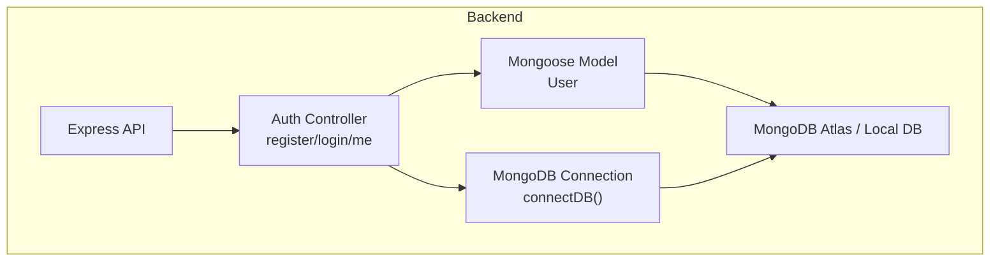
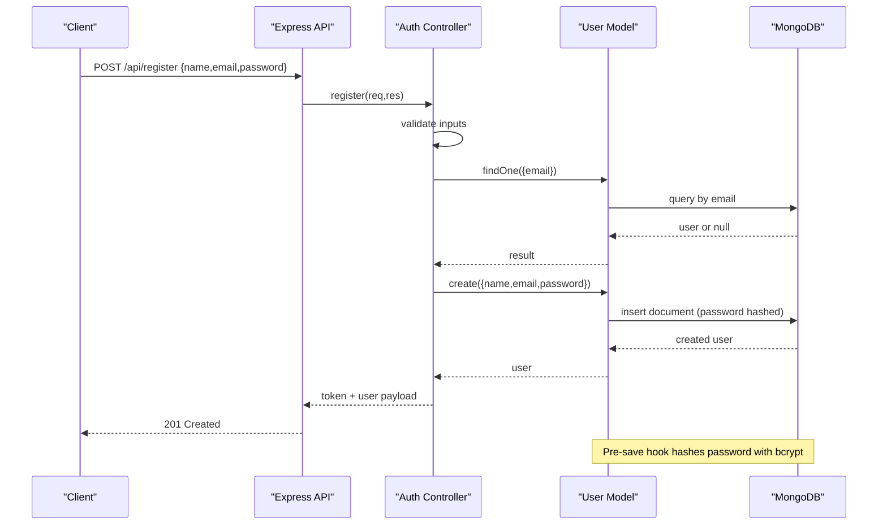
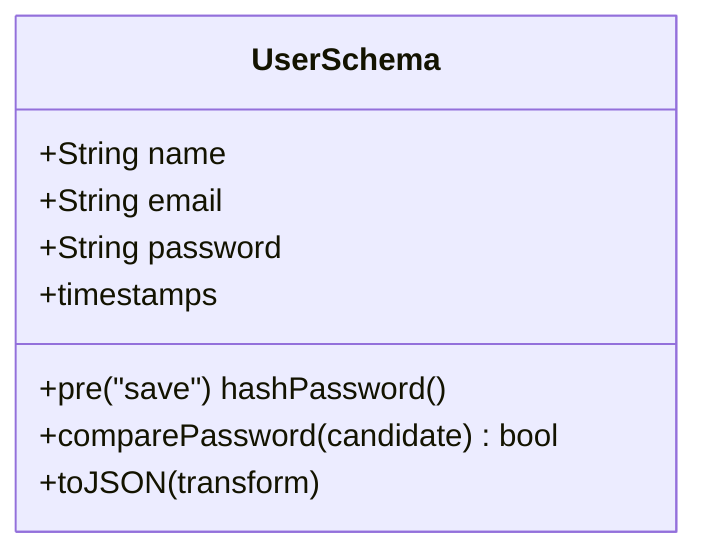
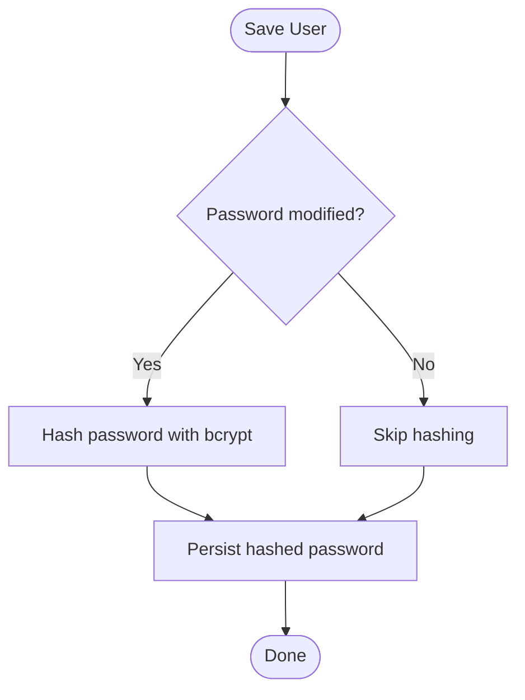
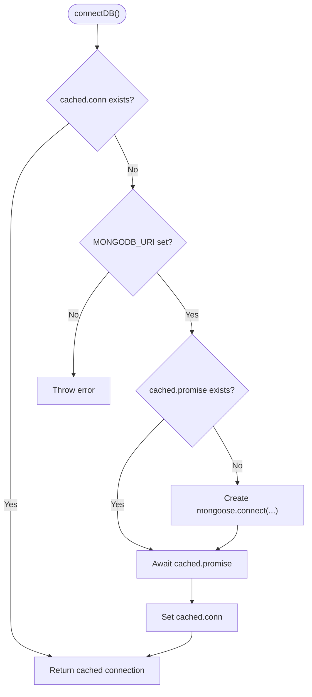
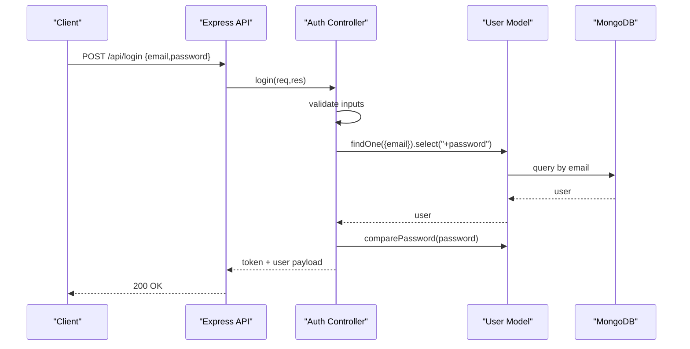
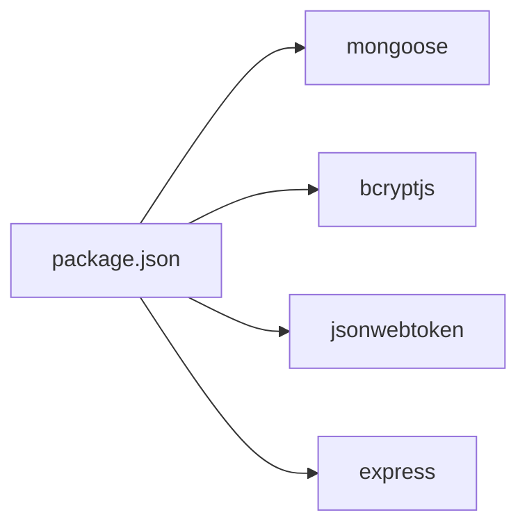

# Database Design

<cite>
**Referenced Files in This Document**
- [User.js](file://backend/src/models/User.js)
- [db.js](file://backend/src/config/db.js)
- [authController.js](file://backend/src/controllers/authController.js)
- [package.json](file://backend/package.json)
- [vercel.json](file://backend/vercel.json)
</cite>

## Table of Contents
1. [Introduction](#introduction)
2. [Project Structure](#project-structure)
3. [Core Components](#core-components)
4. [Architecture Overview](#architecture-overview)
5. [Detailed Component Analysis](#detailed-component-analysis)
6. [Dependency Analysis](#dependency-analysis)
7. [Performance Considerations](#performance-considerations)
8. [Troubleshooting Guide](#troubleshooting-guide)
9. [Conclusion](#conclusion)

## Introduction
This document describes the MongoDB database design for the MERN authentication service, focusing on the User schema, data validation, password hashing with bcrypt, connection configuration for local and serverless environments, and security best practices. It also includes diagrams to visualize the schema, data flows, and connection lifecycle.

## Project Structure
The backend implements a small Express API with:
- A Mongoose model for users
- A reusable MongoDB connection helper optimized for serverless runtimes
- Authentication controllers that use the model and JWT tokens
- Environment-driven configuration via environment variables

**Diagram sources**
- [authController.js:1-74](file://backend/src/controllers/authController.js#L1-L74)
- [User.js:1-50](file://backend/src/models/User.js#L1-L50)
- [db.js:1-38](file://backend/src/config/db.js#L1-L38)

**Section sources**
- [authController.js:1-74](file://backend/src/controllers/authController.js#L1-L74)
- [User.js:1-50](file://backend/src/models/User.js#L1-L50)
- [db.js:1-38](file://backend/src/config/db.js#L1-L38)

## Core Components
- User schema defines name, email, and password fields with validation rules and serialization behavior.
- Passwords are hashed using bcryptjs before persistence and compared securely during login.
- The MongoDB connection is cached globally to support serverless function reuse and reduce cold-start overhead.
- Authentication controller enforces input validation, uniqueness constraints, and returns JSON Web Tokens (JWT).

Key implementation references:
- Schema and methods: [User.js:4-47](file://backend/src/models/User.js#L4-L47)
- Connection caching and options: [db.js:3-35](file://backend/src/config/db.js#L3-L35)
- Registration and login flows: [authController.js:19-66](file://backend/src/controllers/authController.js#L19-L66)

**Section sources**
- [User.js:4-47](file://backend/src/models/User.js#L4-L47)
- [db.js:3-35](file://backend/src/config/db.js#L3-L35)
- [authController.js:19-66](file://backend/src/controllers/authController.js#L19-L66)

## Architecture Overview
The system uses Mongoose as an ODM over MongoDB. The User model encapsulates validation, hashing, and safe serialization. The auth controller orchestrates request handling, interacts with the model, and issues JWTs. The connection helper ensures efficient reuse of connections across serverless invocations.

**Diagram sources**
- [authController.js:19-50](file://backend/src/controllers/authController.js#L19-L50)
- [User.js:30-33](file://backend/src/models/User.js#L30-L33)

## Detailed Component Analysis

### User Schema and Data Model
The User schema defines three primary fields with strict validation and secure defaults:
- name: string, required, trimmed, max length 80
- email: string, required, unique, lowercased, trimmed, validated against a standard email pattern
- password: string, required, minimum length 8, excluded from default JSON output

Additional behaviors:
- Timestamps enabled for createdAt and updatedAt
- Pre-save hook hashes passwords using bcryptjs with a cost factor of 10
- Instance method comparePassword compares a candidate password with the stored hash
- toJSON transform hides internal fields (_id, __v, password) and exposes id

**Diagram sources**
- [User.js:4-47](file://backend/src/models/User.js#L4-L47)

Sample user document (illustrative):
- _id: ObjectId
- name: string
- email: string
- password: string (hashed)
- createdAt: timestamp
- updatedAt: timestamp

Security note:
- The password field is never included in serialized responses due to the toJSON transform.

**Section sources**
- [User.js:4-47](file://backend/src/models/User.js#L4-L47)

### Password Hashing and Comparison
- Hashing occurs in a pre-save hook; only when the password field changes
- Uses bcryptjs with a fixed salt rounds value
- Login compares provided password against stored hash via instance method

**Diagram sources**
- [User.js:30-33](file://backend/src/models/User.js#L30-L33)

**Section sources**
- [User.js:30-37](file://backend/src/models/User.js#L30-L37)

### MongoDB Connection Configuration
The connection module provides a reusable connectDB function:
- Caches the connection and promise on global scope to avoid reconnection on each serverless invocation
- Requires MONGODB_URI environment variable
- Sets serverSelectionTimeoutMS to 10 seconds for faster failures in constrained environments
- Returns the existing connection if already established

**Diagram sources**
- [db.js:3-35](file://backend/src/config/db.js#L3-L35)

Serverless considerations:
- Global caching aligns with Vercel’s function reuse strategy
- Timeout tuning helps avoid long waits during cold starts
- No explicit connection pooling parameters are configured; rely on Mongoose defaults

Local development:
- Ensure MONGODB_URI points to a local or remote MongoDB instance
- The same connectDB function works for both environments

**Section sources**
- [db.js:3-35](file://backend/src/config/db.js#L3-L35)

### Authentication Flow and Validation
Registration flow:
- Validates presence and types of name, email, password
- Normalizes email (trim, lowercase) and validates format
- Enforces minimum password length
- Checks for duplicate emails
- Creates user; handles duplicate key errors
- Returns JWT and sanitized user payload

Login flow:
- Validates presence and types of email and password
- Retrieves user including password field for comparison
- Compares password using the model method
- Returns JWT and sanitized user payload

**Diagram sources**
- [authController.js:53-66](file://backend/src/controllers/authController.js#L53-L66)
- [User.js:35-37](file://backend/src/models/User.js#L35-L37)

**Section sources**
- [authController.js:19-66](file://backend/src/controllers/authController.js#L19-L66)
- [User.js:35-37](file://backend/src/models/User.js#L35-L37)

### Indexes and Performance
- Unique constraint on email is enforced at the schema level, which creates a unique index automatically.
- No additional indexes are defined in the model.
- For high-volume lookups by email, ensure the unique index remains optimal and consider adding compound indexes if queries expand beyond email.

Note:
- The current implementation relies on Mongoose’s automatic index creation for unique fields.

**Section sources**
- [User.js:12-18](file://backend/src/models/User.js#L12-L18)

### Data Validation Patterns
- Field-level validation via Mongoose schema validators (required, trim, lowercase, match, minlength, maxlength)
- Controller-level validation for type checks and business rules (e.g., minimum password length)
- Duplicate email detection via unique index and explicit check in the controller

**Section sources**
- [User.js:4-28](file://backend/src/models/User.js#L4-L28)
- [authController.js:19-50](file://backend/src/controllers/authController.js#L19-L50)

## Dependency Analysis
External dependencies relevant to the database design:
- mongoose: ODM for MongoDB
- bcryptjs: password hashing
- dotenv: environment variable loading (if used elsewhere)
- jsonwebtoken: issuing and verifying tokens

**Diagram sources**
- [package.json:14-21](file://backend/package.json#L14-L21)

**Section sources**
- [package.json:14-21](file://backend/package.json#L14-L21)

## Performance Considerations
- Connection reuse: The global cache prevents repeated handshakes in serverless functions, reducing latency and resource usage.
- Server selection timeout: Short timeout avoids hanging requests when the database is unreachable.
- Password hashing cost: A moderate bcrypt cost balances security and performance; adjust based on deployment capacity.
- Query efficiency: Email lookups benefit from the unique index; avoid unnecessary projections and select only needed fields.

[No sources needed since this section provides general guidance]

## Troubleshooting Guide
Common issues and resolutions:
- Missing MONGODB_URI: The connection helper throws an error if the environment variable is not set. Ensure it is configured in your runtime environment.
- Duplicate email registration: The controller returns a conflict response when the email already exists; verify normalization and uniqueness constraints.
- Invalid credentials: Login fails if the user is not found or the password does not match; ensure correct casing and trimming of email inputs.
- Serialization leaks: The toJSON transform excludes password and internal fields; confirm client-side consumption matches expected shape.

Operational tips:
- Verify environment variables for MONGODB_URI and JWT_SECRET.
- Monitor connection logs for successful connection messages.
- Use consistent input normalization (trim, lowercase) across client and server.

**Section sources**
- [db.js:16-18](file://backend/src/config/db.js#L16-L18)
- [authController.js:29-40](file://backend/src/controllers/authController.js#L29-L40)
- [authController.js:60-66](file://backend/src/controllers/authController.js#L60-L66)
- [User.js:39-47](file://backend/src/models/User.js#L39-L47)

## Conclusion
The database design centers on a well-validated User schema with secure password handling and a robust, serverless-friendly MongoDB connection strategy. The combination of schema-level validations, controller-level checks, and safe serialization ensures data integrity and privacy. With proper environment configuration and attention to indexing and performance tuning, the system scales effectively in both local and serverless deployments.

[No sources needed since this section summarizes without analyzing specific files]