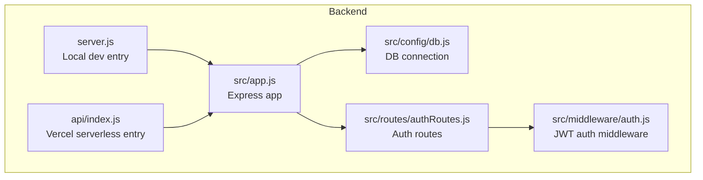
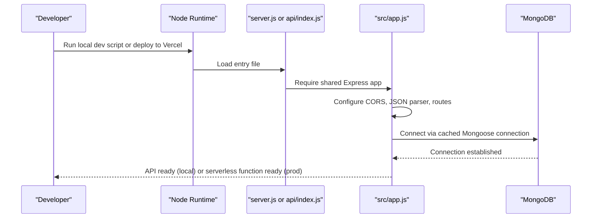
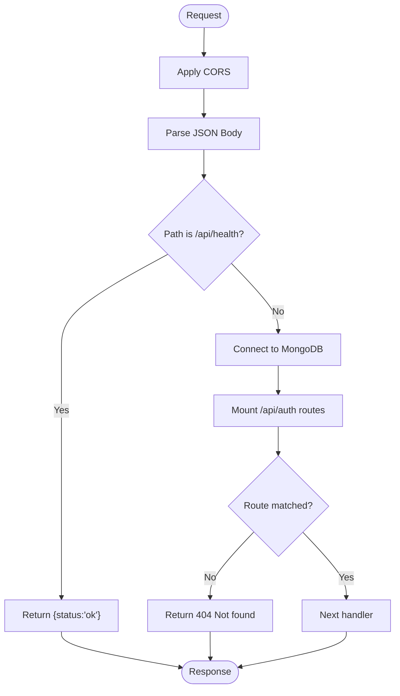
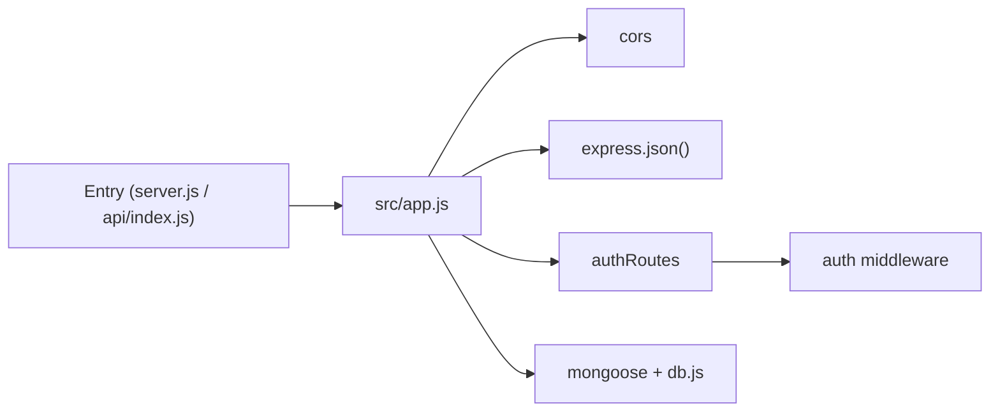

# Server Setup and Configuration

<cite>
**Referenced Files in This Document**
- [server.js](file://backend/server.js)
- [api/index.js](file://backend/api/index.js)
- [src/app.js](file://backend/src/app.js)
- [vercel.json](file://backend/vercel.json)
- [package.json](file://backend/package.json)
- [src/config/db.js](file://backend/src/config/db.js)
- [src/routes/authRoutes.js](file://backend/src/routes/authRoutes.js)
- [src/middleware/auth.js](file://backend/src/middleware/auth.js)
</cite>

## Table of Contents
1. [Introduction](#introduction)
2. [Project Structure](#project-structure)
3. [Core Components](#core-components)
4. [Architecture Overview](#architecture-overview)
5. [Detailed Component Analysis](#detailed-component-analysis)
6. [Dependency Analysis](#dependency-analysis)
7. [Performance Considerations](#performance-considerations)
8. [Troubleshooting Guide](#troubleshooting-guide)
9. [Conclusion](#conclusion)

## Introduction
This document explains how the Express.js backend is initialized and configured for both local development and production serverless deployment. It covers:
- Dual-mode operation using a local server entry point and a Vercel serverless function entry point
- Environment variable configuration with dotenv
- Port configuration and application bootstrap process
- Vercel deployment configuration including rewrites and serverless function behavior
- CORS configuration, middleware setup, and error handling patterns

## Project Structure
The backend is organized to support two execution modes:
- Local development: starts an HTTP server on a configurable port
- Production serverless: exports the Express app for Vercel’s serverless runtime

**Diagram sources**
- [server.js:1-9](file://backend/server.js#L1-L9)
- [api/index.js:1-5](file://backend/api/index.js#L1-L5)
- [src/app.js:1-56](file://backend/src/app.js#L1-L56)
- [src/config/db.js:1-38](file://backend/src/config/db.js#L1-L38)
- [src/routes/authRoutes.js:1-13](file://backend/src/routes/authRoutes.js#L1-L13)
- [src/middleware/auth.js:1-24](file://backend/src/middleware/auth.js#L1-L24)

**Section sources**
- [server.js:1-9](file://backend/server.js#L1-L9)
- [api/index.js:1-5](file://backend/api/index.js#L1-L5)
- [src/app.js:1-56](file://backend/src/app.js#L1-L56)

## Core Components
- Local server entry (server.js): loads environment variables, requires the shared Express app, reads PORT from environment, and starts listening.
- Serverless entry (api/index.js): loads environment variables and exports the shared Express app for Vercel.
- Shared Express app (src/app.js): configures CORS, JSON parsing, health endpoint, database connection middleware, routes, 404 handler, and global error handler.
- Database connection (src/config/db.js): caches Mongoose connections across serverless invocations and validates required environment variables.
- Auth routes and middleware (src/routes/authRoutes.js, src/middleware/auth.js): define protected endpoints and JWT-based authorization.

Key responsibilities:
- Initialization: dotenv, express app creation, middleware registration
- Routing: mount route modules under /api
- Error handling: parse errors and generic server errors
- Deployment: dual-mode entry points and Vercel rewrites

**Section sources**
- [server.js:1-9](file://backend/server.js#L1-L9)
- [api/index.js:1-5](file://backend/api/index.js#L1-L5)
- [src/app.js:1-56](file://backend/src/app.js#L1-L56)
- [src/config/db.js:1-38](file://backend/src/config/db.js#L1-L38)
- [src/routes/authRoutes.js:1-13](file://backend/src/routes/authRoutes.js#L1-L13)
- [src/middleware/auth.js:1-24](file://backend/src/middleware/auth.js#L1-L24)

## Architecture Overview
The application uses a single Express app instance shared between local and serverless environments. The local entry starts an HTTP server; the serverless entry exports the app for Vercel. All routing and middleware live in the shared app module.

**Diagram sources**
- [server.js:1-9](file://backend/server.js#L1-L9)
- [api/index.js:1-5](file://backend/api/index.js#L1-L5)
- [src/app.js:1-56](file://backend/src/app.js#L1-L56)
- [src/config/db.js:1-38](file://backend/src/config/db.js#L1-L38)

## Detailed Component Analysis

### Local Development Entry (server.js)
- Loads environment variables via dotenv
- Requires the shared Express app
- Reads PORT from environment with a default fallback
- Starts the HTTP server and logs the URL

Operational notes:
- Use the provided npm scripts to run locally
- Ensure .env exists with required variables before starting

**Section sources**
- [server.js:1-9](file://backend/server.js#L1-L9)
- [package.json:7-10](file://backend/package.json#L7-L10)

### Serverless Entry (api/index.js)
- Loads environment variables via dotenv
- Exports the shared Express app for Vercel serverless functions

Operational notes:
- No explicit port binding; Vercel manages the runtime
- Keep all logic in the shared app module

**Section sources**
- [api/index.js:1-5](file://backend/api/index.js#L1-L5)

### Shared Express App (src/app.js)
Responsibilities:
- CORS configuration based on CLIENT_ORIGIN
- JSON body parsing
- Health check endpoint at /api/health
- Database connection middleware that ensures MongoDB is connected before processing requests
- Route mounting under /api/auth
- 404 handler for unmatched routes
- Global error handler for parse errors and unhandled exceptions

CORS details:
- Supports wildcard or comma-separated allowed origins
- Validates incoming Origin header against allowed list

Database middleware:
- Ensures connectDB runs once per request lifecycle
- Propagates connection errors to the global error handler

Error handling:
- Returns 400 for invalid JSON bodies
- Returns 500 for other errors after logging

**Diagram sources**
- [src/app.js:1-56](file://backend/src/app.js#L1-L56)

**Section sources**
- [src/app.js:1-56](file://backend/src/app.js#L1-L56)

### Database Connection (src/config/db.js)
- Caches the Mongoose connection globally to avoid reconnecting on every serverless invocation
- Throws if MONGODB_URI is missing
- Uses a promise-based connection pattern with timeout settings
- Logs successful connection

Best practices:
- Always set MONGODB_URI in your environment
- Avoid creating new connections per request

**Section sources**
- [src/config/db.js:1-38](file://backend/src/config/db.js#L1-L38)

### Authentication Routes and Middleware
- Routes: register, login, and a protected me endpoint
- Middleware: validates Authorization header, verifies JWT, attaches user to request

Security considerations:
- Store JWT_SECRET securely in environment variables
- Validate tokens and handle verification failures gracefully

**Section sources**
- [src/routes/authRoutes.js:1-13](file://backend/src/routes/authRoutes.js#L1-L13)
- [src/middleware/auth.js:1-24](file://backend/src/middleware/auth.js#L1-L24)

### Vercel Deployment Configuration (vercel.json)
- Rewrites all paths to /api so serverless functions handle requests
- Works with api/index.js exporting the Express app

Deployment notes:
- Ensure environment variables are configured in Vercel dashboard
- Build step is not explicitly defined; Vercel will use package.json defaults

**Section sources**
- [vercel.json:1-9](file://backend/vercel.json#L1-L9)
- [api/index.js:1-5](file://backend/api/index.js#L1-L5)

### Package Scripts and Engines (package.json)
- dev script uses node --watch for hot reload during development
- start script runs the local server
- engines field enforces Node version compatibility

Usage:
- npm run dev for local development
- npm start to run the local server without watch mode

**Section sources**
- [package.json:7-13](file://backend/package.json#L7-L13)

## Dependency Analysis
High-level dependencies:
- Express: web framework
- cors: cross-origin resource sharing
- dotenv: environment variable loading
- mongoose: MongoDB ODM
- jsonwebtoken: JWT token handling
- bcryptjs: password hashing (used by controllers)

Runtime flow:
- Entry files load dotenv and require the shared app
- The app mounts middleware and routes
- Database connection is ensured before route handlers execute

**Diagram sources**
- [server.js:1-9](file://backend/server.js#L1-L9)
- [api/index.js:1-5](file://backend/api/index.js#L1-L5)
- [src/app.js:1-56](file://backend/src/app.js#L1-L56)
- [src/routes/authRoutes.js:1-13](file://backend/src/routes/authRoutes.js#L1-L13)
- [src/middleware/auth.js:1-24](file://backend/src/middleware/auth.js#L1-L24)
- [src/config/db.js:1-38](file://backend/src/config/db.js#L1-L38)

**Section sources**
- [package.json:14-21](file://backend/package.json#L14-L21)
- [src/app.js:1-56](file://backend/src/app.js#L1-L56)

## Performance Considerations
- Connection caching: The database connection is cached globally to minimize cold starts and repeated handshakes in serverless environments.
- Minimal middleware: Only essential middleware is applied early to reduce overhead.
- Health endpoint: Provides a lightweight probe for readiness checks.

Recommendations:
- Keep environment variables pre-warmed where possible
- Monitor MongoDB connection timeouts and adjust serverSelectionTimeoutMS if needed
- Profile route handlers for latency spikes

[No sources needed since this section provides general guidance]

## Troubleshooting Guide
Common issues and resolutions:
- Missing environment variables:
  - Ensure .env contains CLIENT_ORIGIN, MONGODB_URI, JWT_SECRET, and optionally PORT
  - For Vercel, configure these variables in the project settings
- CORS errors:
  - Verify CLIENT_ORIGIN matches the frontend origin exactly, or allow wildcard temporarily for development
- Invalid JSON payloads:
  - The global error handler returns 400 for malformed JSON; validate client requests
- Not found responses:
  - Unmatched routes return 404; ensure correct path prefixes (/api/auth/...)
- Database connection failures:
  - Check MONGODB_URI format and network access; verify credentials and cluster connectivity

Relevant code locations:
- Environment loading and app bootstrap: [server.js:1-9](file://backend/server.js#L1-L9), [api/index.js:1-5](file://backend/api/index.js#L1-L5)
- CORS and error handling: [src/app.js:8-22](file://backend/src/app.js#L8-L22), [src/app.js:47-53](file://backend/src/app.js#L47-L53)
- Database connection validation: [src/config/db.js:16-18](file://backend/src/config/db.js#L16-L18)

**Section sources**
- [server.js:1-9](file://backend/server.js#L1-L9)
- [api/index.js:1-5](file://backend/api/index.js#L1-L5)
- [src/app.js:8-22](file://backend/src/app.js#L8-L22)
- [src/app.js:47-53](file://backend/src/app.js#L47-L53)
- [src/config/db.js:16-18](file://backend/src/config/db.js#L16-L18)

## Conclusion
The backend follows a clean separation between environment-specific entry points and a shared Express application. This design supports both local development and serverless deployment with minimal duplication. Proper environment configuration, CORS setup, and robust error handling ensure reliable operation across environments. Following the guidelines here will streamline local development and production deployments on Vercel.

[No sources needed since this section summarizes without analyzing specific files]