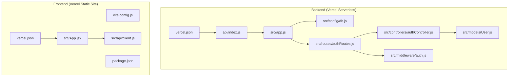
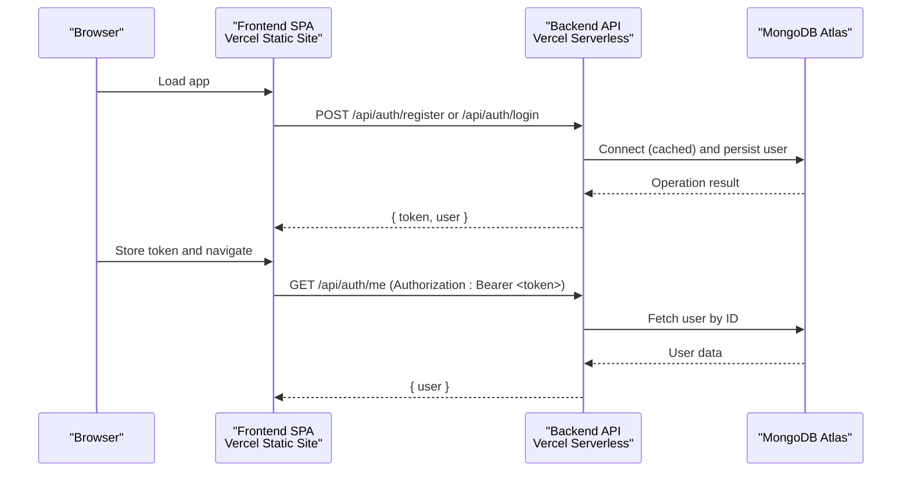
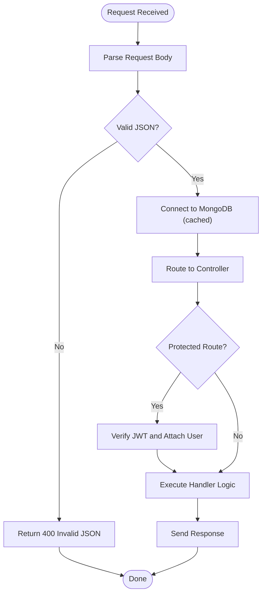
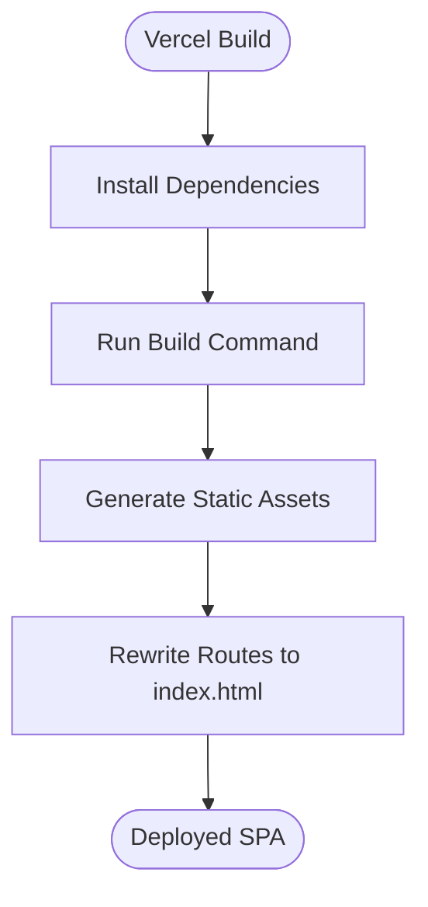
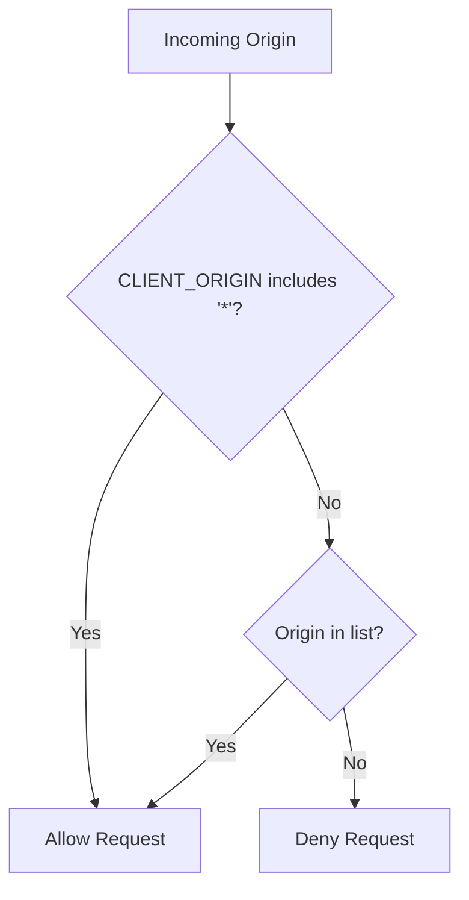
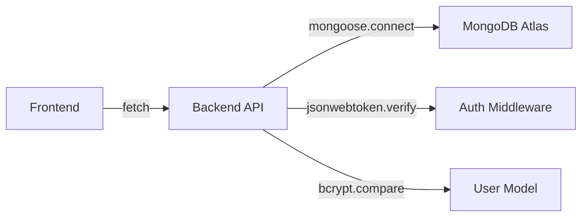

# Deployment Guide

<cite>
**Referenced Files in This Document**
- [README.md](file://README.md)
- [backend/package.json](file://backend/package.json)
- [backend/vercel.json](file://backend/vercel.json)
- [backend/api/index.js](file://backend/api/index.js)
- [backend/src/app.js](file://backend/src/app.js)
- [backend/src/config/db.js](file://backend/src/config/db.js)
- [backend/src/models/User.js](file://backend/src/models/User.js)
- [backend/src/controllers/authController.js](file://backend/src/controllers/authController.js)
- [backend/src/routes/authRoutes.js](file://backend/src/routes/authRoutes.js)
- [backend/src/middleware/auth.js](file://backend/src/middleware/auth.js)
- [frontend/package.json](file://frontend/package.json)
- [frontend/vercel.json](file://frontend/vercel.json)
- [frontend/vite.config.js](file://frontend/vite.config.js)
- [frontend/src/App.jsx](file://frontend/src/App.jsx)
- [frontend/src/api/client.js](file://frontend/src/api/client.js)
</cite>

## Table of Contents
1. Introduction
2. Project Structure
3. Core Components
4. Architecture Overview
5. Detailed Component Analysis
6. Dependency Analysis
7. Performance Considerations
8. Troubleshooting Guide
9. Conclusion
10. Appendices

## Introduction
This guide explains how to deploy the MERN Auth Application to Vercel, including setting up MongoDB Atlas, configuring environment variables, and deploying both backend and frontend components. It also documents serverless function configuration, static site deployment settings, CORS configuration for cross-origin requests, troubleshooting steps, performance optimization tips, production best practices, post-deployment verification, and monitoring recommendations.

The application consists of:
- Backend: Express API with JWT authentication, deployed as Vercel serverless functions.
- Frontend: React + Vite SPA, deployed as a static site on Vercel.

**Section sources**
- [README.md:1-32](file://README.md#L1-L32)

## Project Structure
At a high level:
- backend: Express API with serverless entry point at api/index.js; database connection caching in src/config/db.js; routes under src/routes; controllers under src/controllers; middleware under src/middleware; model under src/models.
- frontend: React app built with Vite; API client in src/api/client.js; routing and protected routes in src/App.jsx and related files.

**Diagram sources**
- [backend/vercel.json:1-9](file://backend/vercel.json#L1-L9)
- [backend/api/index.js:1-5](file://backend/api/index.js#L1-L5)
- [backend/src/app.js:1-56](file://backend/src/app.js#L1-L56)
- [backend/src/config/db.js:1-38](file://backend/src/config/db.js#L1-L38)
- [backend/src/routes/authRoutes.js:1-13](file://backend/src/routes/authRoutes.js#L1-L13)
- [backend/src/controllers/authController.js:1-74](file://backend/src/controllers/authController.js#L1-L74)
- [backend/src/middleware/auth.js:1-24](file://backend/src/middleware/auth.js#L1-L24)
- [backend/src/models/User.js:1-50](file://backend/src/models/User.js#L1-L50)
- [frontend/vercel.json:1-11](file://frontend/vercel.json#L1-L11)
- [frontend/vite.config.js:1-10](file://frontend/vite.config.js#L1-L10)
- [frontend/src/App.jsx:1-29](file://frontend/src/App.jsx#L1-L29)
- [frontend/src/api/client.js:1-33](file://frontend/src/api/client.js#L1-L33)

**Section sources**
- [README.md:10-32](file://README.md#L10-L32)
- [backend/package.json:1-23](file://backend/package.json#L1-L23)
- [frontend/package.json:1-21](file://frontend/package.json#L1-L21)

## Core Components
- Backend serverless entry point: Exports an Express app for Vercel serverless runtime.
- Database connection: Caches Mongoose connection across serverless invocations for performance.
- Authentication: JWT-based auth with bcrypt password hashing and token verification middleware.
- Frontend build: Vite builds a static SPA; Vercel rewrites all routes to index.html.
- API client: Fetch wrapper that attaches Authorization header when a token is present.

Key responsibilities:
- api/index.js: Loads environment variables and exports the Express app.
- src/app.js: Configures CORS, JSON parsing, health endpoint, DB connection middleware, routes, and error handling.
- src/config/db.js: Provides a cached, serverless-safe Mongoose connection.
- src/models/User.js: Defines user schema, password hashing, and safe JSON serialization.
- src/controllers/authController.js: Implements register, login, and me endpoints.
- src/routes/authRoutes.js: Mounts auth routes and applies requireAuth middleware to protected routes.
- src/middleware/auth.js: Verifies JWT and attaches user to request.
- frontend/src/api/client.js: Centralized fetch logic with base URL from environment variable.

**Section sources**
- [backend/api/index.js:1-5](file://backend/api/index.js#L1-L5)
- [backend/src/app.js:1-56](file://backend/src/app.js#L1-L56)
- [backend/src/config/db.js:1-38](file://backend/src/config/db.js#L1-L38)
- [backend/src/models/User.js:1-50](file://backend/src/models/User.js#L1-L50)
- [backend/src/controllers/authController.js:1-74](file://backend/src/controllers/authController.js#L1-L74)
- [backend/src/routes/authRoutes.js:1-13](file://backend/src/routes/authRoutes.js#L1-L13)
- [backend/src/middleware/auth.js:1-24](file://backend/src/middleware/auth.js#L1-L24)
- [frontend/src/api/client.js:1-33](file://frontend/src/api/client.js#L1-L33)

## Architecture Overview
The frontend SPA calls the backend API over HTTPS. The backend runs on Vercel serverless functions and connects to MongoDB Atlas. CORS is configured to allow only specified origins.

**Diagram sources**
- [frontend/src/api/client.js:1-33](file://frontend/src/api/client.js#L1-L33)
- [backend/src/routes/authRoutes.js:1-13](file://backend/src/routes/authRoutes.js#L1-L13)
- [backend/src/controllers/authController.js:1-74](file://backend/src/controllers/authController.js#L1-L74)
- [backend/src/middleware/auth.js:1-24](file://backend/src/middleware/auth.js#L1-L24)
- [backend/src/config/db.js:1-38](file://backend/src/config/db.js#L1-L38)

## Detailed Component Analysis

### MongoDB Atlas Setup
- Create a free cluster on MongoDB Atlas.
- Create a database user with username and password.
- Under Network Access, allow access from anywhere (0.0.0.0/0) because Vercel serverless functions use dynamic IPs.
- Copy the connection string and append a database name to form your MONGODB_URI.

Environment variables required by the backend:
- MONGODB_URI: MongoDB connection string.
- JWT_SECRET: Long random string used to sign tokens.
- CLIENT_ORIGIN: Comma-separated allowed origins (defaults to wildcard if not set).
- JWT_EXPIRES_IN: Token lifetime (default 7 days).

**Section sources**
- [README.md:87-108](file://README.md#L87-L108)
- [backend/src/config/db.js:16-22](file://backend/src/config/db.js#L16-L22)
- [backend/src/controllers/authController.js:6-12](file://backend/src/controllers/authController.js#L6-L12)

### Backend Deployment to Vercel
Steps:
1. Push the repository to Git.
2. In Vercel, add a new project and import the repository.
3. Set Root Directory to backend and framework preset to Other.
4. Add environment variables: MONGODB_URI, JWT_SECRET, CLIENT_ORIGIN (optional), JWT_EXPIRES_IN (optional).
5. Deploy and verify the health endpoint returns ok.

Serverless function configuration:
- vercel.json rewrites all paths to the serverless function at api/index.js.
- api/index.js loads environment variables and exports the Express app.
- src/app.js configures CORS, JSON parsing, health endpoint, DB connection middleware, routes, and error handling.

CORS configuration:
- Allowed origins are read from CLIENT_ORIGIN and split by commas.
- If CLIENT_ORIGIN is unset, wildcard is allowed.

Database connection:
- src/config/db.js caches the Mongoose connection globally to avoid cold starts on each invocation.

Authentication flow:
- Register and login endpoints create and return JWTs.
- Protected routes use middleware to verify the token and attach the user to the request.

**Diagram sources**
- [backend/vercel.json:1-9](file://backend/vercel.json#L1-L9)
- [backend/api/index.js:1-5](file://backend/api/index.js#L1-L5)
- [backend/src/app.js:1-56](file://backend/src/app.js#L1-L56)
- [backend/src/config/db.js:1-38](file://backend/src/config/db.js#L1-L38)
- [backend/src/middleware/auth.js:1-24](file://backend/src/middleware/auth.js#L1-L24)
- [backend/src/controllers/authController.js:1-74](file://backend/src/controllers/authController.js#L1-L74)

**Section sources**
- [README.md:87-108](file://README.md#L87-L108)
- [backend/vercel.json:1-9](file://backend/vercel.json#L1-L9)
- [backend/api/index.js:1-5](file://backend/api/index.js#L1-L5)
- [backend/src/app.js:1-56](file://backend/src/app.js#L1-L56)
- [backend/src/config/db.js:1-38](file://backend/src/config/db.js#L1-L38)
- [backend/src/routes/authRoutes.js:1-13](file://backend/src/routes/authRoutes.js#L1-L13)
- [backend/src/controllers/authController.js:1-74](file://backend/src/controllers/authController.js#L1-L74)
- [backend/src/middleware/auth.js:1-24](file://backend/src/middleware/auth.js#L1-L24)

### Frontend Deployment to Vercel
Steps:
1. In Vercel, add a new project and import the same repository again.
2. Set Root Directory to frontend; Vite is auto-detected.
3. Add environment variable VITE_API_URL pointing to the deployed backend URL (no trailing slash).
4. Deploy.

Static site configuration:
- vercel.json sets buildCommand and outputDirectory, and rewrites all routes to index.html for SPA routing.
- vite.config.js defines plugins and dev server port.
- src/App.jsx defines routes and uses a protected route component.
- src/api/client.js reads VITE_API_URL and attaches Authorization header when a token is present.

**Diagram sources**
- [frontend/vercel.json:1-11](file://frontend/vercel.json#L1-L11)
- [frontend/vite.config.js:1-10](file://frontend/vite.config.js#L1-L10)
- [frontend/src/App.jsx:1-29](file://frontend/src/App.jsx#L1-L29)
- [frontend/src/api/client.js:1-33](file://frontend/src/api/client.js#L1-L33)

**Section sources**
- [README.md:110-119](file://README.md#L110-L119)
- [frontend/vercel.json:1-11](file://frontend/vercel.json#L1-L11)
- [frontend/vite.config.js:1-10](file://frontend/vite.config.js#L1-L10)
- [frontend/src/App.jsx:1-29](file://frontend/src/App.jsx#L1-L29)
- [frontend/src/api/client.js:1-33](file://frontend/src/api/client.js#L1-L33)

### CORS Configuration
- The backend reads CLIENT_ORIGIN and allows requests from those origins.
- If CLIENT_ORIGIN is unset, wildcard is allowed.
- After deploying the frontend, set CLIENT_ORIGIN to the frontend’s origin and redeploy the backend.

**Diagram sources**
- [backend/src/app.js:8-22](file://backend/src/app.js#L8-L22)

**Section sources**
- [README.md:117-119](file://README.md#L117-L119)
- [backend/src/app.js:8-22](file://backend/src/app.js#L8-L22)

## Dependency Analysis
Backend dependencies:
- express: Web framework.
- cors: CORS middleware.
- mongoose: MongoDB ODM.
- jsonwebtoken: JWT signing and verification.
- bcryptjs: Password hashing.
- dotenv: Environment variable loading.

Frontend dependencies:
- react, react-dom: UI library.
- react-router-dom: Client-side routing.
- vite: Build tooling.

**Diagram sources**
- [backend/package.json:14-21](file://backend/package.json#L14-L21)
- [frontend/package.json:11-19](file://frontend/package.json#L11-L19)
- [backend/src/config/db.js:1-38](file://backend/src/config/db.js#L1-L38)
- [backend/src/middleware/auth.js:1-24](file://backend/src/middleware/auth.js#L1-L24)
- [backend/src/models/User.js:1-50](file://backend/src/models/User.js#L1-L50)

**Section sources**
- [backend/package.json:1-23](file://backend/package.json#L1-L23)
- [frontend/package.json:1-21](file://frontend/package.json#L1-L21)

## Performance Considerations
- Connection reuse: The backend caches the Mongoose connection globally to reduce cold start latency on serverless invocations.
- Minimal payload: The user model excludes sensitive fields and internal metadata from JSON responses.
- Efficient validation: Input validation occurs early in controllers to fail fast.
- Static assets: The frontend is built into static files and served via CDN through Vercel.

Recommendations:
- Keep CLIENT_ORIGIN restrictive to minimize unnecessary CORS preflight checks.
- Use appropriate JWT_EXPIRES_IN to balance security and session longevity.
- Monitor cold starts and database connection times in production.

**Section sources**
- [backend/src/config/db.js:1-38](file://backend/src/config/db.js#L1-L38)
- [backend/src/models/User.js:39-47](file://backend/src/models/User.js#L39-L47)
- [backend/src/controllers/authController.js:19-50](file://backend/src/controllers/authController.js#L19-L50)

## Troubleshooting Guide
Common issues and resolutions:
- Cannot reach the server: Ensure VITE_API_URL points to the correct backend URL without a trailing slash.
- CORS errors: Set CLIENT_ORIGIN to the frontend origin and redeploy the backend.
- Not authorized: Verify Authorization header contains a valid Bearer token and that JWT_SECRET matches between deployments.
- Invalid JSON body: Ensure Content-Type is application/json and the body is valid JSON.
- Database connection failures: Confirm MONGODB_URI is correct and network access allows Vercel IPs.

Verification steps:
- Health check: Call https://<backend-project>.vercel.app/api/health and expect status ok.
- Register/Login: Submit registration and login payloads; ensure tokens are returned and stored.
- Protected route: Access /api/auth/me with a valid token; expect user data.

Monitoring recommendations:
- Enable Vercel logs for serverless functions to inspect errors and cold starts.
- Track API response times and error rates in Vercel analytics.
- Monitor MongoDB Atlas metrics for connection counts and query latency.

**Section sources**
- [frontend/src/api/client.js:1-33](file://frontend/src/api/client.js#L1-L33)
- [backend/src/app.js:26-53](file://backend/src/app.js#L26-L53)
- [backend/src/middleware/auth.js:1-24](file://backend/src/middleware/auth.js#L1-L24)
- [backend/src/config/db.js:16-34](file://backend/src/config/db.js#L16-L34)
- [README.md:87-119](file://README.md#L87-L119)

## Conclusion
You now have a complete guide to deploy the MERN Auth Application to Vercel, configure MongoDB Atlas, set environment variables, and secure cross-origin requests. Follow the steps for backend and frontend deployment, validate functionality using the provided endpoints, and apply the performance and troubleshooting recommendations to ensure a reliable production setup.

## Appendices

### Environment Variables Reference
- Backend:
  - MONGODB_URI: Required. MongoDB connection string.
  - JWT_SECRET: Required. Long random string for signing tokens.
  - CLIENT_ORIGIN: Optional. Comma-separated allowed origins.
  - JWT_EXPIRES_IN: Optional. Token lifetime (default 7 days).
- Frontend:
  - VITE_API_URL: Required. Base URL of the backend API (no trailing slash).

**Section sources**
- [README.md:55-64](file://README.md#L55-L64)
- [README.md:102-115](file://README.md#L102-L115)
- [frontend/src/api/client.js:1-3](file://frontend/src/api/client.js#L1-L3)