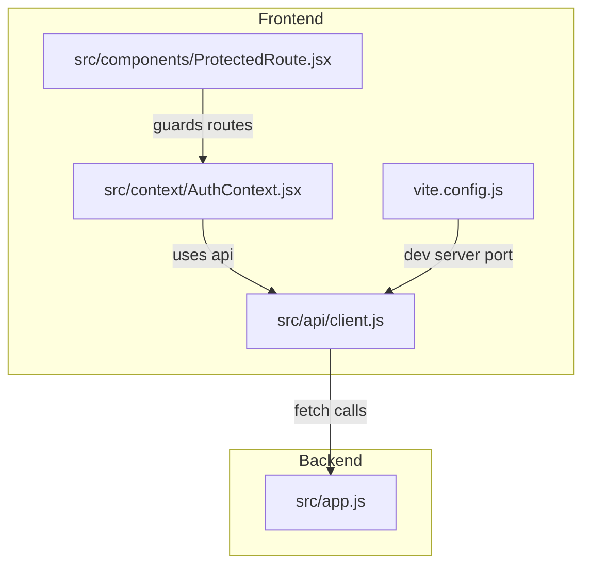
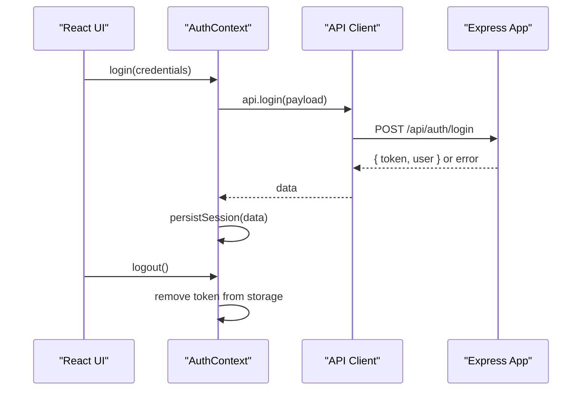
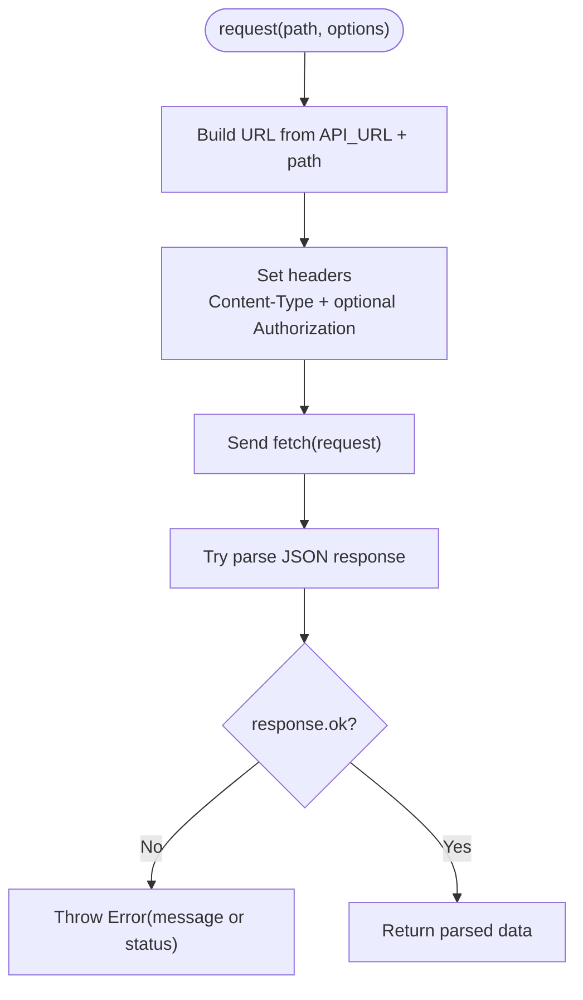
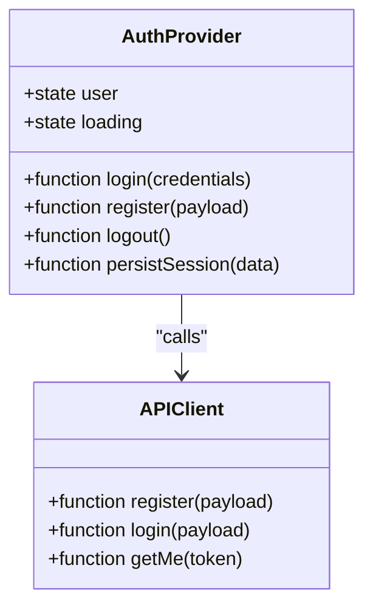
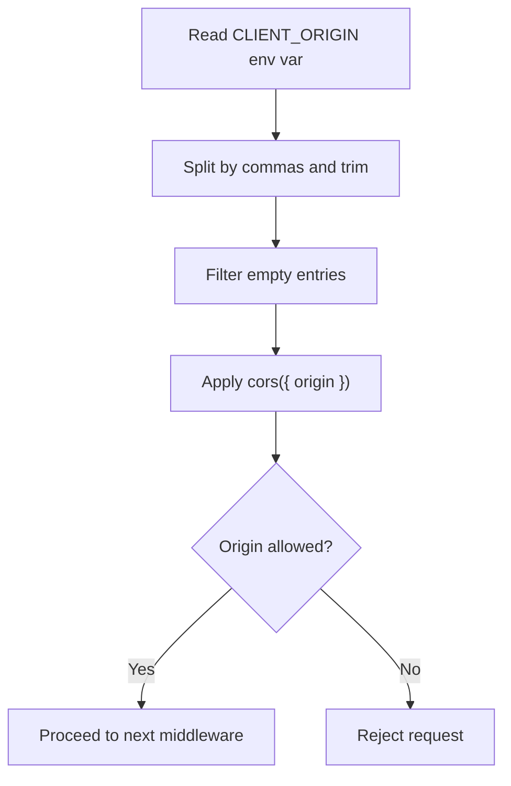
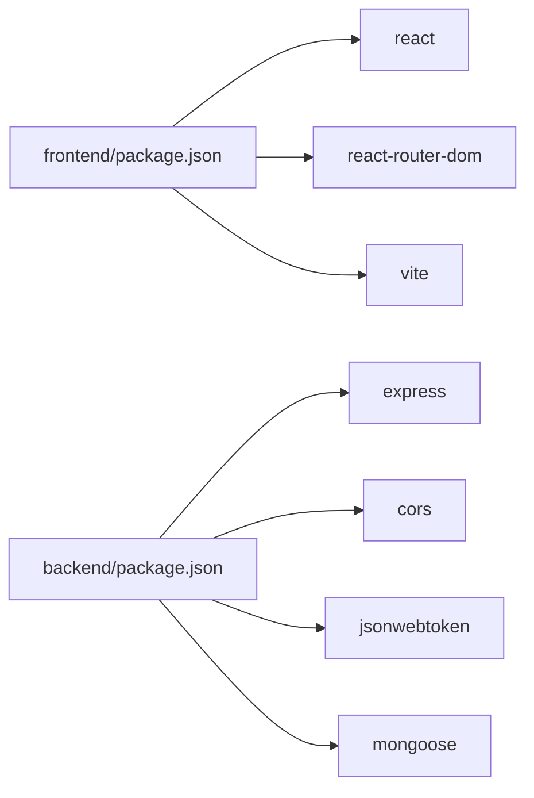

# API Integration

<cite>
**Referenced Files in This Document**
- [client.js](file://frontend/src/api/client.js)
- [AuthContext.jsx](file://frontend/src/context/AuthContext.jsx)
- [ProtectedRoute.jsx](file://frontend/src/components/ProtectedRoute.jsx)
- [vite.config.js](file://frontend/vite.config.js)
- [app.js](file://backend/src/app.js)
- [package.json (frontend)](file://frontend/package.json)
- [package.json (backend)](file://backend/package.json)
- [README.md](file://README.md)
</cite>

## Table of Contents
1. [Introduction](#introduction)
2. [Project Structure](#project-structure)
3. [Core Components](#core-components)
4. [Architecture Overview](#architecture-overview)
5. [Detailed Component Analysis](#detailed-component-analysis)
6. [Dependency Analysis](#dependency-analysis)
7. [Performance Considerations](#performance-considerations)
8. [Troubleshooting Guide](#troubleshooting-guide)
9. [Conclusion](#conclusion)

## Introduction
This document explains the frontend API integration layer for a MERN application. It covers how HTTP requests are made, how JWT tokens are attached to authenticated requests, how errors are handled, and how CORS is configured across environments. The client uses the native fetch API rather than axios. There are no request/response interceptors; instead, authentication and error handling are implemented directly in the client module and consumed via React context.

## Project Structure
The frontend API integration lives under `frontend/src/api`, with authentication state managed in `frontend/src/context` and route protection in `frontend/src/components`. The backend Express app configures CORS and exposes `/api/auth/*` endpoints.

**Diagram sources**
- [client.js:1-32](file://frontend/src/api/client.js#L1-L32)
- [AuthContext.jsx:1-73](file://frontend/src/context/AuthContext.jsx#L1-L73)
- [ProtectedRoute.jsx:1-17](file://frontend/src/components/ProtectedRoute.jsx#L1-L17)
- [vite.config.js:1-10](file://frontend/vite.config.js#L1-L10)
- [app.js:1-56](file://backend/src/app.js#L1-L56)

**Section sources**
- [client.js:1-32](file://frontend/src/api/client.js#L1-L32)
- [AuthContext.jsx:1-73](file://frontend/src/context/AuthContext.jsx#L1-L73)
- [ProtectedRoute.jsx:1-17](file://frontend/src/components/ProtectedRoute.jsx#L1-L17)
- [vite.config.js:1-10](file://frontend/vite.config.js#L1-L10)
- [app.js:1-56](file://backend/src/app.js#L1-L56)

## Core Components
- HTTP client abstraction: `frontend/src/api/client.js` defines a small wrapper around fetch, base URL configuration, JSON serialization, optional Authorization header injection, and unified error throwing.
- Authentication context: `frontend/src/context/AuthContext.jsx` persists the JWT in localStorage, attaches it to protected requests, and provides login/register/logout helpers.
- Route protection: `frontend/src/components/ProtectedRoute.jsx` guards routes based on authentication state.
- Backend CORS: `backend/src/app.js` configures allowed origins via an environment variable and applies CORS middleware.

Key responsibilities:
- Base URL resolution from Vite environment variables.
- Automatic Authorization header attachment when a token is provided.
- Centralized error handling that converts non-OK responses into thrown errors with user-friendly messages.
- Session persistence and restoration on app startup.

**Section sources**
- [client.js:1-32](file://frontend/src/api/client.js#L1-L32)
- [AuthContext.jsx:1-73](file://frontend/src/context/AuthContext.jsx#L1-L73)
- [ProtectedRoute.jsx:1-17](file://frontend/src/components/ProtectedRoute.jsx#L1-L17)
- [app.js:1-56](file://backend/src/app.js#L1-L56)

## Architecture Overview
The frontend uses a thin fetch-based client to call backend endpoints. Authenticated requests include a Bearer token in the Authorization header. The backend enforces CORS based on allowed origins and returns standardized error objects.

**Diagram sources**
- [AuthContext.jsx:43-51](file://frontend/src/context/AuthContext.jsx#L43-L51)
- [client.js:28-31](file://frontend/src/api/client.js#L28-L31)
- [app.js:41-45](file://backend/src/app.js#L41-L45)

## Detailed Component Analysis

### HTTP Client (`frontend/src/api/client.js`)
- Base URL: Resolved from `VITE_API_URL`; defaults to local development URL if not set. Trailing slashes are removed to avoid double slashes.
- Request function: Wraps fetch with:
  - JSON content type header.
  - Optional Authorization header when a token is passed.
  - JSON body serialization for POST/PUT/PATCH.
  - Network error catch that throws a descriptive message.
  - Response parsing with fallback to empty object on parse failure.
  - Non-OK response handling that throws an error using server-provided message or status code.
- Endpoint abstraction: Exposes `register`, `login`, and `getMe` methods bound to `/api/auth/*` paths.

**Diagram sources**
- [client.js:3-26](file://frontend/src/api/client.js#L3-L26)

**Section sources**
- [client.js:1-32](file://frontend/src/api/client.js#L1-L32)

### Authentication Context (`frontend/src/context/AuthContext.jsx`)
- Token storage key: Uses a constant for localStorage.
- Initialization: On mount, reads token from localStorage, validates it by calling `api.getMe(token)`, sets user state, and clears invalid tokens on failure.
- Login/Register: Calls corresponding API methods and persists returned token and user.
- Logout: Clears stored token and resets user state.
- Provider value: Memoizes and exposes `user`, `loading`, `login`, `register`, `logout`.

**Diagram sources**
- [AuthContext.jsx:8-63](file://frontend/src/context/AuthContext.jsx#L8-L63)
- [client.js:28-31](file://frontend/src/api/client.js#L28-L31)

**Section sources**
- [AuthContext.jsx:1-73](file://frontend/src/context/AuthContext.jsx#L1-L73)

### Protected Route (`frontend/src/components/ProtectedRoute.jsx`)
- Guards routes by checking authentication state from context.
- Shows a loading indicator while auth state initializes.
- Redirects unauthenticated users to the login page.

**Section sources**
- [ProtectedRoute.jsx:1-17](file://frontend/src/components/ProtectedRoute.jsx#L1-L17)

### Backend CORS Configuration (`backend/src/app.js`)
- Allowed origins: Parsed from `CLIENT_ORIGIN` environment variable; supports comma-separated values and wildcard.
- CORS middleware: Applied early in the pipeline to allow cross-origin requests from permitted origins.
- Global error handler: Returns consistent JSON error payloads for malformed bodies and other server errors.

**Diagram sources**
- [app.js:8-22](file://backend/src/app.js#L8-L22)

**Section sources**
- [app.js:1-56](file://backend/src/app.js#L1-L56)

## Dependency Analysis
- Frontend dependencies: React, React Router DOM, Vite. No axios dependency is present; the client uses fetch.
- Backend dependencies: Express, CORS, JSON Web Tokens, Mongoose, bcryptjs, dotenv.

**Diagram sources**
- [package.json (frontend):1-21](file://frontend/package.json#L1-L21)
- [package.json (backend):1-23](file://backend/package.json#L1-L23)

**Section sources**
- [package.json (frontend):1-21](file://frontend/package.json#L1-L21)
- [package.json (backend):1-23](file://backend/package.json#L1-L23)

## Performance Considerations
- Fetch vs axios: The current implementation uses fetch, which avoids extra bundle size from axios. For complex scenarios (interceptors, retries), consider introducing a lightweight wrapper or library later.
- JSON parsing fallback: The client safely handles malformed JSON responses to prevent crashes.
- State initialization: AuthContext performs one validation call on startup; ensure the backend health endpoint is available to reduce cold-start latency if needed.

[No sources needed since this section provides general guidance]

## Troubleshooting Guide

### Common Issues and Resolutions
- Cannot reach the server:
  - Symptom: Thrown error indicating the server cannot be reached.
  - Causes: Backend not running, wrong `VITE_API_URL`, network issues.
  - Resolution: Ensure backend is running and `VITE_API_URL` points to the correct base URL without trailing slash.

- CORS errors:
  - Symptom: Browser blocks requests due to cross-origin policy.
  - Causes: Frontend origin not included in `CLIENT_ORIGIN` on the backend.
  - Resolution: Set `CLIENT_ORIGIN` to the frontend’s origin (e.g., `http://localhost:5173` locally or your deployed frontend domain). Multiple origins can be comma-separated.

- Invalid JSON body:
  - Symptom: Server responds with a 400 error indicating invalid JSON.
  - Causes: Sending malformed request body.
  - Resolution: Ensure request payloads are valid JSON objects.

- Not found:
  - Symptom: 404 responses for unknown routes.
  - Causes: Incorrect endpoint path or missing route on backend.
  - Resolution: Verify the path matches backend routes under `/api/auth`.

- Token not attached:
  - Symptom: Protected endpoints reject requests.
  - Causes: Missing token when calling API methods.
  - Resolution: Pass the token to methods that accept it (e.g., `getMe`) or ensure the context attaches it where appropriate.

**Section sources**
- [client.js:15-23](file://frontend/src/api/client.js#L15-L23)
- [app.js:47-53](file://backend/src/app.js#L47-L53)
- [README.md:117-124](file://README.md#L117-L124)

## Conclusion
The frontend API integration layer is intentionally minimal: a fetch-based client with base URL configuration, optional Authorization header injection, and centralized error handling. Authentication state is managed in React context, persisting the JWT in localStorage and validating it on app start. CORS is enforced on the backend through an environment-driven allowlist. For advanced needs like interceptors and retry logic, consider extending the client with a dedicated service layer or adopting a library that supports these features.

[No sources needed since this section summarizes without analyzing specific files]