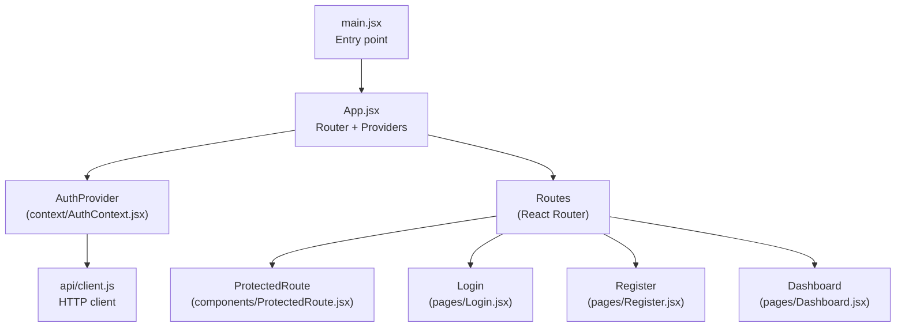
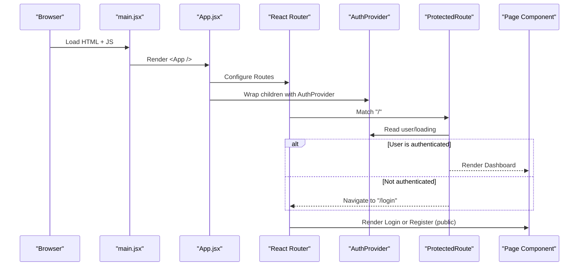
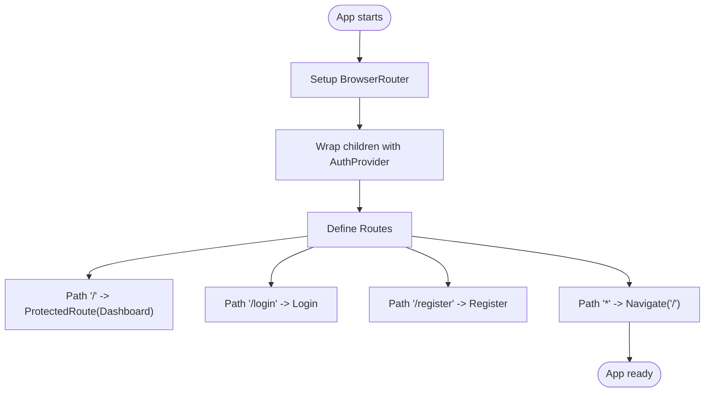
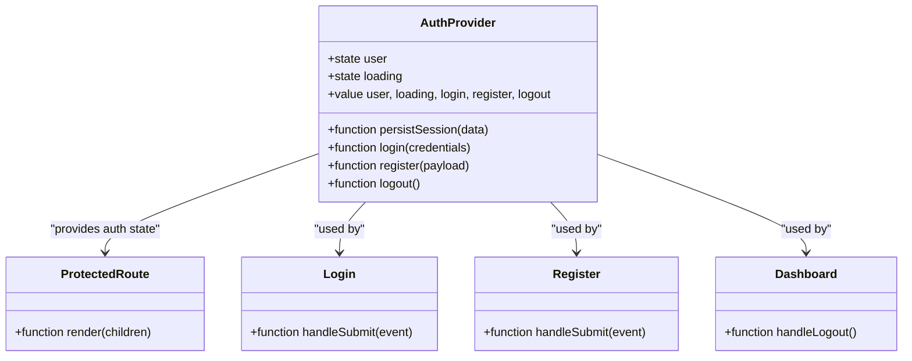
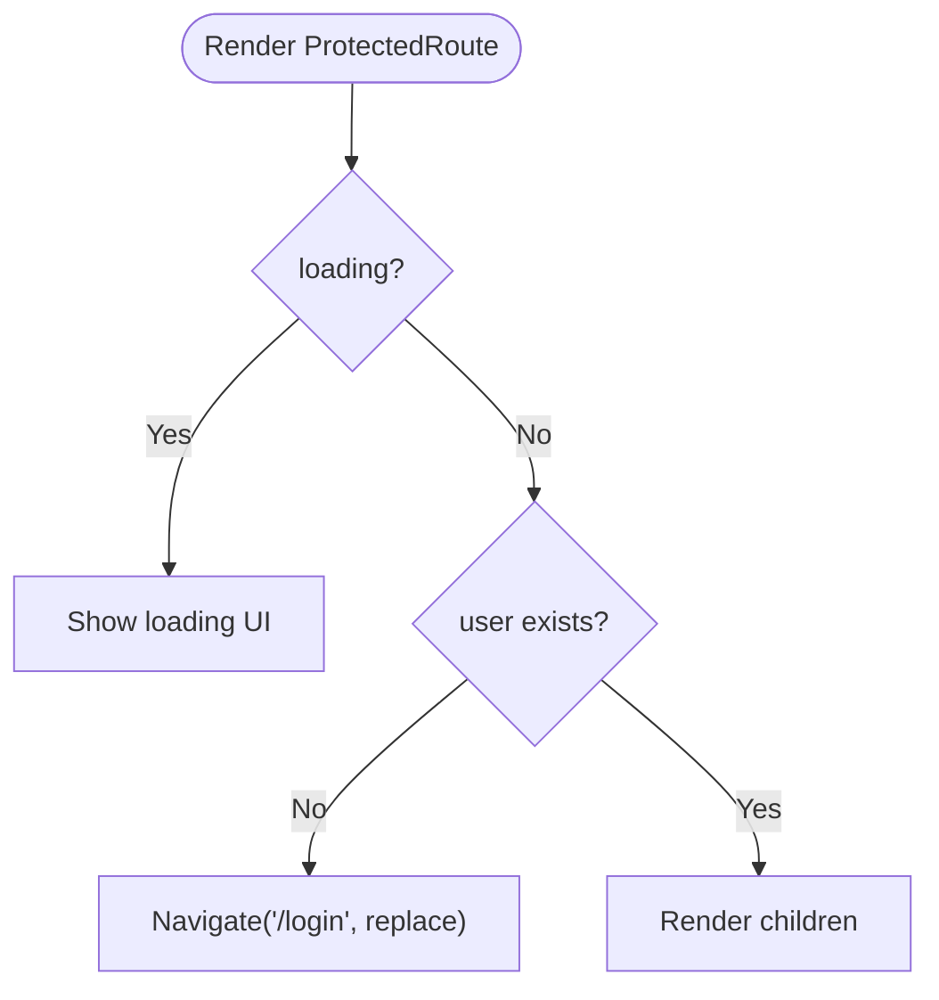
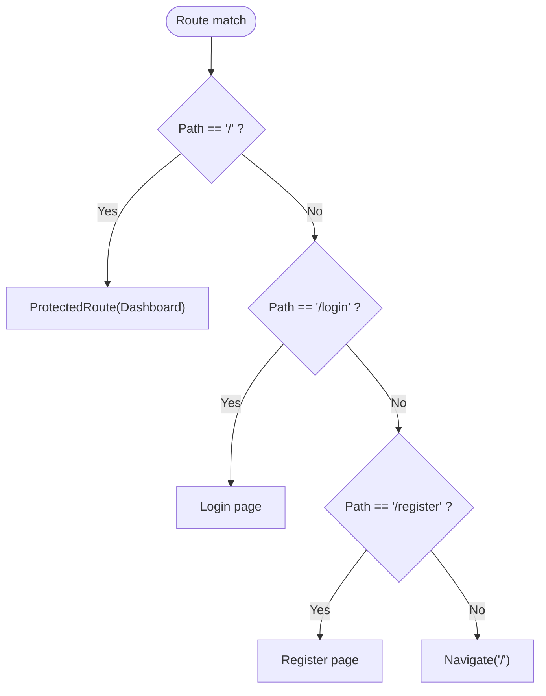
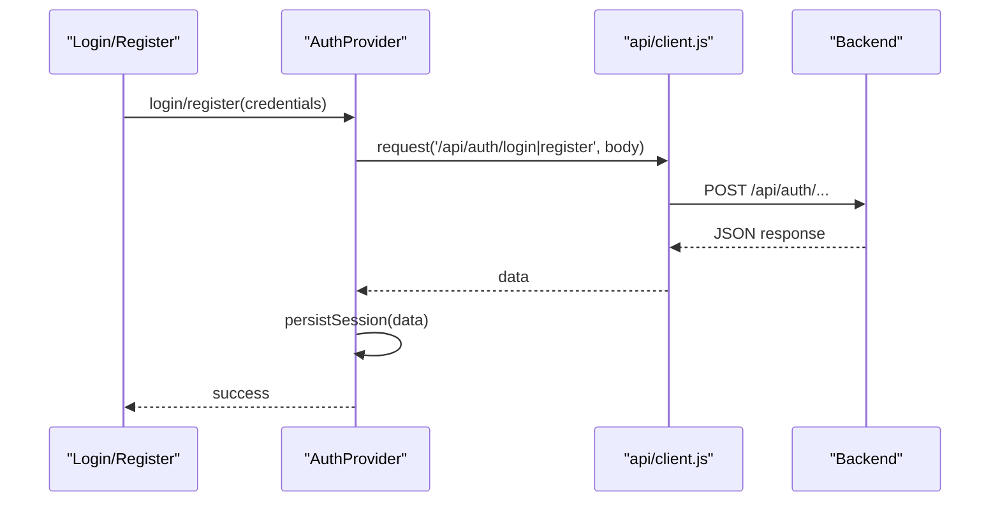
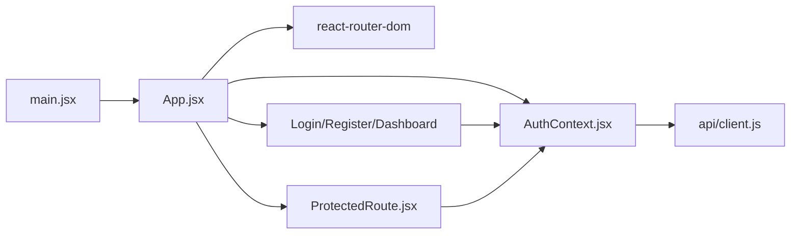

# Application Structure

<cite>
**Referenced Files in This Document**
- [main.jsx](file://frontend/src/main.jsx)
- [App.jsx](file://frontend/src/App.jsx)
- [AuthContext.jsx](file://frontend/src/context/AuthContext.jsx)
- [ProtectedRoute.jsx](file://frontend/src/components/ProtectedRoute.jsx)
- [Login.jsx](file://frontend/src/pages/Login.jsx)
- [Register.jsx](file://frontend/src/pages/Register.jsx)
- [Dashboard.jsx](file://frontend/src/pages/Dashboard.jsx)
- [client.js](file://frontend/src/api/client.js)
- [vite.config.js](file://frontend/vite.config.js)
- [package.json](file://frontend/package.json)
</cite>

## Table of Contents
1. [Introduction](#introduction)
2. [Project Structure](#project-structure)
3. [Core Components](#core-components)
4. [Architecture Overview](#architecture-overview)
5. [Detailed Component Analysis](#detailed-component-analysis)
6. [Dependency Analysis](#dependency-analysis)
7. [Performance Considerations](#performance-considerations)
8. [Troubleshooting Guide](#troubleshooting-guide)
9. [Conclusion](#conclusion)

## Introduction
This document explains the React application’s structure and bootstrap process, focusing on:
- The main entry point that mounts the app into the DOM
- The root App component configuration with React Router
- The Vite build setup for development and production
- The component hierarchy starting from the root
- How AuthProvider wraps the entire application to provide authentication context
- Routing configuration including protected routes, public routes, and fallback navigation
- Directory organization pattern for maintainability

## Project Structure
The frontend follows a feature-oriented layout under src/:
- api: HTTP client abstraction for backend calls
- components: Reusable UI components (e.g., ProtectedRoute)
- context: Global state providers (e.g., AuthContext)
- pages: Route-level components (Login, Register, Dashboard)
- Root files: App.jsx (routing + providers), index.css (global styles), main.jsx (entry point)

**Diagram sources**
- [main.jsx:1-11](file://frontend/src/main.jsx#L1-L11)
- [App.jsx:1-29](file://frontend/src/App.jsx#L1-L29)
- [AuthContext.jsx:1-73](file://frontend/src/context/AuthContext.jsx#L1-L73)
- [ProtectedRoute.jsx:1-17](file://frontend/src/components/ProtectedRoute.jsx#L1-L17)
- [Login.jsx:1-73](file://frontend/src/pages/Login.jsx#L1-L73)
- [Register.jsx:1-105](file://frontend/src/pages/Register.jsx#L1-L105)
- [Dashboard.jsx:1-43](file://frontend/src/pages/Dashboard.jsx#L1-L43)
- [client.js:1-33](file://frontend/src/api/client.js#L1-L33)

**Section sources**
- [main.jsx:1-11](file://frontend/src/main.jsx#L1-L11)
- [App.jsx:1-29](file://frontend/src/App.jsx#L1-L29)

## Core Components
- Entry point (main.jsx): Creates the React root and renders App inside StrictMode.
- Root App (App.jsx): Configures BrowserRouter, wraps children with AuthProvider, and defines Routes for protected and public pages plus a wildcard fallback.
- Authentication provider (AuthContext.jsx): Provides user state, loading state, login/register/logout actions, persists tokens, and exposes useAuth hook.
- Protected route (ProtectedRoute.jsx): Guards routes by checking auth state; redirects unauthenticated users to /login.
- Pages: Login, Register, Dashboard consume auth context and navigate accordingly.
- API client (client.js): Centralized fetch wrapper with token handling and error normalization.

**Section sources**
- [main.jsx:1-11](file://frontend/src/main.jsx#L1-L11)
- [App.jsx:1-29](file://frontend/src/App.jsx#L1-L29)
- [AuthContext.jsx:1-73](file://frontend/src/context/AuthContext.jsx#L1-L73)
- [ProtectedRoute.jsx:1-17](file://frontend/src/components/ProtectedRoute.jsx#L1-L17)
- [Login.jsx:1-73](file://frontend/src/pages/Login.jsx#L1-L73)
- [Register.jsx:1-105](file://frontend/src/pages/Register.jsx#L1-L105)
- [Dashboard.jsx:1-43](file://frontend/src/pages/Dashboard.jsx#L1-L43)
- [client.js:1-33](file://frontend/src/api/client.js#L1-L33)

## Architecture Overview
The application bootstraps via main.jsx, which mounts App. App sets up routing and provides global auth context. Protected routes ensure only authenticated users can access certain pages. Public routes allow login and registration. An unknown route redirects to the root.

**Diagram sources**
- [main.jsx:6-10](file://frontend/src/main.jsx#L6-L10)
- [App.jsx:8-28](file://frontend/src/App.jsx#L8-L28)
- [AuthContext.jsx:8-63](file://frontend/src/context/AuthContext.jsx#L8-L63)
- [ProtectedRoute.jsx:4-15](file://frontend/src/components/ProtectedRoute.jsx#L4-L15)

## Detailed Component Analysis

### Bootstrap and Root Configuration
- main.jsx creates the React root and renders App within StrictMode.
- App.jsx configures BrowserRouter, wraps all routes with AuthProvider, and defines:
  - Protected route at "/" rendering Dashboard
  - Public routes at "/login" and "/register"
  - Wildcard route "*" redirecting to "/"

**Diagram sources**
- [App.jsx:1-29](file://frontend/src/App.jsx#L1-L29)

**Section sources**
- [main.jsx:1-11](file://frontend/src/main.jsx#L1-L11)
- [App.jsx:1-29](file://frontend/src/App.jsx#L1-L29)

### Authentication Context (AuthProvider)
Responsibilities:
- Initialize user and loading states
- On mount, read token from localStorage and validate it via API
- Persist session data (token and user) after successful login/register
- Provide login, register, logout functions
- Expose a stable value object via useMemo to minimize re-renders
- Export useAuth hook for consuming components

**Diagram sources**
- [AuthContext.jsx:1-73](file://frontend/src/context/AuthContext.jsx#L1-L73)
- [ProtectedRoute.jsx:1-17](file://frontend/src/components/ProtectedRoute.jsx#L1-L17)
- [Login.jsx:1-73](file://frontend/src/pages/Login.jsx#L1-L73)
- [Register.jsx:1-105](file://frontend/src/pages/Register.jsx#L1-L105)
- [Dashboard.jsx:1-43](file://frontend/src/pages/Dashboard.jsx#L1-L43)

**Section sources**
- [AuthContext.jsx:1-73](file://frontend/src/context/AuthContext.jsx#L1-L73)

### Protected Route Logic
Behavior:
- If loading is true, show a loading indicator
- If no user is present, redirect to /login
- Otherwise, render the protected child component

**Diagram sources**
- [ProtectedRoute.jsx:4-15](file://frontend/src/components/ProtectedRoute.jsx#L4-L15)

**Section sources**
- [ProtectedRoute.jsx:1-17](file://frontend/src/components/ProtectedRoute.jsx#L1-L17)

### Routing Configuration
- Protected route: "/" requires authentication and renders Dashboard
- Public routes: "/login", "/register" are accessible without authentication
- Fallback: Any unmatched path redirects to "/"

**Diagram sources**
- [App.jsx:12-24](file://frontend/src/App.jsx#L12-L24)

**Section sources**
- [App.jsx:1-29](file://frontend/src/App.jsx#L1-L29)

### API Client Integration
- Centralizes fetch requests with consistent headers and error handling
- Supports optional Authorization header via token parameter
- Exposes methods for register, login, and getMe used by AuthContext and pages

**Diagram sources**
- [AuthContext.jsx:43-50](file://frontend/src/context/AuthContext.jsx#L43-L50)
- [client.js:1-33](file://frontend/src/api/client.js#L1-L33)

**Section sources**
- [client.js:1-33](file://frontend/src/api/client.js#L1-L33)

### Vite Build Setup
- vite.config.js enables the React plugin and sets dev server port to 5173
- package.json scripts:
  - dev: start Vite dev server
  - build: create optimized production bundle
  - preview: serve the built output locally

Key points:
- Development server runs on port 5173
- Production builds are generated via Vite
- Environment variables can be injected using import.meta.env.* (e.g., VITE_API_URL)

**Section sources**
- [vite.config.js:1-10](file://frontend/vite.config.js#L1-L10)
- [package.json:1-21](file://frontend/package.json#L1-L21)

## Dependency Analysis
High-level dependencies among core modules:

**Diagram sources**
- [main.jsx:1-11](file://frontend/src/main.jsx#L1-L11)
- [App.jsx:1-29](file://frontend/src/App.jsx#L1-L29)
- [AuthContext.jsx:1-73](file://frontend/src/context/AuthContext.jsx#L1-L73)
- [ProtectedRoute.jsx:1-17](file://frontend/src/components/ProtectedRoute.jsx#L1-L17)
- [Login.jsx:1-73](file://frontend/src/pages/Login.jsx#L1-L73)
- [Register.jsx:1-105](file://frontend/src/pages/Register.jsx#L1-L105)
- [Dashboard.jsx:1-43](file://frontend/src/pages/Dashboard.jsx#L1-L43)
- [client.js:1-33](file://frontend/src/api/client.js#L1-L33)

**Section sources**
- [App.jsx:1-29](file://frontend/src/App.jsx#L1-L29)
- [AuthContext.jsx:1-73](file://frontend/src/context/AuthContext.jsx#L1-L73)
- [ProtectedRoute.jsx:1-17](file://frontend/src/components/ProtectedRoute.jsx#L1-L17)
- [client.js:1-33](file://frontend/src/api/client.js#L1-L33)

## Performance Considerations
- Use memoization for context values to avoid unnecessary re-renders when only non-critical fields change.
- Keep heavy logic out of render paths; perform async operations in effects or event handlers.
- Prefer code splitting for large pages if the app grows beyond current scope.
- Ensure API errors are handled gracefully to prevent UI crashes and improve perceived performance.

[No sources needed since this section provides general guidance]

## Troubleshooting Guide
Common issues and resolutions:
- Cannot reach the server: The API client throws an error when fetch fails; verify backend is running and VITE_API_URL is set correctly.
- Token invalidation: If validating the token fails, the token is removed from localStorage; re-authenticate to restore session.
- Redirect loops: Ensure protected routes check both loading and user states; avoid navigating to the same route from within a guarded component.
- Dev server port conflicts: Adjust the port in vite.config.js if 5173 is already in use.

**Section sources**
- [client.js:1-33](file://frontend/src/api/client.js#L1-L33)
- [AuthContext.jsx:12-36](file://frontend/src/context/AuthContext.jsx#L12-L36)
- [ProtectedRoute.jsx:4-15](file://frontend/src/components/ProtectedRoute.jsx#L4-L15)
- [vite.config.js:4-9](file://frontend/vite.config.js#L4-L9)

## Conclusion
The application uses a clear separation of concerns:
- main.jsx boots the app
- App.jsx configures routing and providers
- AuthContext centralizes authentication state and actions
- ProtectedRoute enforces access control
- Pages implement domain-specific UI and flows
- Vite provides a fast development experience and efficient builds

This structure supports scalability and maintainability while keeping the bootstrap and routing logic straightforward.

[No sources needed since this section summarizes without analyzing specific files]