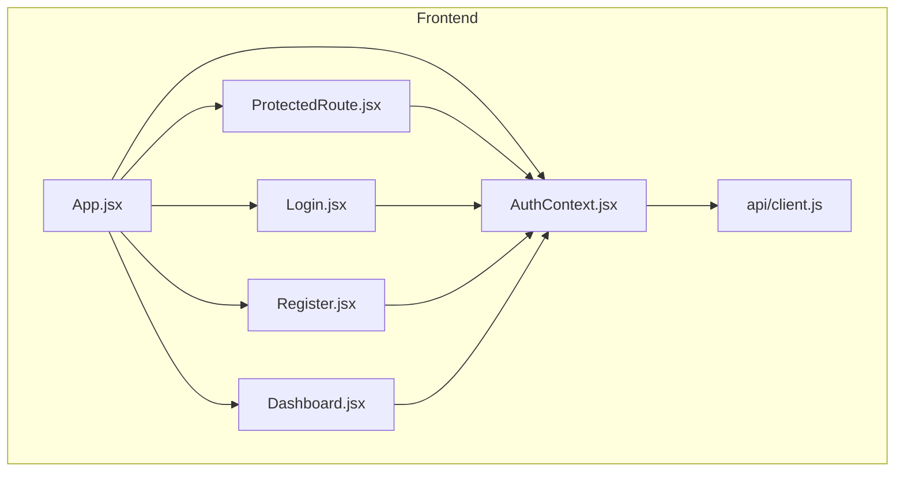
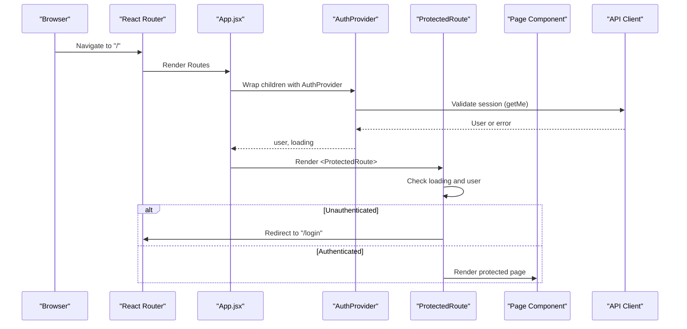
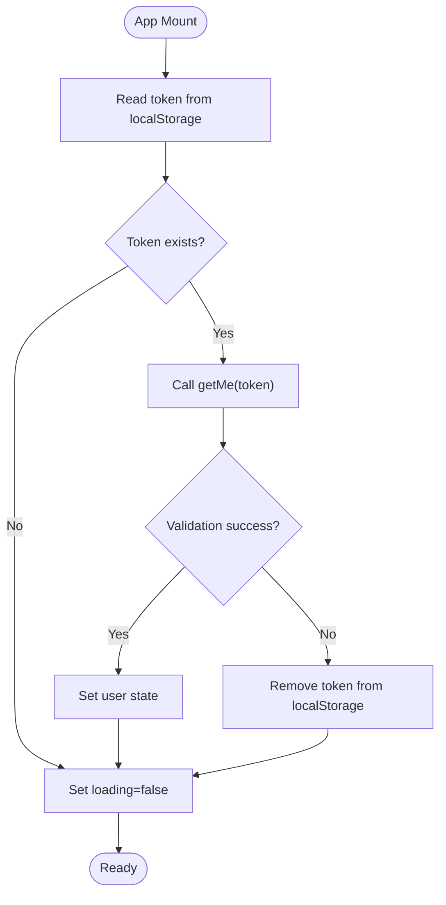
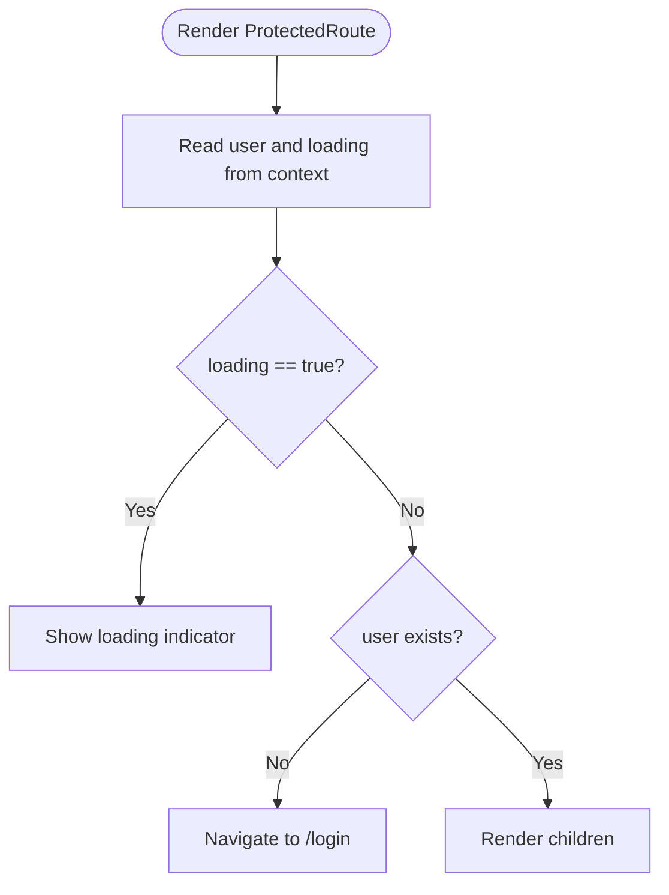
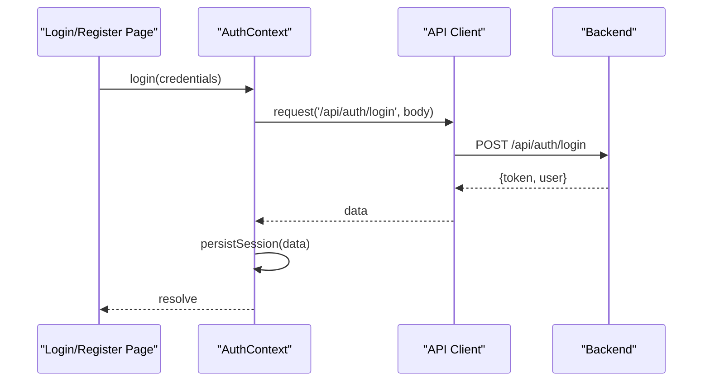
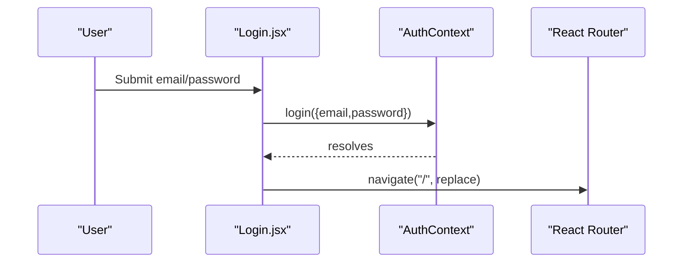
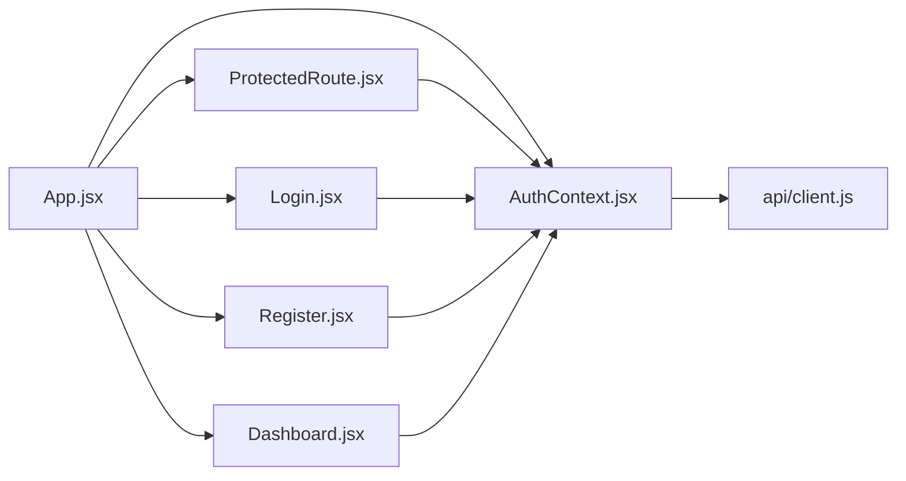

# Authentication Implementation

<cite>
**Referenced Files in This Document**
- [AuthContext.jsx](file://frontend/src/context/AuthContext.jsx)
- [ProtectedRoute.jsx](file://frontend/src/components/ProtectedRoute.jsx)
- [App.jsx](file://frontend/src/App.jsx)
- [client.js](file://frontend/src/api/client.js)
- [Login.jsx](file://frontend/src/pages/Login.jsx)
- [Register.jsx](file://frontend/src/pages/Register.jsx)
- [Dashboard.jsx](file://frontend/src/pages/Dashboard.jsx)
</cite>

## Table of Contents
1. [Introduction](#introduction)
2. [Project Structure](#project-structure)
3. [Core Components](#core-components)
4. [Architecture Overview](#architecture-overview)
5. [Detailed Component Analysis](#detailed-component-analysis)
6. [Dependency Analysis](#dependency-analysis)
7. [Performance Considerations](#performance-considerations)
8. [Troubleshooting Guide](#troubleshooting-guide)
9. [Conclusion](#conclusion)

## Introduction
This document explains the client-side authentication system implemented with React Context API for global state management, including user session persistence via localStorage, token handling, and authentication state updates across the component tree. It also documents the ProtectedRoute component that guards authenticated routes, handles redirect logic, and integrates with the authentication context. The guide includes concrete examples of how authentication flows through components, error handling strategies, and best practices for secure token storage.

## Project Structure
The frontend is a React application using Vite. Authentication-related code is organized into:
- Context layer for global auth state and actions
- A protected route component to guard routes
- Pages for login, registration, and dashboard
- An API client for HTTP requests with token injection

**Diagram sources**
- [App.jsx:1-29](file://frontend/src/App.jsx#L1-L29)
- [AuthContext.jsx:1-73](file://frontend/src/context/AuthContext.jsx#L1-L73)
- [ProtectedRoute.jsx:1-17](file://frontend/src/components/ProtectedRoute.jsx#L1-L17)
- [Login.jsx:1-73](file://frontend/src/pages/Login.jsx#L1-L73)
- [Register.jsx:1-105](file://frontend/src/pages/Register.jsx#L1-L105)
- [Dashboard.jsx:1-43](file://frontend/src/pages/Dashboard.jsx#L1-L43)
- [client.js:1-33](file://frontend/src/api/client.js#L1-L33)

**Section sources**
- [App.jsx:1-29](file://frontend/src/App.jsx#L1-L29)
- [AuthContext.jsx:1-73](file://frontend/src/context/AuthContext.jsx#L1-L73)
- [ProtectedRoute.jsx:1-17](file://frontend/src/components/ProtectedRoute.jsx#L1-L17)
- [client.js:1-33](file://frontend/src/api/client.js#L1-L33)

## Core Components
- AuthContext: Provides global authentication state (user, loading), exposes login/register/logout functions, persists tokens to localStorage, and validates sessions on app load.
- ProtectedRoute: Guards routes by checking authentication state; redirects unauthenticated users to login while showing a loading indicator during initial checks.
- API Client: Centralizes HTTP requests, attaches Authorization headers when a token is present, and normalizes errors.

Key responsibilities:
- Session initialization and validation on mount
- Token persistence and cleanup
- State synchronization between UI and server
- Route protection based on authentication status

**Section sources**
- [AuthContext.jsx:1-73](file://frontend/src/context/AuthContext.jsx#L1-L73)
- [ProtectedRoute.jsx:1-17](file://frontend/src/components/ProtectedRoute.jsx#L1-L17)
- [client.js:1-33](file://frontend/src/api/client.js#L1-L33)

## Architecture Overview
The authentication architecture follows a provider-consumer pattern:
- App wraps the entire UI with AuthProvider to make auth state available globally.
- ProtectedRoute consumes auth state to enforce access control.
- Pages consume auth state and actions to perform login, register, and logout operations.
- AuthContext uses the API client to communicate with the backend, persisting tokens and updating user state.

**Diagram sources**
- [App.jsx:1-29](file://frontend/src/App.jsx#L1-L29)
- [AuthContext.jsx:12-36](file://frontend/src/context/AuthContext.jsx#L12-L36)
- [ProtectedRoute.jsx:4-16](file://frontend/src/components/ProtectedRoute.jsx#L4-L16)
- [client.js:28-32](file://frontend/src/api/client.js#L28-L32)

## Detailed Component Analysis

### AuthContext Implementation
AuthContext manages:
- Global state: user object and loading flag
- Persistence: stores and retrieves JWT from localStorage under a fixed key
- Validation: calls /api/auth/me to validate token on app start
- Actions: login, register, logout

Behavior highlights:
- On mount, if a token exists, it validates the session; on failure, it clears the token and sets loading to false.
- login and register call the API, then persist the token and update user state.
- logout removes the token and resets user state.
- Exposes a memoized value containing user, loading, and action functions.

**Diagram sources**
- [AuthContext.jsx:12-36](file://frontend/src/context/AuthContext.jsx#L12-L36)

Error handling:
- If getMe fails, the token is removed from localStorage to prevent invalid sessions.
- API errors are thrown by the client and can be caught by callers (e.g., Login and Register pages).

Best practices observed:
- Token stored in localStorage with a stable key.
- Session validation on startup ensures consistent state.
- Memoization of context value reduces unnecessary re-renders.

Security considerations:
- Storing tokens in localStorage is convenient but vulnerable to XSS. Prefer httpOnly cookies where possible.
- Ensure HTTPS and CSP policies are configured to mitigate XSS risks.

**Section sources**
- [AuthContext.jsx:1-73](file://frontend/src/context/AuthContext.jsx#L1-L73)
- [client.js:1-33](file://frontend/src/api/client.js#L1-L33)

### ProtectedRoute Component
ProtectedRoute enforces route-level authentication:
- Reads user and loading from AuthContext
- While loading, displays a loading indicator
- If no user, redirects to /login using react-router-dom’s Navigate
- Otherwise renders the protected child component

**Diagram sources**
- [ProtectedRoute.jsx:4-16](file://frontend/src/components/ProtectedRoute.jsx#L4-L16)

Integration points:
- Uses useAuth hook to access global auth state
- Integrates with React Router for navigation

**Section sources**
- [ProtectedRoute.jsx:1-17](file://frontend/src/components/ProtectedRoute.jsx#L1-L17)

### API Client and Token Management
The API client centralizes fetch calls:
- Builds base URL from environment variables
- Attaches Authorization header with Bearer token when provided
- Normalizes response parsing and throws descriptive errors on failures
- Exposes methods for register, login, and getMe

Token flow:
- Login and register return data containing token and user; AuthContext persists them.
- getMe validates the token; successful responses set user state.

**Diagram sources**
- [client.js:3-26](file://frontend/src/api/client.js#L3-L26)
- [AuthContext.jsx:43-50](file://frontend/src/context/AuthContext.jsx#L43-L50)

**Section sources**
- [client.js:1-33](file://frontend/src/api/client.js#L1-L33)
- [AuthContext.jsx:38-56](file://frontend/src/context/AuthContext.jsx#L38-L56)

### Usage in Pages
- Login: Submits credentials, catches errors, navigates to home on success.
- Register: Validates local fields, submits payload, navigates to home on success.
- Dashboard: Displays user profile and provides logout action.

**Diagram sources**
- [Login.jsx:17-30](file://frontend/src/pages/Login.jsx#L17-L30)
- [AuthContext.jsx:43-46](file://frontend/src/context/AuthContext.jsx#L43-L46)

**Section sources**
- [Login.jsx:1-73](file://frontend/src/pages/Login.jsx#L1-L73)
- [Register.jsx:1-105](file://frontend/src/pages/Register.jsx#L1-L105)
- [Dashboard.jsx:1-43](file://frontend/src/pages/Dashboard.jsx#L1-L43)

## Dependency Analysis
The following diagram shows how components depend on each other and the API client:

**Diagram sources**
- [App.jsx:1-29](file://frontend/src/App.jsx#L1-L29)
- [AuthContext.jsx:1-73](file://frontend/src/context/AuthContext.jsx#L1-L73)
- [ProtectedRoute.jsx:1-17](file://frontend/src/components/ProtectedRoute.jsx#L1-L17)
- [Login.jsx:1-73](file://frontend/src/pages/Login.jsx#L1-L73)
- [Register.jsx:1-105](file://frontend/src/pages/Register.jsx#L1-L105)
- [Dashboard.jsx:1-43](file://frontend/src/pages/Dashboard.jsx#L1-L43)
- [client.js:1-33](file://frontend/src/api/client.js#L1-L33)

**Section sources**
- [App.jsx:1-29](file://frontend/src/App.jsx#L1-L29)
- [AuthContext.jsx:1-73](file://frontend/src/context/AuthContext.jsx#L1-L73)
- [ProtectedRoute.jsx:1-17](file://frontend/src/components/ProtectedRoute.jsx#L1-L17)
- [client.js:1-33](file://frontend/src/api/client.js#L1-L33)

## Performance Considerations
- Memoized context value prevents unnecessary re-renders of consumers when only non-critical values change.
- Single source of truth for auth state avoids prop drilling and redundant API calls.
- Initial session validation runs once on mount; consider debouncing or caching if multiple providers are used.
- Avoid heavy computations inside render paths; compute derived values (like initials) within components as shown.

[No sources needed since this section provides general guidance]

## Troubleshooting Guide
Common issues and resolutions:
- Token not recognized after refresh:
  - Ensure getMe is called on mount and token exists in localStorage.
  - Verify backend returns expected user structure.
- Redirect loops:
  - Confirm ProtectedRoute checks both loading and user states correctly.
  - Ensure login/register navigate to the correct route upon success.
- Network errors:
  - API client throws descriptive errors; catch and display messages in forms.
  - Verify backend URL configuration and CORS settings.

Operational tips:
- Use browser DevTools to inspect localStorage for token presence.
- Check network tab for failed requests and error payloads.
- Add logging around login/register/logout to trace state transitions.

**Section sources**
- [client.js:3-26](file://frontend/src/api/client.js#L3-L26)
- [ProtectedRoute.jsx:4-16](file://frontend/src/components/ProtectedRoute.jsx#L4-L16)
- [Login.jsx:17-30](file://frontend/src/pages/Login.jsx#L17-L30)
- [Register.jsx:19-38](file://frontend/src/pages/Register.jsx#L19-L38)

## Conclusion
The client-side authentication system leverages React Context for centralized state management, localStorage for token persistence, and a robust API client for HTTP communication. ProtectedRoute ensures secure access to sensitive routes, while pages handle user interactions and error feedback. For improved security, consider migrating from localStorage to httpOnly cookies and implementing CSRF protections. The current design offers a clear, maintainable foundation for authentication flows in a React application.

[No sources needed since this section summarizes without analyzing specific files]