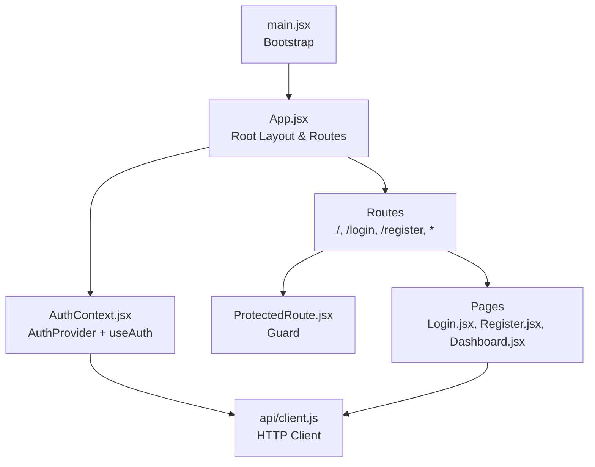
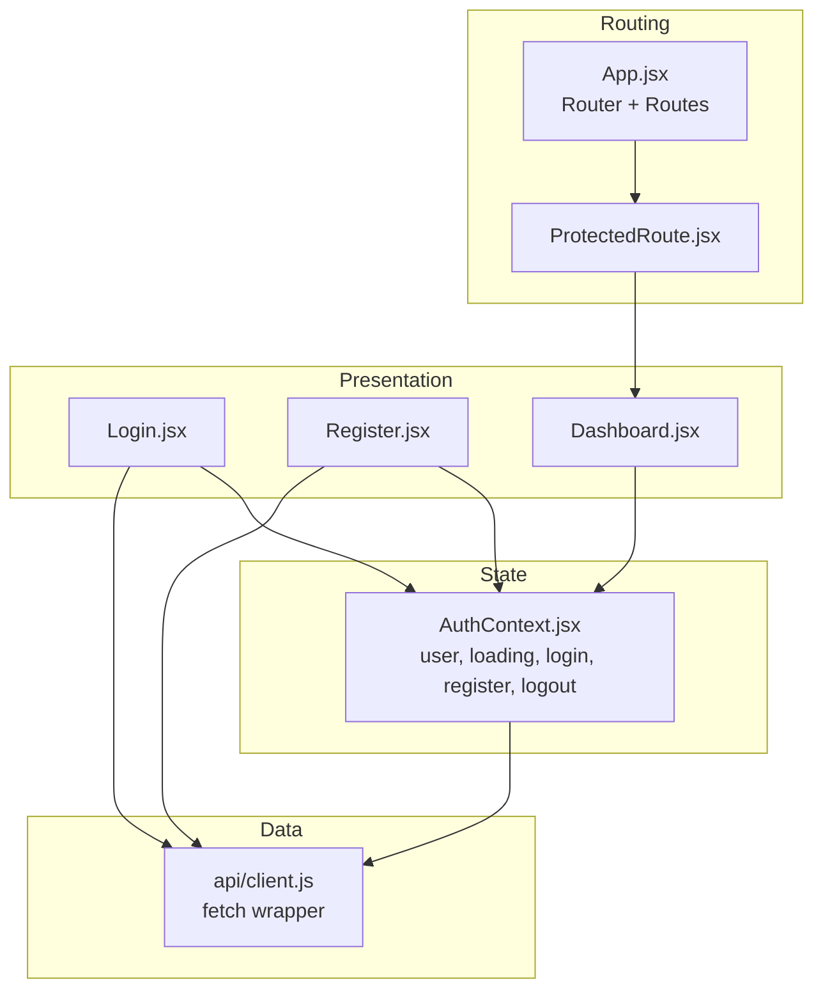
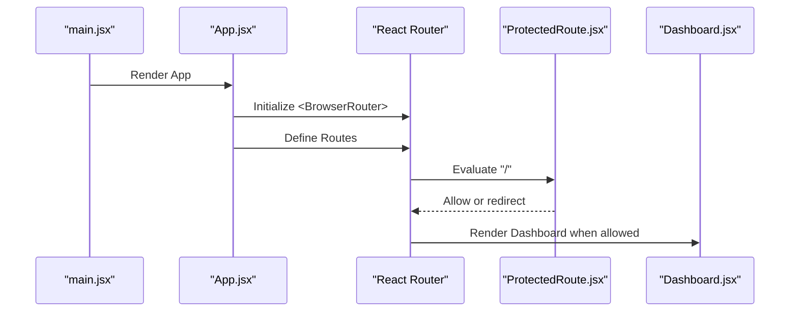
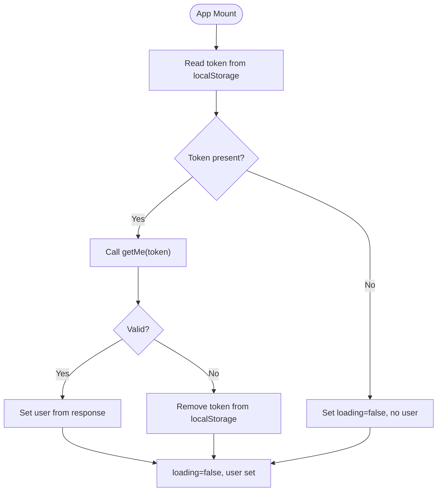
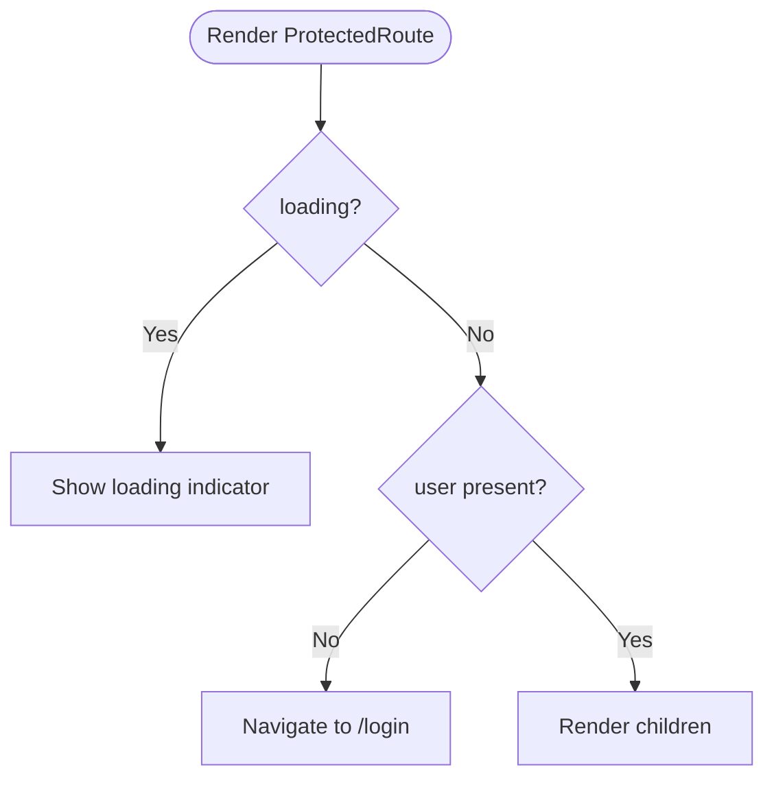
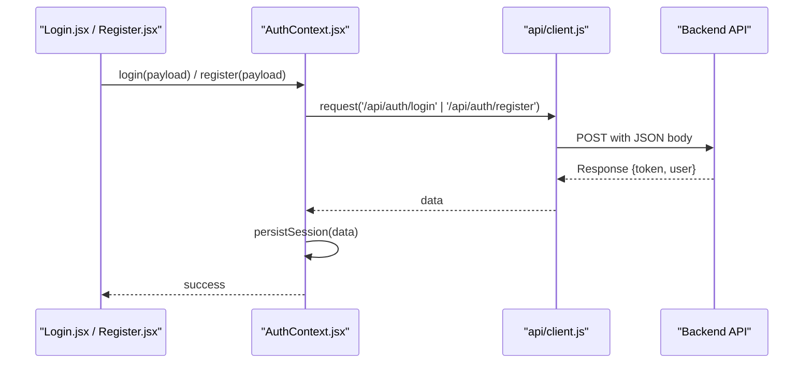
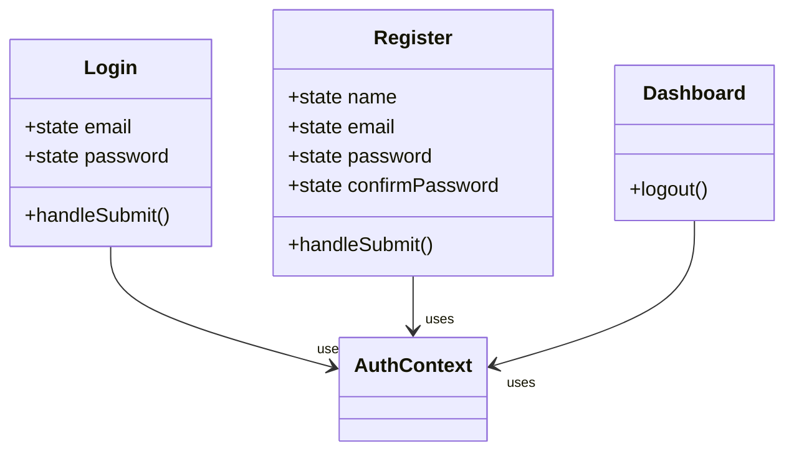
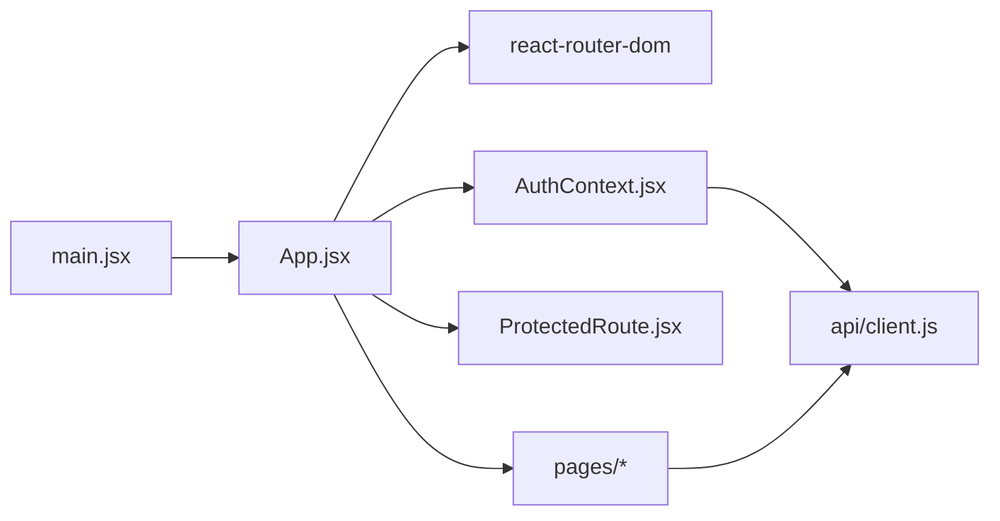

# Frontend Architecture

<cite>
**Referenced Files in This Document**
- [main.jsx](file://frontend/src/main.jsx)
- [App.jsx](file://frontend/src/App.jsx)
- [AuthContext.jsx](file://frontend/src/context/AuthContext.jsx)
- [ProtectedRoute.jsx](file://frontend/src/components/ProtectedRoute.jsx)
- [Login.jsx](file://frontend/src/pages/Login.jsx)
- [Register.jsx](file://frontend/src/pages/Register.jsx)
- [Dashboard.jsx](file://frontend/src/pages/Dashboard.jsx)
- [client.js](file://frontend/src/api/client.js)
- [package.json](file://frontend/package.json)
- [vite.config.js](file://frontend/vite.config.js)
- [vercel.json](file://frontend/vercel.json)
</cite>

## Table of Contents
1. [Introduction](#introduction)
2. [Project Structure](#project-structure)
3. [Core Components](#core-components)
4. [Architecture Overview](#architecture-overview)
5. [Detailed Component Analysis](#detailed-component-analysis)
6. [Dependency Analysis](#dependency-analysis)
7. [Performance Considerations](#performance-considerations)
8. [Troubleshooting Guide](#troubleshooting-guide)
9. [Conclusion](#conclusion)

## Introduction
This document describes the React frontend architecture for a MERN-based authentication application. It explains how the app bootstraps, configures routing with React Router, manages authenticated state via Context API, and integrates with the backend through a centralized API client. It also covers build configuration with Vite and static site generation for Vercel deployment, including client-side routing and protected route behavior.

## Project Structure
The frontend is organized by feature and responsibility:
- Application bootstrap and root layout
- Routing configuration
- Authentication context and provider
- Protected route component
- Page components for login, register, and dashboard
- Centralized API client for HTTP requests
- Build and deployment configuration

**Diagram sources**
- [main.jsx:1-11](file://frontend/src/main.jsx#L1-L11)
- [App.jsx:1-29](file://frontend/src/App.jsx#L1-L29)
- [AuthContext.jsx:1-73](file://frontend/src/context/AuthContext.jsx#L1-L73)
- [ProtectedRoute.jsx:1-17](file://frontend/src/components/ProtectedRoute.jsx#L1-L17)
- [Login.jsx:1-73](file://frontend/src/pages/Login.jsx#L1-L73)
- [Register.jsx:1-105](file://frontend/src/pages/Register.jsx#L1-L105)
- [Dashboard.jsx:1-43](file://frontend/src/pages/Dashboard.jsx#L1-L43)
- [client.js:1-33](file://frontend/src/api/client.js#L1-L33)

**Section sources**
- [main.jsx:1-11](file://frontend/src/main.jsx#L1-L11)
- [App.jsx:1-29](file://frontend/src/App.jsx#L1-L29)

## Core Components
- Bootstrap entry point mounts the React tree under the root DOM node and wraps the app in StrictMode.
- Root App component sets up React Router, wraps all routes with the AuthProvider, and defines public and protected routes.
- AuthContext provides user state, loading state, and actions (login, register, logout), persisting the token to localStorage and validating sessions on mount.
- ProtectedRoute guards routes by checking authentication state and redirects unauthenticated users.
- Pages implement UI and orchestrate calls to the API client via the auth context.
- API client centralizes fetch logic, headers, error handling, and exposes typed endpoints for registration, login, and profile retrieval.

**Section sources**
- [main.jsx:1-11](file://frontend/src/main.jsx#L1-L11)
- [App.jsx:1-29](file://frontend/src/App.jsx#L1-L29)
- [AuthContext.jsx:1-73](file://frontend/src/context/AuthContext.jsx#L1-L73)
- [ProtectedRoute.jsx:1-17](file://frontend/src/components/ProtectedRoute.jsx#L1-L17)
- [client.js:1-33](file://frontend/src/api/client.js#L1-L33)

## Architecture Overview
The application follows a layered approach:
- Presentation layer: page components render UI and handle user interactions.
- State layer: AuthContext holds global authentication state and lifecycle.
- Data layer: API client encapsulates HTTP communication with the backend.
- Routing layer: React Router handles navigation and route protection.

**Diagram sources**
- [App.jsx:1-29](file://frontend/src/App.jsx#L1-L29)
- [ProtectedRoute.jsx:1-17](file://frontend/src/components/ProtectedRoute.jsx#L1-L17)
- [AuthContext.jsx:1-73](file://frontend/src/context/AuthContext.jsx#L1-L73)
- [Login.jsx:1-73](file://frontend/src/pages/Login.jsx#L1-L73)
- [Register.jsx:1-105](file://frontend/src/pages/Register.jsx#L1-L105)
- [Dashboard.jsx:1-43](file://frontend/src/pages/Dashboard.jsx#L1-L43)
- [client.js:1-33](file://frontend/src/api/client.js#L1-L33)

## Detailed Component Analysis

### Application Bootstrap and Root Layout
- The bootstrap file creates the root DOM container and renders the App component inside React.StrictMode.
- The App component initializes BrowserRouter, wraps the app with AuthProvider, and declares routes:
  - Protected root route rendering Dashboard behind a guard.
  - Public routes for Login and Register.
  - A catch-all route that redirects to the root.

**Diagram sources**
- [main.jsx:1-11](file://frontend/src/main.jsx#L1-L11)
- [App.jsx:1-29](file://frontend/src/App.jsx#L1-L29)
- [ProtectedRoute.jsx:1-17](file://frontend/src/components/ProtectedRoute.jsx#L1-L17)
- [Dashboard.jsx:1-43](file://frontend/src/pages/Dashboard.jsx#L1-L43)

**Section sources**
- [main.jsx:1-11](file://frontend/src/main.jsx#L1-L11)
- [App.jsx:1-29](file://frontend/src/App.jsx#L1-L29)

### Routing Configuration and Client-Side Navigation
- Uses react-router-dom v6 with declarative Routes and programmatic navigation via useNavigate.
- Public routes are accessible without authentication; the root route is protected.
- A wildcard route ensures unknown paths redirect to the root.

Key behaviors:
- Redirects after successful login/register navigate to the root.
- Unauthenticated access to protected routes redirects to login.

**Section sources**
- [App.jsx:1-29](file://frontend/src/App.jsx#L1-L29)
- [Login.jsx:1-73](file://frontend/src/pages/Login.jsx#L1-L73)
- [Register.jsx:1-105](file://frontend/src/pages/Register.jsx#L1-L105)

### Authentication State Management with Context API
- AuthProvider maintains user and loading states, persists the JWT token in localStorage, and validates the session on mount by calling the profile endpoint.
- Provides login, register, and logout functions that update both local storage and React state.
- Exposes a custom hook useAuth for consuming state and actions across components.

**Diagram sources**
- [AuthContext.jsx:1-73](file://frontend/src/context/AuthContext.jsx#L1-L73)
- [client.js:1-33](file://frontend/src/api/client.js#L1-L33)

**Section sources**
- [AuthContext.jsx:1-73](file://frontend/src/context/AuthContext.jsx#L1-L73)

### Protected Route Implementation
- ProtectedRoute reads user and loading from AuthContext.
- While loading, it shows a placeholder.
- If no user is present, it redirects to the login route.
- Otherwise, it renders the protected child component.

**Diagram sources**
- [ProtectedRoute.jsx:1-17](file://frontend/src/components/ProtectedRoute.jsx#L1-L17)
- [AuthContext.jsx:1-73](file://frontend/src/context/AuthContext.jsx#L1-L73)

**Section sources**
- [ProtectedRoute.jsx:1-17](file://frontend/src/components/ProtectedRoute.jsx#L1-L17)

### API Client Integration
- The API client centralizes fetch calls, base URL resolution, JSON serialization, and error handling.
- It supports optional Authorization headers using a Bearer token.
- Endpoints exposed:
  - Registration
  - Login
  - Profile retrieval (getMe)

**Diagram sources**
- [Login.jsx:1-73](file://frontend/src/pages/Login.jsx#L1-L73)
- [Register.jsx:1-105](file://frontend/src/pages/Register.jsx#L1-L105)
- [AuthContext.jsx:1-73](file://frontend/src/context/AuthContext.jsx#L1-L73)
- [client.js:1-33](file://frontend/src/api/client.js#L1-L33)

**Section sources**
- [client.js:1-33](file://frontend/src/api/client.js#L1-L33)

### Page Components
- Login: collects credentials, calls login via context, navigates to root on success, displays errors.
- Register: validates password confirmation, calls register via context, navigates to root on success, displays errors.
- Dashboard: displays user profile information and provides logout action.

**Diagram sources**
- [Login.jsx:1-73](file://frontend/src/pages/Login.jsx#L1-L73)
- [Register.jsx:1-105](file://frontend/src/pages/Register.jsx#L1-L105)
- [Dashboard.jsx:1-43](file://frontend/src/pages/Dashboard.jsx#L1-L43)
- [AuthContext.jsx:1-73](file://frontend/src/context/AuthContext.jsx#L1-L73)

**Section sources**
- [Login.jsx:1-73](file://frontend/src/pages/Login.jsx#L1-L73)
- [Register.jsx:1-105](file://frontend/src/pages/Register.jsx#L1-L105)
- [Dashboard.jsx:1-43](file://frontend/src/pages/Dashboard.jsx#L1-L43)

## Dependency Analysis
The following diagram maps key dependencies between modules:

**Diagram sources**
- [main.jsx:1-11](file://frontend/src/main.jsx#L1-L11)
- [App.jsx:1-29](file://frontend/src/App.jsx#L1-L29)
- [AuthContext.jsx:1-73](file://frontend/src/context/AuthContext.jsx#L1-L73)
- [ProtectedRoute.jsx:1-17](file://frontend/src/components/ProtectedRoute.jsx#L1-L17)
- [client.js:1-33](file://frontend/src/api/client.js#L1-L33)

**Section sources**
- [App.jsx:1-29](file://frontend/src/App.jsx#L1-L29)
- [AuthContext.jsx:1-73](file://frontend/src/context/AuthContext.jsx#L1-L73)
- [client.js:1-33](file://frontend/src/api/client.js#L1-L33)

## Performance Considerations
- Minimize re-renders by memoizing context value where appropriate.
- Avoid unnecessary network calls by caching user data in memory and only refreshing on explicit actions or token changes.
- Use Suspense boundaries and loading indicators around async operations to improve perceived performance.
- Keep API client responses minimal and avoid large payloads in tokens or user objects.

[No sources needed since this section provides general guidance]

## Troubleshooting Guide
Common issues and resolutions:
- Cannot reach the server: The API client throws an error if fetch fails; verify the backend is running and the base URL is correct.
- Token validation failures: On invalid token, the context clears stored token and resets user state; ensure the backend’s profile endpoint returns expected structure.
- Redirect loops: Ensure protected routes check loading state before redirecting and that login/register redirect to the root only after successful authentication.
- CORS or network errors: Confirm the backend allows cross-origin requests and that the environment variable for the API URL is set correctly.

**Section sources**
- [client.js:1-33](file://frontend/src/api/client.js#L1-L33)
- [AuthContext.jsx:1-73](file://frontend/src/context/AuthContext.jsx#L1-L73)

## Conclusion
The frontend uses a clear separation of concerns: pages focus on presentation, the context layer manages authentication state and persistence, the API client abstracts backend integration, and React Router handles navigation and route protection. The build pipeline is configured with Vite for development and production builds, and Vercel is configured for static site generation with client-side routing support. This architecture scales well for additional features while maintaining clarity and maintainability.

[No sources needed since this section summarizes without analyzing specific files]

## Appendices

### Build and Deployment Configuration
- Development server runs on a fixed port and uses the React plugin.
- Production build outputs to a dist directory.
- Vercel configuration specifies the build command, output directory, and rewrites to serve index.html for all routes to enable client-side routing.

**Section sources**
- [package.json:1-21](file://frontend/package.json#L1-L21)
- [vite.config.js:1-10](file://frontend/vite.config.js#L1-L10)
- [vercel.json:1-11](file://frontend/vercel.json#L1-L11)