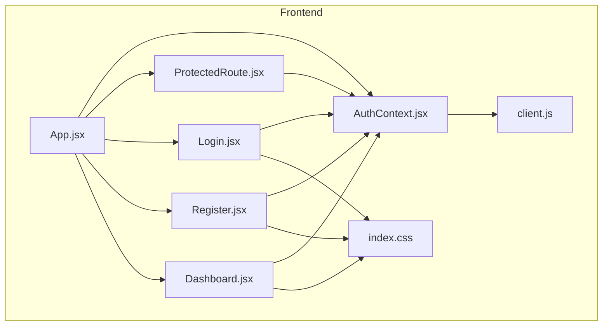
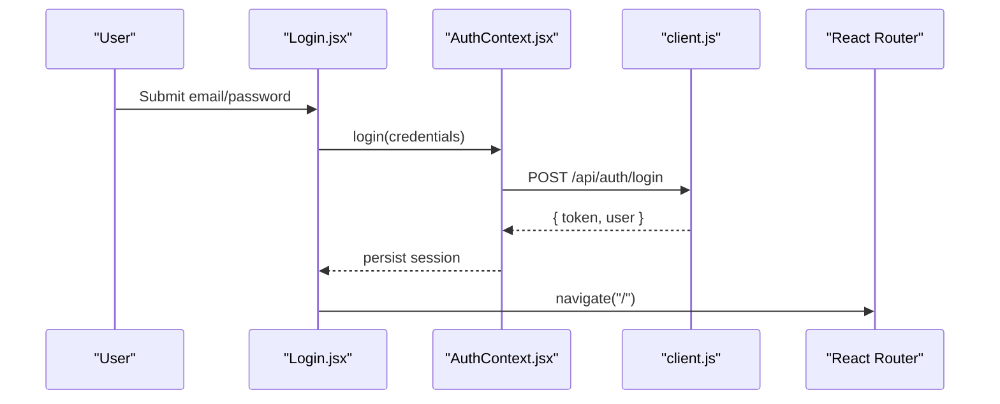
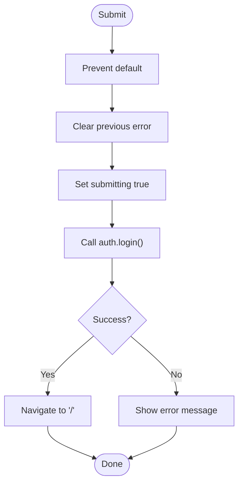
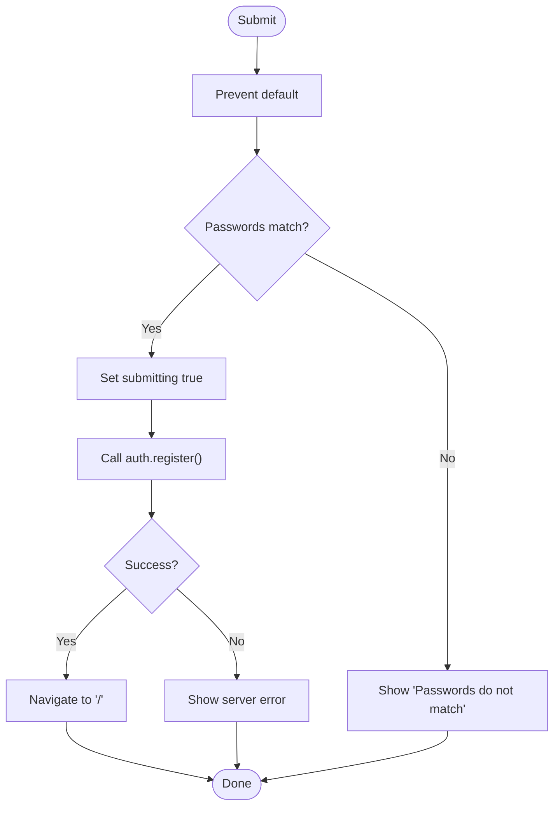
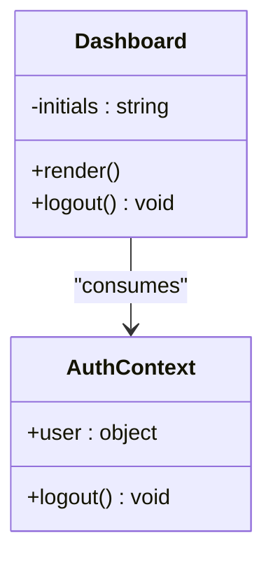
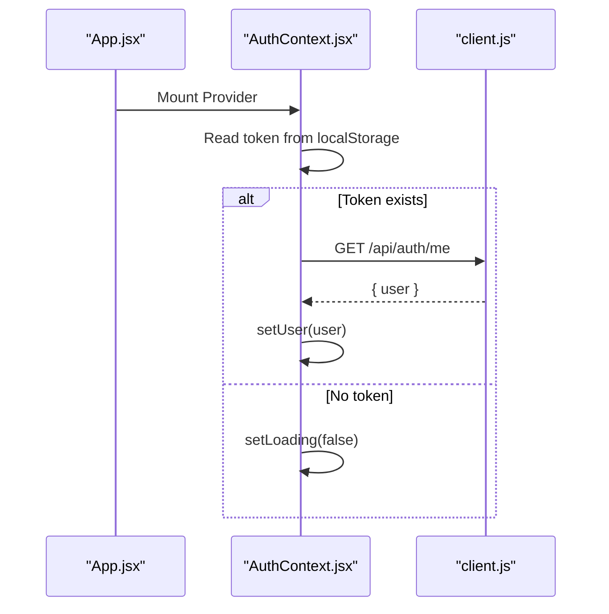
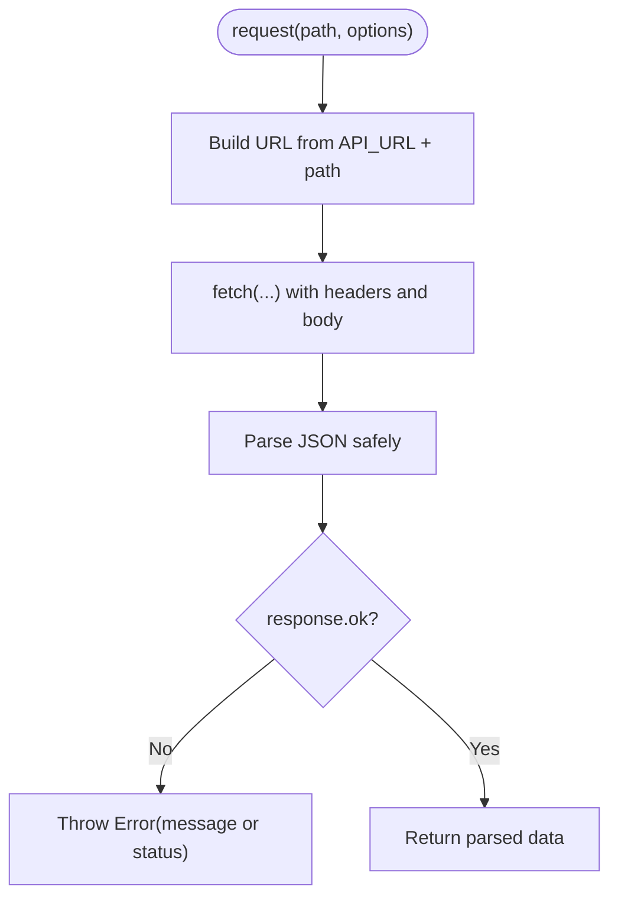
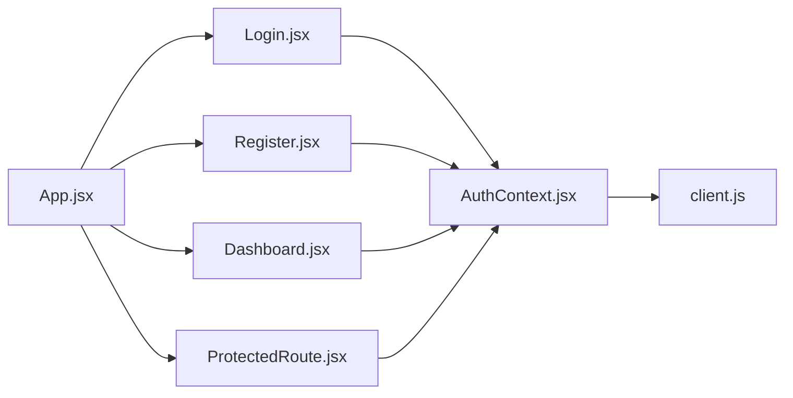

# UI Components

<cite>
**Referenced Files in This Document**
- [Login.jsx](file://frontend/src/pages/Login.jsx)
- [Register.jsx](file://frontend/src/pages/Register.jsx)
- [Dashboard.jsx](file://frontend/src/pages/Dashboard.jsx)
- [AuthContext.jsx](file://frontend/src/context/AuthContext.jsx)
- [client.js](file://frontend/src/api/client.js)
- [ProtectedRoute.jsx](file://frontend/src/components/ProtectedRoute.jsx)
- [App.jsx](file://frontend/src/App.jsx)
- [index.css](file://frontend/src/index.css)
</cite>

## Table of Contents
1. [Introduction](#introduction)
2. [Project Structure](#project-structure)
3. [Core Components](#core-components)
4. [Architecture Overview](#architecture-overview)
5. [Detailed Component Analysis](#detailed-component-analysis)
6. [Dependency Analysis](#dependency-analysis)
7. [Performance Considerations](#performance-considerations)
8. [Troubleshooting Guide](#troubleshooting-guide)
9. [Conclusion](#conclusion)

## Introduction
This document explains the React UI components for authentication and user dashboard: Login, Register, and Dashboard pages. It covers their visual appearance, form handling, validation patterns, user interaction flows, props and state usage, integration with the authentication context, and how they communicate with the backend API through a centralized client. It also includes diagrams to visualize architecture, data flow, and component relationships.

## Project Structure
The frontend is organized by feature and layer:
- Pages: Login, Register, Dashboard
- Context: AuthContext provides authentication state and actions
- API: Centralized HTTP client wrapping fetch
- Routing: App configures routes and protects authenticated routes
- Styles: Global CSS for consistent UI

**Diagram sources**
- [App.jsx:1-29](file://frontend/src/App.jsx#L1-L29)
- [AuthContext.jsx:1-73](file://frontend/src/context/AuthContext.jsx#L1-L73)
- [client.js:1-33](file://frontend/src/api/client.js#L1-L33)
- [ProtectedRoute.jsx:1-17](file://frontend/src/components/ProtectedRoute.jsx#L1-L17)
- [Login.jsx:1-73](file://frontend/src/pages/Login.jsx#L1-L73)
- [Register.jsx:1-105](file://frontend/src/pages/Register.jsx#L1-L105)
- [Dashboard.jsx:1-43](file://frontend/src/pages/Dashboard.jsx#L1-L43)
- [index.css:1-191](file://frontend/src/index.css#L1-L191)

**Section sources**
- [App.jsx:1-29](file://frontend/src/App.jsx#L1-L29)
- [index.css:1-191](file://frontend/src/index.css#L1-L191)

## Core Components
- Login page: Email/password login form with error display and navigation after success.
- Register page: Name/email/password/confirm password form with client-side validation and error display.
- Dashboard page: Displays user profile details and logout action.
- AuthContext: Provides user state, loading state, and login/register/logout functions; persists token.
- ProtectedRoute: Guards routes based on authentication state.
- API client: Centralized fetch wrapper with token injection and error normalization.

Key responsibilities:
- Forms collect input via controlled inputs and submit via async handlers.
- Errors are surfaced in an alert element above the form.
- Navigation uses react-router-dom’s Navigate and useNavigate.
- Authentication state is shared via context; protected routes redirect unauthenticated users.

**Section sources**
- [Login.jsx:1-73](file://frontend/src/pages/Login.jsx#L1-L73)
- [Register.jsx:1-105](file://frontend/src/pages/Register.jsx#L1-L105)
- [Dashboard.jsx:1-43](file://frontend/src/pages/Dashboard.jsx#L1-L43)
- [AuthContext.jsx:1-73](file://frontend/src/context/AuthContext.jsx#L1-L73)
- [ProtectedRoute.jsx:1-17](file://frontend/src/components/ProtectedRoute.jsx#L1-L17)
- [client.js:1-33](file://frontend/src/api/client.js#L1-L33)

## Architecture Overview
The UI follows a layered approach:
- Presentation layer (pages) renders forms and displays user data.
- State layer (AuthContext) manages authentication state and persistence.
- Data layer (API client) encapsulates HTTP requests and error handling.
- Routing layer (App + ProtectedRoute) controls access to protected resources.

**Diagram sources**
- [Login.jsx:17-30](file://frontend/src/pages/Login.jsx#L17-L30)
- [AuthContext.jsx:43-46](file://frontend/src/context/AuthContext.jsx#L43-L46)
- [client.js:28-31](file://frontend/src/api/client.js#L28-L31)

## Detailed Component Analysis

### Login Page
Visual appearance:
- Centered card layout with heading, subtitle, error alert, two inputs (email, password), submit button, and a link to register.
- Uses global styles from index.css for spacing, typography, focus states, and button gradients.

Form handling:
- Controlled inputs for email and password using useState.
- On submit, prevents default, clears previous errors, sets submitting flag, calls auth login, navigates to home on success, catches errors, and resets submitting.

Validation:
- HTML5 required attributes ensure non-empty fields.
- No additional client-side validation beyond browser defaults.

User interaction flow:
- If already logged in, redirects to home.
- Disables submit button while submitting to prevent duplicate requests.
- Shows server or network errors in the alert area.

Props and state:
- Props: none (uses context).
- State: email, password, error, submitting.

Integration with AuthContext:
- Consumes user and login via useAuth.
- On successful login, router navigates to root path.

Code examples (paths only):
- Form submission handler: [Login.jsx:17-30](file://frontend/src/pages/Login.jsx#L17-L30)
- Error display pattern: [Login.jsx:38](file://frontend/src/pages/Login.jsx#L38)
- Redirect when authenticated: [Login.jsx:13-15](file://frontend/src/pages/Login.jsx#L13-L15)

Responsive design considerations:
- Card width adapts to viewport with max-width and grid centering.
- Inputs and buttons scale with fluid spacing and font sizes defined in index.css.

**Diagram sources**
- [Login.jsx:17-30](file://frontend/src/pages/Login.jsx#L17-L30)

**Section sources**
- [Login.jsx:1-73](file://frontend/src/pages/Login.jsx#L1-L73)
- [index.css:20-135](file://frontend/src/index.css#L20-L135)

### Register Page
Visual appearance:
- Similar card layout with four inputs: name, email, password, confirm password.
- Includes a switch link to log in if already have an account.

Form handling:
- Controlled inputs for all fields.
- On submit, validates that password and confirm password match before calling register.
- Sets submitting flag, calls auth register, navigates to home on success, handles errors, and resets submitting.

Validation:
- Client-side check for matching passwords.
- Browser-level minLength and required constraints for password fields.

User interaction flow:
- Redirects to home if already authenticated.
- Disables submit during registration.
- Displays errors in the alert area.

Props and state:
- Props: none (uses context).
- State: name, email, password, confirmPassword, error, submitting.

Integration with AuthContext:
- Consumes user and register via useAuth.
- Persists token and user upon successful registration.

Code examples (paths only):
- Password match validation: [Register.jsx:23-26](file://frontend/src/pages/Register.jsx#L23-L26)
- Registration submission handler: [Register.jsx:19-38](file://frontend/src/pages/Register.jsx#L19-L38)
- Error display pattern: [Register.jsx:46](file://frontend/src/pages/Register.jsx#L46)

Responsive design considerations:
- Same responsive card and input styles as Login.

**Diagram sources**
- [Register.jsx:19-38](file://frontend/src/pages/Register.jsx#L19-L38)

**Section sources**
- [Register.jsx:1-105](file://frontend/src/pages/Register.jsx#L1-L105)
- [index.css:20-135](file://frontend/src/index.css#L20-L135)

### Dashboard Page
Visual appearance:
- Centered card with avatar initials, greeting, subtitle, profile details (name, email, member since), and a secondary logout button.

Data presentation:
- Computes avatar initials from user.name.
- Formats membership date using Date.toLocaleDateString.

User interaction flow:
- Calls logout from context to clear session and user state.

Props and state:
- Props: none (uses context).
- State: none locally; reads user from context.

Integration with AuthContext:
- Reads user and calls logout via useAuth.

Code examples (paths only):
- Avatar initials computation: [Dashboard.jsx:6-12](file://frontend/src/pages/Dashboard.jsx#L6-L12)
- Logout button handler: [Dashboard.jsx:36-38](file://frontend/src/pages/Dashboard.jsx#L36-L38)

Responsive design considerations:
- Profile rows stack vertically and adapt to card width.

**Diagram sources**
- [Dashboard.jsx:1-43](file://frontend/src/pages/Dashboard.jsx#L1-L43)
- [AuthContext.jsx:1-73](file://frontend/src/context/AuthContext.jsx#L1-L73)

**Section sources**
- [Dashboard.jsx:1-43](file://frontend/src/pages/Dashboard.jsx#L1-L43)
- [index.css:137-183](file://frontend/src/index.css#L137-L183)

### Authentication Context
Responsibilities:
- Initializes user state and loading state.
- Restores session on mount by fetching current user with stored token.
- Persists token to localStorage and updates user state on login/register.
- Exposes login, register, logout functions and user/loading state via context.

State management:
- user: current authenticated user or null.
- loading: indicates initial session restoration.

Integration points:
- Uses api client for login, register, getMe.
- Throws error if used outside provider.

Code examples (paths only):
- Session restoration effect: [AuthContext.jsx:12-36](file://frontend/src/context/AuthContext.jsx#L12-L36)
- Persist session helper: [AuthContext.jsx:38-41](file://frontend/src/context/AuthContext.jsx#L38-L41)
- Login/register/logout methods: [AuthContext.jsx:43-56](file://frontend/src/context/AuthContext.jsx#L43-L56)

**Diagram sources**
- [AuthContext.jsx:12-36](file://frontend/src/context/AuthContext.jsx#L12-L36)
- [client.js:28-31](file://frontend/src/api/client.js#L28-L31)

**Section sources**
- [AuthContext.jsx:1-73](file://frontend/src/context/AuthContext.jsx#L1-L73)

### API Client
Responsibilities:
- Centralizes fetch calls with configurable method, body, and optional token.
- Normalizes response errors into thrown Error objects with messages.
- Exposes typed endpoints: register, login, getMe.

Error handling:
- Network failures throw a generic “Cannot reach the server” error.
- Non-OK responses throw an error with server-provided message or status code.

Code examples (paths only):
- Request wrapper: [client.js:3-26](file://frontend/src/api/client.js#L3-L26)
- Endpoint definitions: [client.js:28-32](file://frontend/src/api/client.js#L28-L32)

**Diagram sources**
- [client.js:3-26](file://frontend/src/api/client.js#L3-L26)

**Section sources**
- [client.js:1-33](file://frontend/src/api/client.js#L1-L33)

### Protected Route
Responsibilities:
- Renders a loading indicator while authentication state initializes.
- Redirects unauthenticated users to login.
- Renders children when authenticated.

Integration:
- Uses useAuth to read user and loading.

Code examples (paths only):
- Guard logic: [ProtectedRoute.jsx:4-15](file://frontend/src/components/ProtectedRoute.jsx#L4-L15)

**Section sources**
- [ProtectedRoute.jsx:1-17](file://frontend/src/components/ProtectedRoute.jsx#L1-L17)

### App Routing
Responsibilities:
- Wraps application with Router and AuthProvider.
- Defines routes for home (protected), login, register, and wildcard redirect.

Code examples (paths only):
- Route configuration: [App.jsx:8-28](file://frontend/src/App.jsx#L8-L28)

**Section sources**
- [App.jsx:1-29](file://frontend/src/App.jsx#L1-L29)

## Dependency Analysis
Component and module dependencies:
- Pages depend on AuthContext for user state and actions.
- AuthContext depends on API client for HTTP operations.
- ProtectedRoute depends on AuthContext for guard logic.
- App composes Router, AuthProvider, and route elements.

**Diagram sources**
- [Login.jsx:1-73](file://frontend/src/pages/Login.jsx#L1-L73)
- [Register.jsx:1-105](file://frontend/src/pages/Register.jsx#L1-L105)
- [Dashboard.jsx:1-43](file://frontend/src/pages/Dashboard.jsx#L1-L43)
- [AuthContext.jsx:1-73](file://frontend/src/context/AuthContext.jsx#L1-L73)
- [client.js:1-33](file://frontend/src/api/client.js#L1-L33)
- [ProtectedRoute.jsx:1-17](file://frontend/src/components/ProtectedRoute.jsx#L1-L17)
- [App.jsx:1-29](file://frontend/src/App.jsx#L1-L29)

**Section sources**
- [App.jsx:1-29](file://frontend/src/App.jsx#L1-L29)
- [AuthContext.jsx:1-73](file://frontend/src/context/AuthContext.jsx#L1-L73)
- [client.js:1-33](file://frontend/src/api/client.js#L1-L33)

## Performance Considerations
- Minimize re-renders: AuthContext memoizes context value to avoid unnecessary updates.
- Avoid redundant network calls: Session restoration runs once on mount; tokens are persisted to avoid repeated logins.
- Debounce or throttle heavy operations if added later (e.g., search or analytics).
- Keep form state local to reduce context churn.

[No sources needed since this section provides general guidance]

## Troubleshooting Guide
Common issues and resolutions:
- Cannot reach the server:
  - Ensure backend is running and VITE_API_URL is correctly set.
  - The client throws a specific error when fetch fails.
  - Reference: [client.js:15-17](file://frontend/src/api/client.js#L15-L17)
- Invalid credentials or server errors:
  - Errors returned from the backend are normalized and displayed in the alert area.
  - Reference: [client.js:19-23](file://frontend/src/api/client.js#L19-L23)
- Unauthenticated access:
  - ProtectedRoute redirects to login when no user is present.
  - Reference: [ProtectedRoute.jsx:7-13](file://frontend/src/components/ProtectedRoute.jsx#L7-L13)
- Stale session:
  - On startup, if token exists but getMe fails, token is removed and user cleared.
  - Reference: [AuthContext.jsx:21-31](file://frontend/src/context/AuthContext.jsx#L21-L31)

**Section sources**
- [client.js:15-23](file://frontend/src/api/client.js#L15-L23)
- [ProtectedRoute.jsx:7-13](file://frontend/src/components/ProtectedRoute.jsx#L7-L13)
- [AuthContext.jsx:21-31](file://frontend/src/context/AuthContext.jsx#L21-L31)

## Conclusion
The UI components implement a clean separation between presentation, state, and data layers. Login and Register handle form interactions with clear error feedback, while Dashboard presents user information and supports logout. AuthContext centralizes authentication state and persistence, and the API client standardizes HTTP communication. ProtectedRoute ensures secure access to the dashboard. The styling system provides a responsive, accessible experience across devices.

[No sources needed since this section summarizes without analyzing specific files]