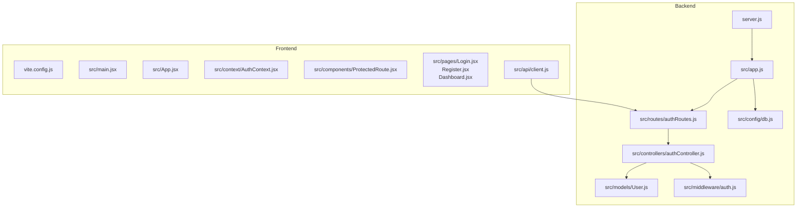

# Getting Started

<cite>
**Referenced Files in This Document**
- [README.md](file://README.md)
- [backend/package.json](file://backend/package.json)
- [frontend/package.json](file://frontend/package.json)
- [backend/server.js](file://backend/server.js)
- [frontend/vite.config.js](file://frontend/vite.config.js)
</cite>

## Table of Contents
1. [Introduction](#introduction)
2. [Prerequisites](#prerequisites)
3. [Project Structure](#project-structure)
4. [Installation](#installation)
5. [Environment Configuration](#environment-configuration)
6. [Local Development Setup](#local-development-setup)
7. [Initial Verification](#initial-verification)
8. [Troubleshooting](#troubleshooting)
9. [Next Steps](#next-steps)

## Introduction
This guide helps you set up and run the MERN Auth Application locally. The project consists of:
- A Node.js/Express backend API with MongoDB (Mongoose), JWT authentication, and bcrypt password hashing.
- A React + Vite frontend SPA that calls the backend to register, login, and access protected routes.

The two parts are intentionally separate so they can be developed and deployed independently.

## Prerequisites
Before starting, ensure your machine meets these requirements:
- Node.js version 20 or newer is installed.
- npm is available (comes with Node.js).
- MongoDB is running locally, or you have a free MongoDB Atlas cluster configured.
- Basic familiarity with terminal commands and environment variables.

You will also need a MongoDB connection string for local development or a hosted Atlas database.

**Section sources**
- [backend/package.json:11-13](file://backend/package.json#L11-L13)
- [README.md:44-65](file://README.md#L44-L65)

## Project Structure
At a high level:
- backend: Express server, routes, controllers, models, middleware, and configuration.
- frontend: React application built with Vite, including auth context, protected routes, and API client.

**Diagram sources**
- [backend/server.js:1-9](file://backend/server.js#L1-L9)
- [frontend/vite.config.js:1-10](file://frontend/vite.config.js#L1-L10)
- [README.md:10-32](file://README.md#L10-L32)

**Section sources**
- [README.md:10-32](file://README.md#L10-L32)

## Installation
Follow these steps to install dependencies for both backend and frontend.

1. Install backend dependencies:
   - Navigate to the backend directory.
   - Run the package manager install command.

2. Install frontend dependencies:
   - Navigate to the frontend directory.
   - Run the package manager install command.

These scripts are defined in each project’s package.json.

**Section sources**
- [backend/package.json:7-10](file://backend/package.json#L7-L10)
- [frontend/package.json:6-10](file://frontend/package.json#L6-L10)

## Environment Configuration
Create and configure environment files for both backend and frontend.

### Backend (.env)
Create a .env file in the backend directory with the following variables:
- MONGODB_URI: Required. Your MongoDB connection string (local or Atlas).
- JWT_SECRET: Required. A long random string used to sign tokens.
- CLIENT_ORIGIN: Optional. Comma-separated allowed origins; defaults to allow all if not set.
- PORT: Optional. Local port for the backend server; default is 5000.
- JWT_EXPIRES_IN: Optional. Token lifetime; default is 7 days.

Notes:
- Do not commit .env to version control.
- For production deployments (e.g., Vercel), set these variables in your hosting platform’s environment settings.

### Frontend (.env)
Create a .env file in the frontend directory with:
- VITE_API_URL: Set to your backend URL during local development (for example, http://localhost:5000).

Important:
- The frontend uses Vite environment variables prefixed with VITE_.
- Ensure there is no trailing slash on VITE_API_URL.

**Section sources**
- [README.md:55-65](file://README.md#L55-L65)
- [README.md:69-74](file://README.md#L69-L74)
- [backend/.gitignore:1-5](file://backend/.gitignore#L1-L5)
- [frontend/.gitignore:1-7](file://frontend/.gitignore#L1-L7)

## Local Development Setup
Run the backend and frontend servers locally.

### Start the Backend
1. Navigate to the backend directory.
2. Create the .env file as described above.
3. Install dependencies if you haven’t already.
4. Start the development server using the provided script.
5. The server listens on the configured port (default 5000).

Verification:
- Open http://localhost:5000/api/health in your browser or use curl to confirm it returns a success status.

### Start the Frontend
1. Navigate to the frontend directory.
2. Create the .env file with VITE_API_URL pointing to your backend URL.
3. Install dependencies if you haven’t already.
4. Start the development server using the provided script.
5. The dev server runs at http://localhost:5173 by default.

Notes:
- If you change the backend port, update VITE_API_URL accordingly.
- If CORS issues occur, ensure CLIENT_ORIGIN includes the frontend origin (for example, http://localhost:5173).

**Section sources**
- [README.md:44-74](file://README.md#L44-L74)
- [backend/server.js:1-9](file://backend/server.js#L1-L9)
- [frontend/vite.config.js:4-9](file://frontend/vite.config.js#L4-L9)

## Initial Verification
After starting both servers, verify the full flow:

1. Health check:
   - Call GET /api/health on the backend. It should return a success response.

2. Register a user:
   - Use the registration endpoint with name, email, and password.
   - Confirm you receive a token and user object.

3. Login:
   - Use the login endpoint with email and password.
   - Confirm you receive a token and user object.

4. Access protected route:
   - Include the Authorization header with the Bearer token.
   - Call GET /api/auth/me to retrieve the current user.

5. Frontend integration:
   - Visit http://localhost:5173.
   - Register or login via the UI.
   - Confirm you can access the dashboard after login.

API endpoints summary:
- POST /api/auth/register
- POST /api/auth/login
- GET /api/auth/me (requires Bearer token)
- GET /api/health

Error responses include a message field with appropriate HTTP status codes.

**Section sources**
- [README.md:76-85](file://README.md#L76-L85)

## Troubleshooting
Common issues and resolutions:

- Cannot connect to MongoDB:
  - Verify MONGODB_URI is correct and accessible from your machine.
  - If using Atlas, ensure network access allows your IP or 0.0.0.0/0 for local testing.

- CORS errors from the frontend:
  - Set CLIENT_ORIGIN in the backend .env to include the frontend origin (for example, http://localhost:5173).
  - Ensure VITE_API_URL points to the correct backend URL without a trailing slash.

- Port conflicts:
  - Change the backend PORT in .env if 5000 is already in use.
  - Update VITE_API_URL to match the new backend port.

- Token-related issues:
  - Ensure JWT_SECRET is set and consistent across environments.
  - Check that the Authorization header is sent as Bearer <token>.

- Environment variables not loading:
  - Confirm .env files exist in the correct directories and are not committed to version control.
  - Restart the servers after modifying .env files.

**Section sources**
- [README.md:55-65](file://README.md#L55-L65)
- [README.md:69-74](file://README.md#L69-L74)
- [backend/.gitignore:1-5](file://backend/.gitignore#L1-L5)
- [frontend/.gitignore:1-7](file://frontend/.gitignore#L1-L7)

## Next Steps
- Explore the API endpoints and test them with tools like Postman or curl.
- Customize authentication rules (password length, token expiry) by editing the relevant backend files.
- Deploy the backend and frontend separately to your preferred hosting platform (for example, Vercel), setting environment variables in the platform’s settings.

[No sources needed since this section provides general guidance]