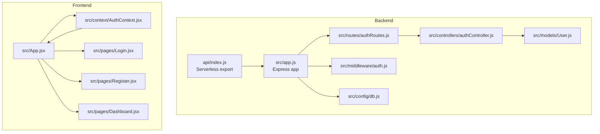
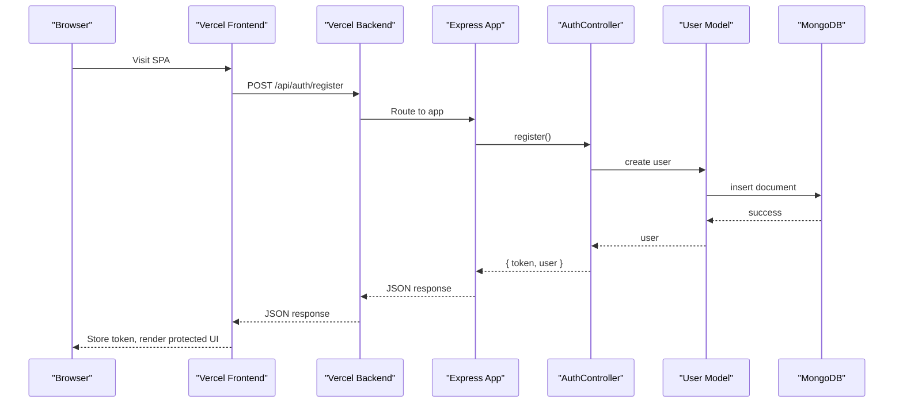
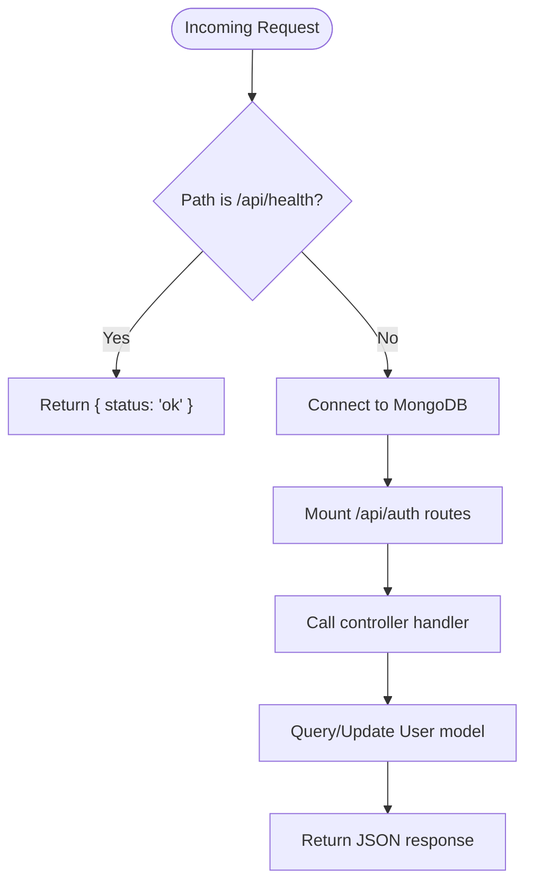
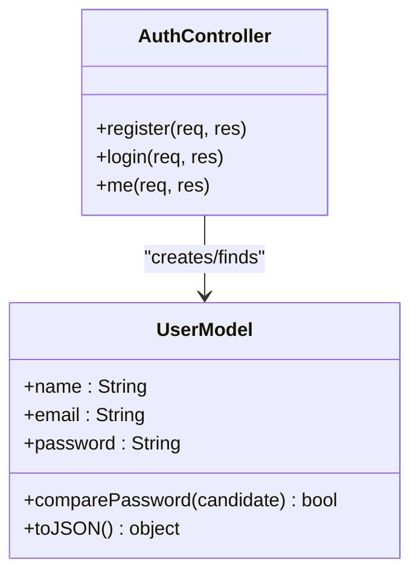
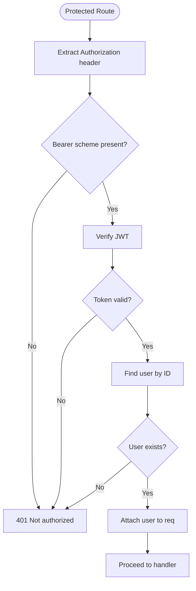
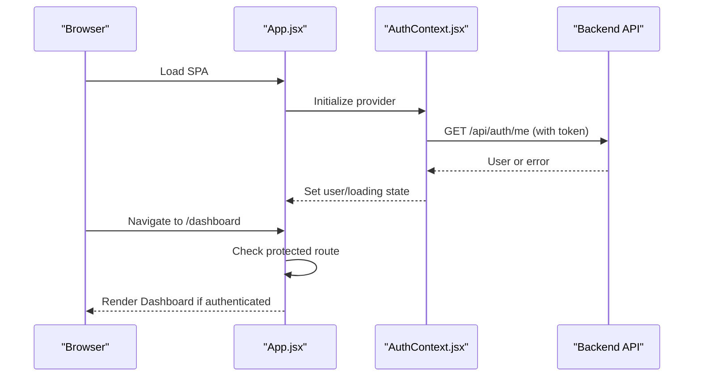
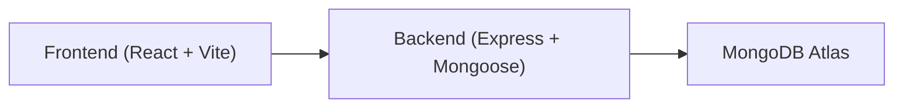

# Project Overview

<cite>
**Referenced Files in This Document**
- [README.md](file://README.md)
- [backend/package.json](file://backend/package.json)
- [frontend/package.json](file://frontend/package.json)
- [backend/src/app.js](file://backend/src/app.js)
- [backend/api/index.js](file://backend/api/index.js)
- [backend/src/controllers/authController.js](file://backend/src/controllers/authController.js)
- [backend/src/models/User.js](file://backend/src/models/User.js)
- [backend/src/middleware/auth.js](file://backend/src/middleware/auth.js)
- [frontend/src/App.jsx](file://frontend/src/App.jsx)
- [frontend/src/context/AuthContext.jsx](file://frontend/src/context/AuthContext.jsx)
</cite>

## Table of Contents
1. [Introduction](#introduction)
2. [Project Structure](#project-structure)
3. [Core Components](#core-components)
4. [Architecture Overview](#architecture-overview)
5. [Detailed Component Analysis](#detailed-component-analysis)
6. [Dependency Analysis](#dependency-analysis)
7. [Performance Considerations](#performance-considerations)
8. [Troubleshooting Guide](#troubleshooting-guide)
9. [Conclusion](#conclusion)

## Introduction
This project is a full-stack authentication application built with the MERN stack: MongoDB, Express.js, React, and Node.js. It provides user registration, login, JWT-based authentication, protected routes, and session management. The backend is an Express API designed to run serverless on Vercel, while the frontend is a React single-page application (SPA) deployed statically on Vercel. The two parts are intentionally separated so they can be deployed as independent Vercel projects.

Key capabilities include:
- User registration with name, email, and password validation
- Password hashing using bcrypt
- Login issuing a signed JWT with configurable expiry
- Protected route handling via bearer token verification
- Client-side session restoration from localStorage
- Basic error responses for common failure scenarios

**Section sources**
- [README.md:1-42](file://README.md#L1-L42)

## Project Structure
The repository contains two main applications:

- Backend (Express + MongoDB):
  - Serverless entry point exports the Express app
  - Central Express app configures CORS, JSON parsing, health check, database connection middleware, auth routes, and error handling
  - Controllers handle register/login/me endpoints
  - Models define the User schema with validation, hashing, and safe serialization
  - Middleware verifies JWTs and attaches the authenticated user to requests

- Frontend (React + Vite + React Router):
  - App defines routes for dashboard, login, and register
  - Auth context manages login/register/logout and restores sessions from localStorage
  - Pages implement UI for authentication flows and protected content

**Diagram sources**
- [backend/api/index.js:1-5](file://backend/api/index.js#L1-L5)
- [backend/src/app.js:1-56](file://backend/src/app.js#L1-L56)
- [backend/src/controllers/authController.js:1-74](file://backend/src/controllers/authController.js#L1-L74)
- [backend/src/models/User.js:1-50](file://backend/src/models/User.js#L1-L50)
- [backend/src/middleware/auth.js:1-24](file://backend/src/middleware/auth.js#L1-L24)
- [frontend/src/App.jsx:1-29](file://frontend/src/App.jsx#L1-L29)
- [frontend/src/context/AuthContext.jsx:1-73](file://frontend/src/context/AuthContext.jsx#L1-L73)

**Section sources**
- [README.md:10-32](file://README.md#L10-L32)
- [backend/package.json:1-23](file://backend/package.json#L1-L23)
- [frontend/package.json:1-21](file://frontend/package.json#L1-L21)

## Core Components
- Authentication API:
  - Register: validates inputs, hashes password, creates user, returns token and user
  - Login: validates credentials, issues JWT, returns token and user
  - Me: requires valid bearer token, returns current user
- Security:
  - Password hashing via bcrypt
  - JWT signing and verification with configurable secret and expiry
  - CORS configured by environment variable
- Session Management:
  - Token stored in localStorage
  - Frontend restores session on load and clears on logout
- Routing:
  - Backend routes under /api/auth
  - Frontend routes protect the dashboard and redirect unauthenticated users

**Section sources**
- [backend/src/controllers/authController.js:1-74](file://backend/src/controllers/authController.js#L1-L74)
- [backend/src/models/User.js:1-50](file://backend/src/models/User.js#L1-L50)
- [backend/src/middleware/auth.js:1-24](file://backend/src/middleware/auth.js#L1-L24)
- [frontend/src/context/AuthContext.jsx:1-73](file://frontend/src/context/AuthContext.jsx#L1-L73)
- [frontend/src/App.jsx:1-29](file://frontend/src/App.jsx#L1-L29)

## Architecture Overview
The system separates concerns between a serverless backend API and a static SPA frontend. Requests flow from the browser to the backend’s serverless function, which delegates to the Express app, then to controllers and models. Responses return JSON payloads including tokens or user data.

**Diagram sources**
- [backend/api/index.js:1-5](file://backend/api/index.js#L1-L5)
- [backend/src/app.js:1-56](file://backend/src/app.js#L1-L56)
- [backend/src/controllers/authController.js:1-74](file://backend/src/controllers/authController.js#L1-L74)
- [backend/src/models/User.js:1-50](file://backend/src/models/User.js#L1-L50)

## Detailed Component Analysis

### Backend API Layer
- Serverless entry point exports the Express app for Vercel functions
- Express app:
  - Configures CORS based on allowed origins
  - Parses JSON bodies
  - Provides a health endpoint
  - Ensures database connectivity before processing requests
  - Mounts authentication routes
  - Handles 404 and global errors

**Diagram sources**
- [backend/src/app.js:1-56](file://backend/src/app.js#L1-L56)

**Section sources**
- [backend/api/index.js:1-5](file://backend/api/index.js#L1-L5)
- [backend/src/app.js:1-56](file://backend/src/app.js#L1-L56)

### Authentication Controller and Model
- Controller:
  - Validates input fields and formats emails
  - Enforces minimum password length
  - Checks for duplicate accounts
  - Hashes passwords via model hooks
  - Issues JWTs with configurable expiry
  - Returns sanitized user objects without sensitive fields
- Model:
  - Defines schema with required fields, uniqueness, and validation rules
  - Pre-save hook hashes passwords
  - Method compares candidate passwords securely
  - Custom toJSON removes internal fields and exposes id

**Diagram sources**
- [backend/src/controllers/authController.js:1-74](file://backend/src/controllers/authController.js#L1-L74)
- [backend/src/models/User.js:1-50](file://backend/src/models/User.js#L1-L50)

**Section sources**
- [backend/src/controllers/authController.js:1-74](file://backend/src/controllers/authController.js#L1-L74)
- [backend/src/models/User.js:1-50](file://backend/src/models/User.js#L1-L50)

### Authorization Middleware
- Extracts bearer token from Authorization header
- Verifies token signature and payload
- Loads user by ID and attaches it to request
- Returns 401 for invalid or missing tokens

**Diagram sources**
- [backend/src/middleware/auth.js:1-24](file://backend/src/middleware/auth.js#L1-L24)

**Section sources**
- [backend/src/middleware/auth.js:1-24](file://backend/src/middleware/auth.js#L1-L24)

### Frontend Application and Session Management
- App component:
  - Wraps routes with AuthProvider
  - Protects dashboard route; redirects to login when not authenticated
  - Defines routes for login and register
- AuthContext:
  - Persists token in localStorage
  - Restores session on app load by calling me endpoint
  - Provides login, register, and logout methods
  - Manages loading state and user object

**Diagram sources**
- [frontend/src/App.jsx:1-29](file://frontend/src/App.jsx#L1-L29)
- [frontend/src/context/AuthContext.jsx:1-73](file://frontend/src/context/AuthContext.jsx#L1-L73)

**Section sources**
- [frontend/src/App.jsx:1-29](file://frontend/src/App.jsx#L1-L29)
- [frontend/src/context/AuthContext.jsx:1-73](file://frontend/src/context/AuthContext.jsx#L1-L73)

## Dependency Analysis
- Backend dependencies:
  - express: HTTP server and routing
  - cors: Cross-origin configuration
  - mongoose: MongoDB ODM
  - jsonwebtoken: JWT creation and verification
  - bcryptjs: Password hashing
  - dotenv: Environment variables
- Frontend dependencies:
  - react/react-dom: UI framework
  - react-router-dom: Client-side routing
  - vite: Build tooling

**Diagram sources**
- [backend/package.json:14-21](file://backend/package.json#L14-L21)
- [frontend/package.json:11-19](file://frontend/package.json#L11-L19)

**Section sources**
- [backend/package.json:1-23](file://backend/package.json#L1-L23)
- [frontend/package.json:1-21](file://frontend/package.json#L1-L21)

## Performance Considerations
- Serverless cold starts:
  - Database connection caching reduces latency on subsequent invocations
- Token lifecycle:
  - JWT expiry balances security and user convenience
- Input validation:
  - Early validation prevents unnecessary database operations
- CORS optimization:
  - Restricting allowed origins improves security and reduces overhead

[No sources needed since this section provides general guidance]

## Troubleshooting Guide
Common issues and resolutions:
- Invalid JSON body:
  - Ensure client sends properly formatted JSON
- Missing environment variables:
  - Configure MONGODB_URI, JWT_SECRET, CLIENT_ORIGIN, and VITE_API_URL appropriately
- CORS errors:
  - Set CLIENT_ORIGIN to the frontend’s deployed URL
- Authentication failures:
  - Verify token presence and validity; ensure JWT_SECRET matches between sign and verify
- Database connectivity:
  - Confirm network access rules in MongoDB Atlas allow Vercel IPs

**Section sources**
- [backend/src/app.js:43-53](file://backend/src/app.js#L43-L53)
- [backend/src/controllers/authController.js:19-50](file://backend/src/controllers/authController.js#L19-L50)
- [backend/src/middleware/auth.js:4-23](file://backend/src/middleware/auth.js#L4-L23)
- [README.md:55-64](file://README.md#L55-L64)
- [README.md:108-119](file://README.md#L108-L119)

## Conclusion
This MERN Auth application demonstrates a clean separation between a serverless Express API and a static React SPA. It implements secure user registration and login with JWT-based authorization, protects routes on both backend and frontend, and manages sessions through localStorage. Deployed on Vercel, the architecture scales efficiently while maintaining clear boundaries between frontend and backend responsibilities.

[No sources needed since this section summarizes without analyzing specific files]