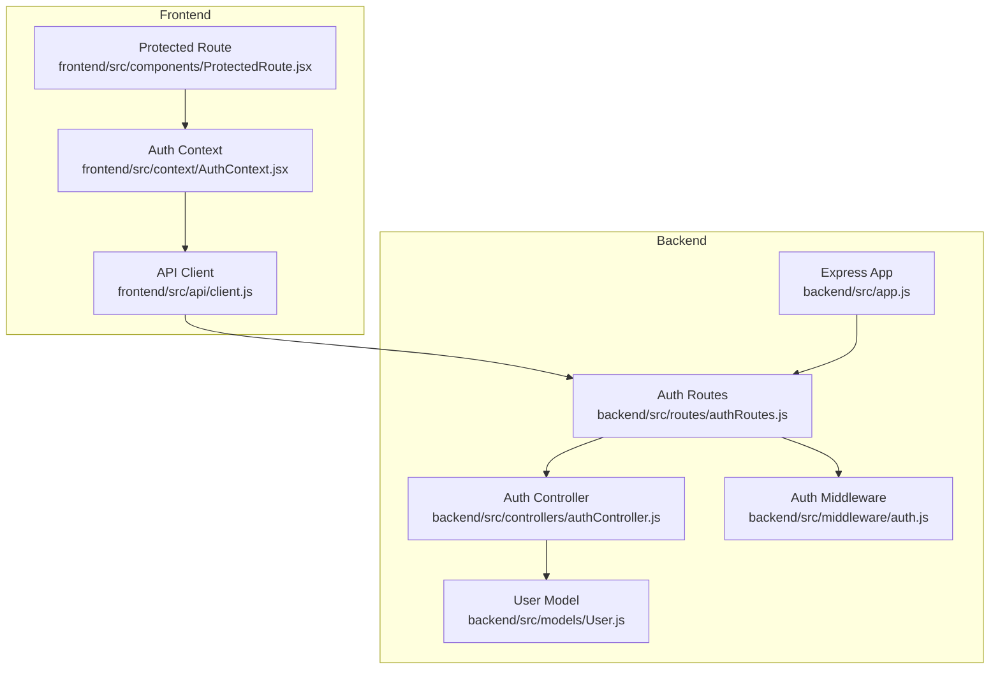
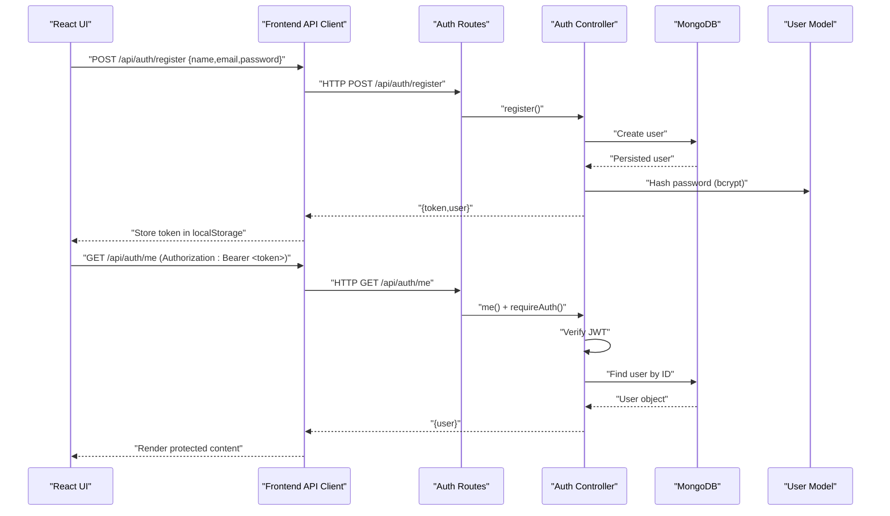
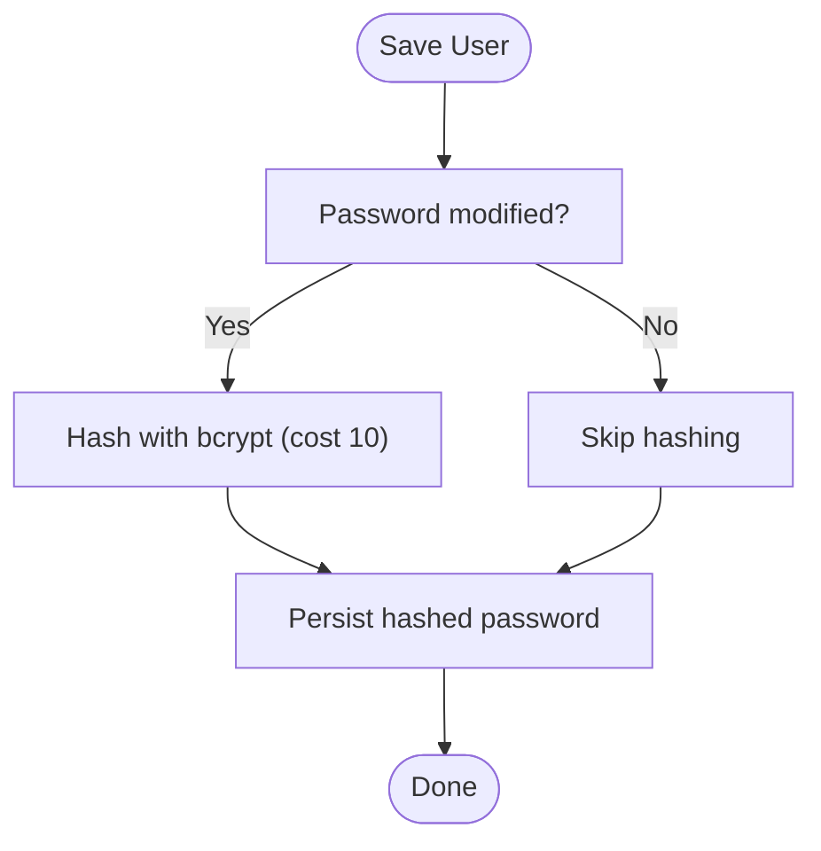
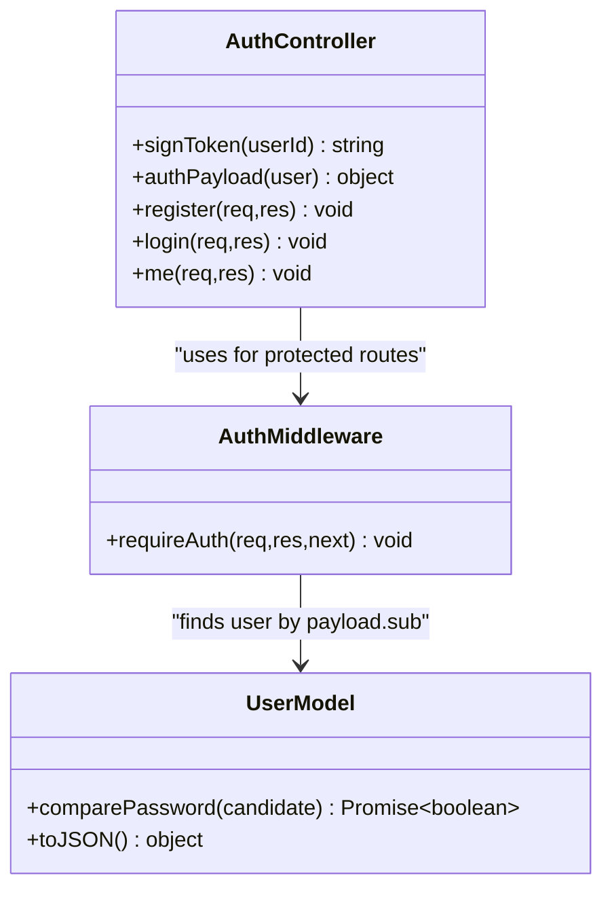
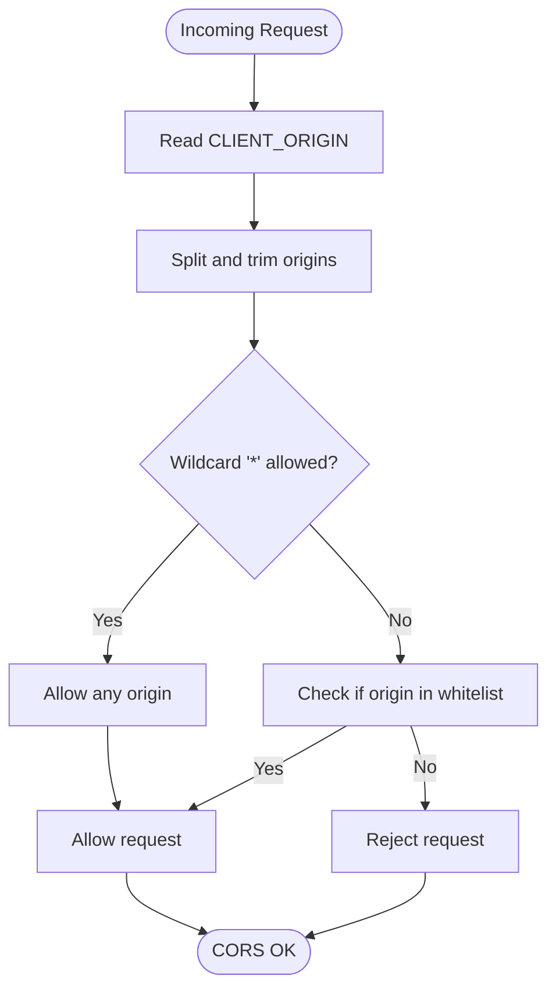
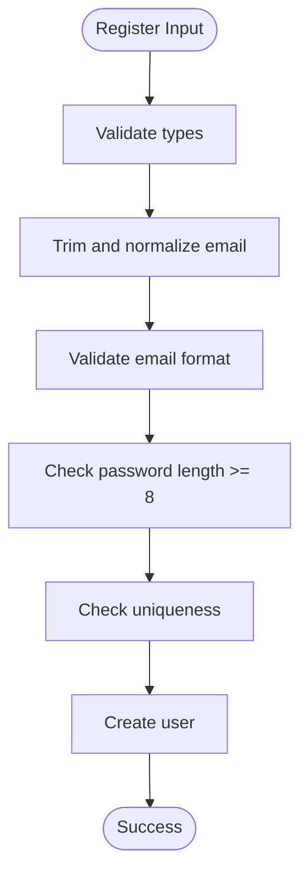
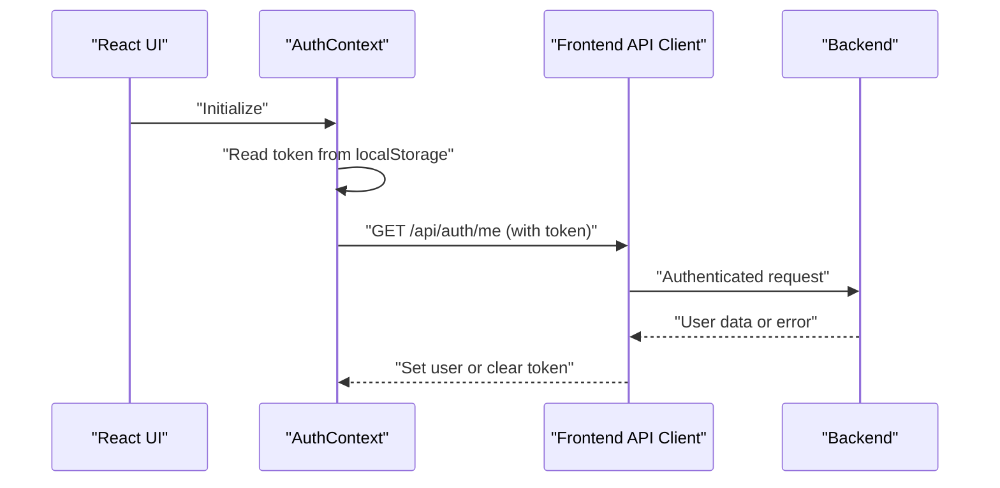
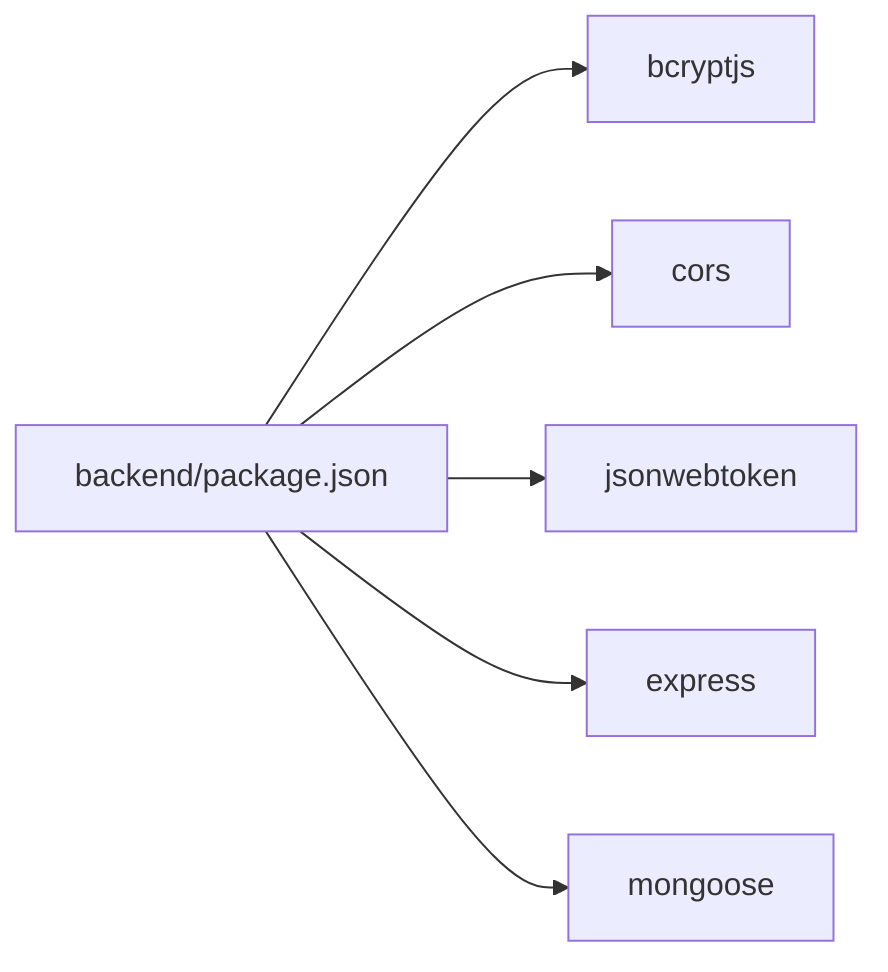

# Security Best Practices

<cite>
**Referenced Files in This Document**
- [app.js](file://backend/src/app.js)
- [authController.js](file://backend/src/controllers/authController.js)
- [auth.js](file://backend/src/middleware/auth.js)
- [User.js](file://backend/src/models/User.js)
- [authRoutes.js](file://backend/src/routes/authRoutes.js)
- [client.js](file://frontend/src/api/client.js)
- [AuthContext.jsx](file://frontend/src/context/AuthContext.jsx)
- [ProtectedRoute.jsx](file://frontend/src/components/ProtectedRoute.jsx)
- [package.json (backend)](file://backend/package.json)
- [package.json (frontend)](file://frontend/package.json)
</cite>

## Table of Contents
1. [Introduction](#introduction)
2. [Project Structure](#project-structure)
3. [Core Components](#core-components)
4. [Architecture Overview](#architecture-overview)
5. [Detailed Component Analysis](#detailed-component-analysis)
6. [Dependency Analysis](#dependency-analysis)
7. [Performance Considerations](#performance-considerations)
8. [Troubleshooting Guide](#troubleshooting-guide)
9. [Conclusion](#conclusion)

## Introduction
This document provides security best practices for the MERN authentication application, focusing on password hashing with bcrypt, JWT token security, CORS configuration, input validation and sanitization, environment variable handling, session management, and protection against common web vulnerabilities such as XSS and CSRF. It also includes guidance for secure development and production configurations.

## Project Structure
The backend is an Express API that handles user registration, login, and protected endpoints. The frontend is a React application that manages authentication state and routes.

**Diagram sources**
- [client.js:1-33](file://frontend/src/api/client.js#L1-L33)
- [AuthContext.jsx:1-73](file://frontend/src/context/AuthContext.jsx#L1-L73)
- [ProtectedRoute.jsx:1-17](file://frontend/src/components/ProtectedRoute.jsx#L1-L17)
- [app.js:1-56](file://backend/src/app.js#L1-L56)
- [authRoutes.js:1-13](file://backend/src/routes/authRoutes.js#L1-L13)
- [authController.js:1-74](file://backend/src/controllers/authController.js#L1-L74)
- [auth.js:1-24](file://backend/src/middleware/auth.js#L1-L24)
- [User.js:1-50](file://backend/src/models/User.js#L1-L50)

**Section sources**
- [app.js:1-56](file://backend/src/app.js#L1-L56)
- [authRoutes.js:1-13](file://backend/src/routes/authRoutes.js#L1-L13)
- [client.js:1-33](file://frontend/src/api/client.js#L1-L33)

## Core Components
- Password hashing: bcryptjs is used to hash passwords before persistence and compare them during login.
- Token issuance and verification: JSON Web Tokens are signed with a secret from environment variables and verified by middleware.
- CORS policy: A whitelist-based CORS configuration controls allowed origins.
- Input validation: Controllers and models validate and sanitize inputs.
- Session management: Frontend stores tokens in localStorage; backend validates tokens per request.

Key responsibilities:
- Backend app sets up CORS, JSON parsing, database connection, error handling, and mounts auth routes.
- Auth controller implements registration, login, and profile retrieval with input validation and token signing.
- Auth middleware verifies JWTs and attaches user context to requests.
- User model enforces schema constraints, hashes passwords, and excludes sensitive fields from serialization.
- Frontend client sends authenticated requests and centralizes API calls.
- Frontend context persists and restores sessions using localStorage.
- Protected route guards access based on authentication state.

**Section sources**
- [User.js:1-50](file://backend/src/models/User.js#L1-L50)
- [authController.js:1-74](file://backend/src/controllers/authController.js#L1-L74)
- [auth.js:1-24](file://backend/src/middleware/auth.js#L1-L24)
- [app.js:1-56](file://backend/src/app.js#L1-L56)
- [client.js:1-33](file://frontend/src/api/client.js#L1-L33)
- [AuthContext.jsx:1-73](file://frontend/src/context/AuthContext.jsx#L1-L73)
- [ProtectedRoute.jsx:1-17](file://frontend/src/components/ProtectedRoute.jsx#L1-L17)

## Architecture Overview
The authentication flow uses JWTs for stateless authorization. The frontend stores tokens in localStorage and sends them via Authorization headers. The backend validates tokens through middleware and returns user data only when valid.

**Diagram sources**
- [authRoutes.js:1-13](file://backend/src/routes/authRoutes.js#L1-L13)
- [authController.js:1-74](file://backend/src/controllers/authController.js#L1-L74)
- [auth.js:1-24](file://backend/src/middleware/auth.js#L1-L24)
- [User.js:1-50](file://backend/src/models/User.js#L1-L50)
- [client.js:1-33](file://frontend/src/api/client.js#L1-L33)

## Detailed Component Analysis

### Password Security with bcrypt
- Hashing strategy: Passwords are hashed using bcryptjs with a cost factor of 10 before being saved to the database.
- Comparison method: Login compares provided plaintext with stored hashes using bcrypt.compare.
- Serialization safety: The toJSON transform removes internal fields like _id, __v, and password from responses.

Recommendations:
- Keep the bcrypt cost factor at least 10; increase if performance allows.
- Ensure password fields are never logged or included in responses.
- Validate minimum length and complexity on both client and server.

**Diagram sources**
- [User.js:30-37](file://backend/src/models/User.js#L30-L37)

**Section sources**
- [User.js:1-50](file://backend/src/models/User.js#L1-L50)

### JWT Implementation and Token Security
- Signing: Tokens are signed with process.env.JWT_SECRET and include the user ID in the subject claim.
- Expiration: Tokens expire according to process.env.JWT_EXPIRES_IN, defaulting to seven days.
- Verification: Middleware verifies tokens using the same secret and loads the user by the subject claim.

Security considerations:
- Store JWT_SECRET in a secure environment variable manager; never commit secrets to source control.
- Use short-lived tokens and implement refresh strategies if needed.
- Validate token presence and scheme (Bearer) before processing requests.
- Avoid storing tokens in cookies without HttpOnly and Secure flags unless explicitly required.

**Diagram sources**
- [authController.js:6-17](file://backend/src/controllers/authController.js#L6-L17)
- [auth.js:4-23](file://backend/src/middleware/auth.js#L4-L23)
- [User.js:35-47](file://backend/src/models/User.js#L35-L47)

**Section sources**
- [authController.js:1-74](file://backend/src/controllers/authController.js#L1-L74)
- [auth.js:1-24](file://backend/src/middleware/auth.js#L1-L24)

### CORS Configuration for Cross-Origin Security
- Allowed origins are read from CLIENT_ORIGIN and split into a list.
- If CLIENT_ORIGIN contains '*', all origins are allowed; otherwise, only listed origins are permitted.
- The CORS middleware rejects requests from disallowed origins.

Best practices:
- In production, set CLIENT_ORIGIN to specific trusted domains.
- Avoid '*' in production to prevent unauthorized cross-origin access.
- Combine CORS with strict Content-Security-Policy and other headers where applicable.

**Diagram sources**
- [app.js:8-22](file://backend/src/app.js#L8-L22)

**Section sources**
- [app.js:1-56](file://backend/src/app.js#L1-L56)

### Input Validation and Sanitization
- Registration: Validates presence and types of name, email, and password; trims and normalizes email; checks minimum password length; ensures unique email.
- Login: Validates presence and types of email and password; normalizes email before lookup.
- Model-level validation: Enforces required fields, min/max lengths, lowercase normalization, and email format.

Recommendations:
- Add explicit password strength rules (uppercase, lowercase, digits, special characters).
- Implement rate limiting on authentication endpoints to mitigate brute-force attacks.
- Log minimal diagnostic information; avoid logging sensitive payloads.

**Diagram sources**
- [authController.js:19-51](file://backend/src/controllers/authController.js#L19-L51)
- [User.js:4-28](file://backend/src/models/User.js#L4-L28)

**Section sources**
- [authController.js:1-74](file://backend/src/controllers/authController.js#L1-L74)
- [User.js:1-50](file://backend/src/models/User.js#L1-L50)

### Data Protection and Serialization Safety
- Password exclusion: The toJSON transform deletes internal identifiers and the password field from serialized output.
- Selective field exposure: Only necessary user data is returned in responses.

Guidelines:
- Never log full user objects containing sensitive fields.
- Audit response shapes to ensure no accidental leakage of internal fields.

**Section sources**
- [User.js:39-47](file://backend/src/models/User.js#L39-L47)

### Environment Variables and Secret Management
- Required variables:
  - JWT_SECRET: Used to sign and verify JWTs.
  - JWT_EXPIRES_IN: Controls token expiration duration.
  - CLIENT_ORIGIN: Defines allowed CORS origins.
- Recommendations:
  - Use a secrets manager or platform-provided environment configuration.
  - Rotate secrets periodically and invalidate existing tokens upon rotation.
  - Do not hardcode secrets in code or commit them to repositories.

**Section sources**
- [authController.js:6-12](file://backend/src/controllers/authController.js#L6-L12)
- [auth.js:12-13](file://backend/src/middleware/auth.js#L12-L13)
- [app.js:8-11](file://backend/src/app.js#L8-L11)

### Session Management
- Frontend storage: Tokens are stored in localStorage under a fixed key.
- Session restoration: On app load, the frontend retrieves the token and validates it via the backend.
- Logout: Clears the stored token and resets user state.

Security notes:
- localStorage is vulnerable to XSS; ensure robust input sanitization and CSP to mitigate XSS risks.
- Consider HttpOnly cookies for tokens if you can manage CSRF protections on the backend.

**Diagram sources**
- [AuthContext.jsx:12-36](file://frontend/src/context/AuthContext.jsx#L12-L36)
- [client.js:28-32](file://frontend/src/api/client.js#L28-L32)

**Section sources**
- [AuthContext.jsx:1-73](file://frontend/src/context/AuthContext.jsx#L1-L73)
- [client.js:1-33](file://frontend/src/api/client.js#L1-L33)

### Protection Against Common Web Vulnerabilities
- XSS prevention:
  - Sanitize and escape user-generated content on the frontend.
  - Set appropriate Content-Security-Policy headers on the backend.
  - Avoid storing tokens in localStorage if possible; prefer HttpOnly cookies.
- CSRF mitigation:
  - If using cookies for tokens, implement SameSite cookie attributes and CSRF tokens or double-submit cookies.
  - For bearer tokens, rely on CORS and strict origin checks.
- Brute-force protection:
  - Implement rate limiting on login and register endpoints.
  - Consider account lockout policies after repeated failures.

[No sources needed since this section provides general guidance]

## Dependency Analysis
External dependencies relevant to security:
- bcryptjs: Password hashing library.
- cors: Cross-origin resource sharing middleware.
- jsonwebtoken: JWT signing and verification.
- express: Web framework.
- mongoose: MongoDB ODM.

**Diagram sources**
- [package.json (backend):14-21](file://backend/package.json#L14-L21)

**Section sources**
- [package.json (backend):1-23](file://backend/package.json#L1-L23)

## Performance Considerations
- bcrypt cost factor: Higher values improve security but increase CPU usage; tune based on server capacity.
- Database queries: Minimize unnecessary selects and use indexes for frequently queried fields like email.
- Token verification: Keep JWT payloads small; avoid embedding large user objects in tokens.

[No sources needed since this section provides general guidance]

## Troubleshooting Guide
Common issues and resolutions:
- Invalid JSON body: The backend returns a 400 error when request bodies are malformed.
- Not authorized: Occurs when Authorization header is missing, malformed, or token is invalid/expired.
- Not found: Returned for unmatched routes.

Debugging steps:
- Verify environment variables are correctly set (JWT_SECRET, JWT_EXPIRES_IN, CLIENT_ORIGIN).
- Check CORS settings if cross-origin requests fail.
- Inspect network logs for token presence and correct Authorization header format.

**Section sources**
- [app.js:43-53](file://backend/src/app.js#L43-L53)
- [auth.js:4-23](file://backend/src/middleware/auth.js#L4-L23)

## Conclusion
This application implements core security practices including bcrypt password hashing, JWT-based authentication with environment-managed secrets, CORS whitelisting, and input validation. To further strengthen security:
- Enforce stricter password policies and add rate limiting.
- Adopt HttpOnly cookies with CSRF protections where feasible.
- Apply comprehensive CSP and sanitize all user inputs.
- Regularly rotate secrets and audit dependency versions.

[No sources needed since this section summarizes without analyzing specific files]