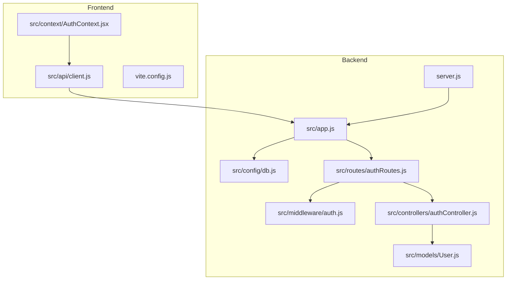
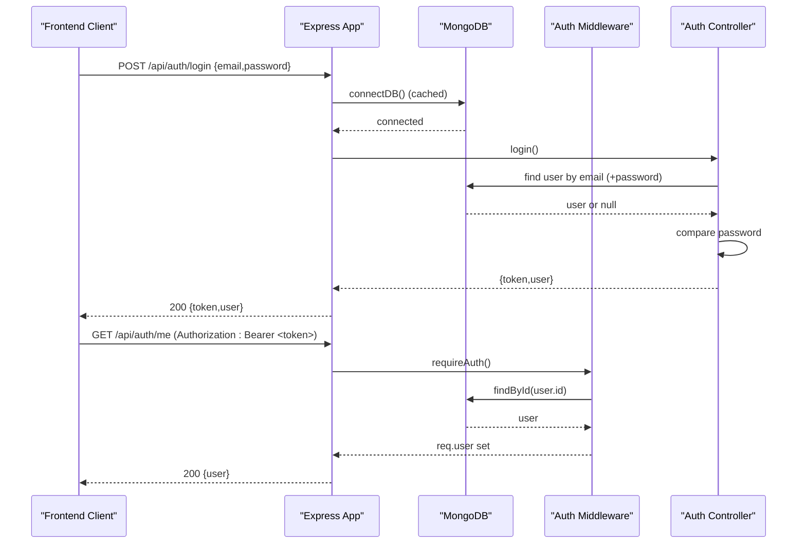
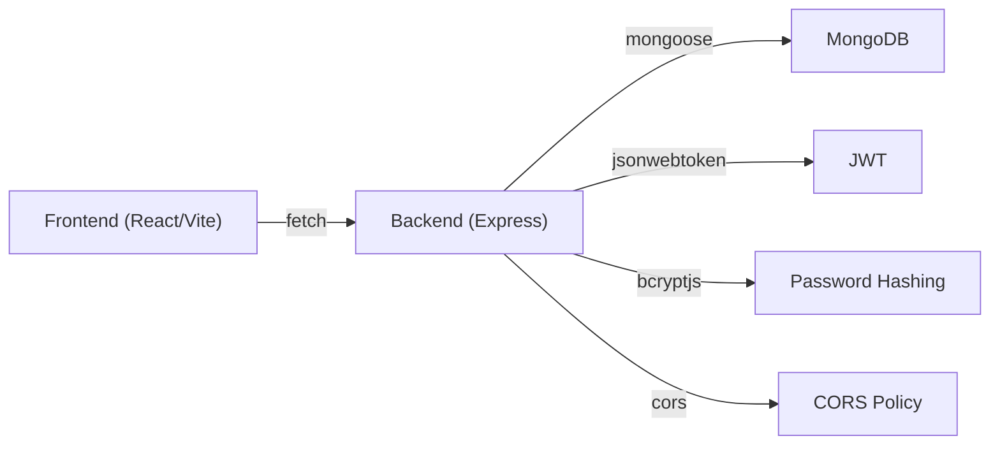
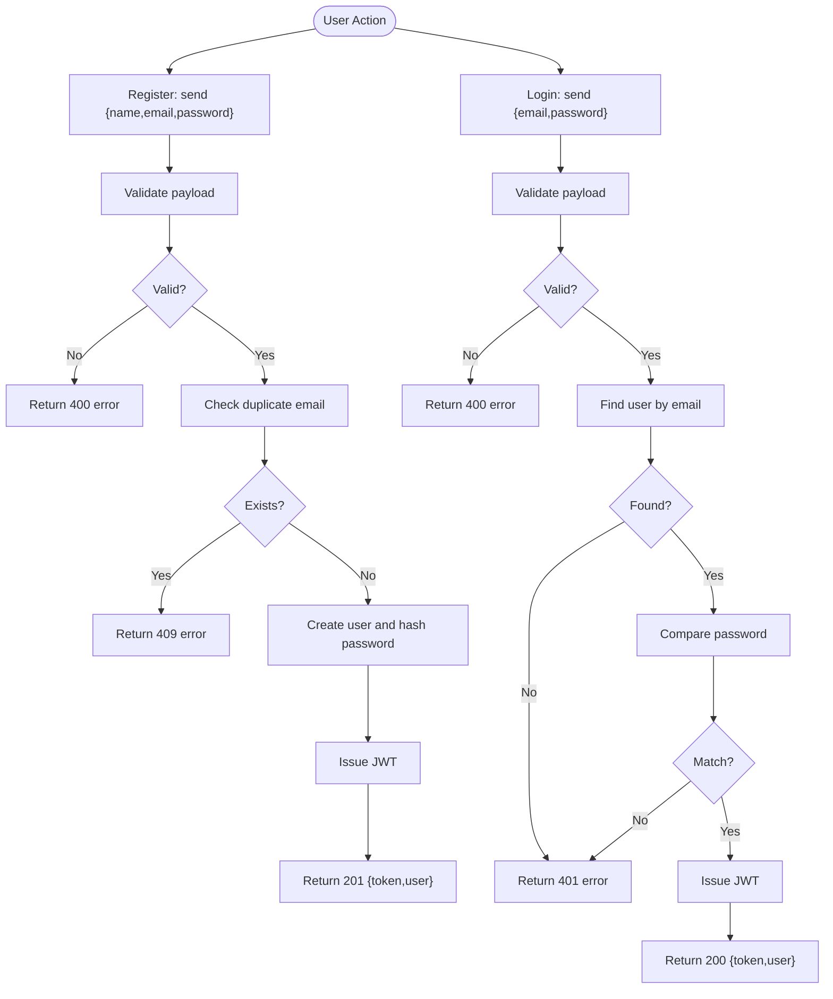

# Troubleshooting & FAQ

<cite>
**Referenced Files in This Document**
- [README.md](file://README.md)
- [backend/package.json](file://backend/package.json)
- [frontend/package.json](file://frontend/package.json)
- [backend/server.js](file://backend/server.js)
- [backend/src/app.js](file://backend/src/app.js)
- [backend/src/config/db.js](file://backend/src/config/db.js)
- [backend/src/controllers/authController.js](file://backend/src/controllers/authController.js)
- [backend/src/middleware/auth.js](file://backend/src/middleware/auth.js)
- [backend/src/models/User.js](file://backend/src/models/User.js)
- [backend/src/routes/authRoutes.js](file://backend/src/routes/authRoutes.js)
- [frontend/src/api/client.js](file://frontend/src/api/client.js)
- [frontend/src/context/AuthContext.jsx](file://frontend/src/context/AuthContext.jsx)
- [frontend/vite.config.js](file://frontend/vite.config.js)
- [backend/vercel.json](file://backend/vercel.json)
- [frontend/vercel.json](file://frontend/vercel.json)
</cite>

## Table of Contents
1. Introduction
2. Project Structure
3. Core Components
4. Architecture Overview
5. Detailed Component Analysis
6. Dependency Analysis
7. Performance Considerations
8. Troubleshooting Guide
9. Conclusion
10. Appendices

## Introduction
This document provides comprehensive troubleshooting guidance for the MERN authentication application, covering setup issues, debugging techniques, and frequently asked questions. It focuses on MongoDB connection problems, CORS errors, authentication failures, deployment issues, environment configuration, serverless function behavior, and client-server communication. The goal is to help you quickly diagnose and resolve common issues during local development and production deployments.

## Project Structure
The repository contains two separate applications:
- Backend: Express API with MongoDB (Mongoose), JWT-based authentication, deployable as Vercel serverless functions.
- Frontend: React + Vite SPA that calls the backend via fetch and stores a JWT token in localStorage.

**Diagram sources**
- [backend/server.js:1-9](file://backend/server.js#L1-L9)
- [backend/src/app.js:1-56](file://backend/src/app.js#L1-L56)
- [backend/src/config/db.js:1-38](file://backend/src/config/db.js#L1-L38)
- [backend/src/routes/authRoutes.js:1-13](file://backend/src/routes/authRoutes.js#L1-L13)
- [backend/src/middleware/auth.js:1-24](file://backend/src/middleware/auth.js#L1-L24)
- [backend/src/controllers/authController.js:1-74](file://backend/src/controllers/authController.js#L1-L74)
- [backend/src/models/User.js:1-50](file://backend/src/models/User.js#L1-L50)
- [frontend/src/api/client.js:1-33](file://frontend/src/api/client.js#L1-L33)
- [frontend/src/context/AuthContext.jsx:1-73](file://frontend/src/context/AuthContext.jsx#L1-L73)
- [frontend/vite.config.js:1-10](file://frontend/vite.config.js#L1-L10)

**Section sources**
- [README.md:10-32](file://README.md#L10-L32)

## Core Components
- Backend entrypoint and routing:
  - Local server bootstrap and port configuration.
  - Express app initialization, CORS middleware, JSON parsing, health endpoint, database connection middleware, auth routes, and error handling.
- Database connection:
  - Mongoose connection with serverless-safe caching and timeout configuration.
- Authentication:
  - User model with bcrypt hashing and safe JSON serialization.
  - Controllers for register/login/me with validation and error mapping.
  - Middleware to verify JWT bearer tokens and attach user to request.
- Frontend API client:
  - Fetch wrapper that attaches Authorization header and normalizes errors.
- Frontend auth context:
  - Session restore from localStorage, login/register/logout flows, and protected state.

Key responsibilities and integration points are defined across these files.

**Section sources**
- [backend/server.js:1-9](file://backend/server.js#L1-L9)
- [backend/src/app.js:1-56](file://backend/src/app.js#L1-L56)
- [backend/src/config/db.js:1-38](file://backend/src/config/db.js#L1-L38)
- [backend/src/models/User.js:1-50](file://backend/src/models/User.js#L1-L50)
- [backend/src/controllers/authController.js:1-74](file://backend/src/controllers/authController.js#L1-L74)
- [backend/src/middleware/auth.js:1-24](file://backend/src/middleware/auth.js#L1-L24)
- [frontend/src/api/client.js:1-33](file://frontend/src/api/client.js#L1-L33)
- [frontend/src/context/AuthContext.jsx:1-73](file://frontend/src/context/AuthContext.jsx#L1-L73)

## Architecture Overview
The frontend communicates with the backend over HTTP. On each request, the frontend includes a Bearer token when authenticated. The backend validates the token using a shared secret and returns user data or errors.

**Diagram sources**
- [frontend/src/api/client.js:1-33](file://frontend/src/api/client.js#L1-L33)
- [backend/src/app.js:1-56](file://backend/src/app.js#L1-L56)
- [backend/src/config/db.js:1-38](file://backend/src/config/db.js#L1-L38)
- [backend/src/controllers/authController.js:1-74](file://backend/src/controllers/authController.js#L1-L74)
- [backend/src/middleware/auth.js:1-24](file://backend/src/middleware/auth.js#L1-L24)
- [backend/src/models/User.js:1-50](file://backend/src/models/User.js#L1-L50)

## Detailed Component Analysis

### MongoDB Connection Issues
Symptoms:
- Server fails to start or responds with 500 on first request.
- Logs show missing URI or connection timeouts.

Root causes and resolutions:
- Missing or invalid MONGODB_URI:
  - Ensure the environment variable is set both locally and in your deployment platform.
  - Verify the Atlas cluster allows connections from all IPs (0.0.0.0/0) for serverless environments.
- Network or DNS issues:
  - Check connectivity to MongoDB Atlas from your runtime environment.
- Connection reuse:
  - The backend caches the Mongoose connection; if it fails once, retry logic resets the promise. A transient failure may be retried on subsequent requests.

Debugging steps:
- Validate environment variables at startup.
- Test the health endpoint to confirm the server is reachable.
- Inspect logs for “MongoDB connected” or connection errors.

Performance considerations:
- The cached connection avoids re-establishing connections per invocation, improving cold-start performance.

**Section sources**
- [backend/src/config/db.js:1-38](file://backend/src/config/db.js#L1-L38)
- [backend/src/app.js:30-39](file://backend/src/app.js#L30-L39)
- [README.md:89-108](file://README.md#L89-L108)

### CORS Errors
Symptoms:
- Browser blocks requests with CORS policy errors.
- Requests succeed in Postman but fail in the browser.

Root causes and resolutions:
- CLIENT_ORIGIN not configured or mismatched:
  - Set CLIENT_ORIGIN to the exact frontend origin (no trailing slash). Multiple origins can be comma-separated.
- Development vs production mismatches:
  - During local dev, ensure the frontend’s API URL matches the backend’s running address.
- Wildcard usage:
  - Using "*" allows any origin; restrict to known domains in production.

Debugging steps:
- Confirm the frontend origin appears in allowed origins.
- Use browser DevTools Network tab to inspect preflight responses and Access-Control headers.
- Temporarily allow wildcard to isolate whether the issue is origin-specific.

**Section sources**
- [backend/src/app.js:8-22](file://backend/src/app.js#L8-L22)
- [README.md:55-63](file://README.md#L55-L63)
- [README.md:117-119](file://README.md#L117-L119)

### Authentication Failures
Symptoms:
- Login/register returns 400/401/409.
- Protected endpoints return 401 Not authorized.

Root causes and resolutions:
- Invalid or missing credentials:
  - Ensure email/password format and minimum password length requirements are met.
- Token issues:
  - Missing Authorization header or incorrect scheme (must be Bearer).
  - Expired or tampered token.
  - Mismatched JWT_SECRET between server and token issuer.
- User not found:
  - Account may have been deleted or token references an unknown user.

Debugging steps:
- Validate payload structure and constraints before sending.
- Inspect stored token and Authorization header.
- Verify JWT_SECRET is consistent across deployments.
- Use the health endpoint to confirm backend availability.

Error mapping overview:
- 400: Validation errors (missing fields, invalid email, short password).
- 401: Invalid credentials or unauthorized access.
- 409: Duplicate email registration.
- 500: Server-side errors.

**Section sources**
- [backend/src/controllers/authController.js:19-71](file://backend/src/controllers/authController.js#L19-L71)
- [backend/src/middleware/auth.js:1-24](file://backend/src/middleware/auth.js#L1-L24)
- [backend/src/models/User.js:1-50](file://backend/src/models/User.js#L1-L50)
- [README.md:76-85](file://README.md#L76-L85)

### Deployment Issues (Vercel)
Symptoms:
- Health endpoint not reachable.
- Frontend cannot reach backend.
- Routes not working after deployment.

Root causes and resolutions:
- Backend root directory misconfigured:
  - Ensure Vercel project root is set to backend.
- Environment variables missing:
  - Set MONGODB_URI, JWT_SECRET, and CLIENT_ORIGIN in Vercel project settings.
- Frontend API URL:
  - Set VITE_API_URL to the deployed backend URL without a trailing slash.
- Rewrites:
  - Backend vercel.json rewrites all paths to the API handler.
  - Frontend vercel.json rewrites to index.html for SPA routing.

Debugging steps:
- Verify backend health endpoint returns ok.
- Confirm frontend builds with correct VITE_API_URL.
- Check Vercel build logs for environment variable warnings.

**Section sources**
- [README.md:87-119](file://README.md#L87-L119)
- [backend/vercel.json:1-9](file://backend/vercel.json#L1-L9)
- [frontend/vercel.json:1-11](file://frontend/vercel.json#L1-L11)

### Environment Configuration Problems
Symptoms:
- Backend fails to start or connect to database.
- Frontend requests go to wrong host.

Resolutions:
- Backend .env:
  - MONGODB_URI: required.
  - JWT_SECRET: required.
  - CLIENT_ORIGIN: optional; defaults to wildcard.
  - PORT: optional; defaults to 5000.
  - JWT_EXPIRES_IN: optional; defaults to 7 days.
- Frontend .env:
  - VITE_API_URL: must point to backend base URL without trailing slash.

Validation tips:
- Start backend and check console output for listening port.
- Confirm frontend uses the correct API URL at runtime.

**Section sources**
- [README.md:44-74](file://README.md#L44-L74)
- [backend/server.js:1-9](file://backend/server.js#L1-L9)
- [frontend/src/api/client.js:1-2](file://frontend/src/api/client.js#L1-L2)

### Serverless Function Issues
Symptoms:
- Slow cold starts or intermittent connection errors.
- First request fails but subsequent ones succeed.

Causes and mitigations:
- Cold starts:
  - Caching the Mongoose connection reduces overhead on reused invocations.
- Timeouts:
  - Adjust server selection timeout if needed; default is set to avoid long hangs.

Debugging steps:
- Monitor logs for “MongoDB connected”.
- Trigger health endpoint to warm up the function.

**Section sources**
- [backend/src/config/db.js:1-38](file://backend/src/config/db.js#L1-L38)
- [README.md:108-109](file://README.md#L108-L109)

### Client-Server Communication Problems
Symptoms:
- Frontend throws “Cannot reach the server.”
- Requests fail with generic network errors.

Causes and resolutions:
- Backend not running or wrong API URL:
  - Ensure backend is running locally or deployed correctly.
  - Verify VITE_API_URL is correct.
- Mixed content or HTTPS restrictions:
  - Ensure frontend and backend use compatible protocols.

Debugging steps:
- Open browser DevTools Network tab to inspect failed requests.
- Test endpoints directly with curl or Postman.

**Section sources**
- [frontend/src/api/client.js:1-33](file://frontend/src/api/client.js#L1-L33)
- [frontend/vite.config.js:1-10](file://frontend/vite.config.js#L1-L10)

## Dependency Analysis
Key dependencies and their roles:
- Backend:
  - express: web framework.
  - cors: cross-origin resource sharing.
  - mongoose: MongoDB ODM.
  - jsonwebtoken: JWT signing/verification.
  - bcryptjs: password hashing.
  - dotenv: environment variables.
- Frontend:
  - react, react-dom: UI library.
  - react-router-dom: routing.
  - vite: build tool and dev server.

**Diagram sources**
- [backend/package.json:14-21](file://backend/package.json#L14-L21)
- [frontend/package.json:11-19](file://frontend/package.json#L11-L19)

**Section sources**
- [backend/package.json:1-23](file://backend/package.json#L1-L23)
- [frontend/package.json:1-21](file://frontend/package.json#L1-L21)

## Performance Considerations
- Database connection caching:
  - Reuse Mongoose connections to reduce cold-start latency in serverless environments.
- Token expiry:
  - Balance security and UX by tuning JWT_EXPIRES_IN.
- Payload validation:
  - Early validation prevents unnecessary database queries and reduces error rates.
- Minimal response payloads:
  - User schema excludes sensitive fields and internal IDs in JSON serialization.

[No sources needed since this section provides general guidance]

## Troubleshooting Guide

### Common Error Messages and Resolutions
- “Invalid JSON body” (400):
  - Cause: Malformed request body.
  - Resolution: Ensure Content-Type is application/json and body is valid JSON.
- “Not found” (404):
  - Cause: Request path does not match any route.
  - Resolution: Verify endpoint paths and routing configuration.
- “Server error” (500):
  - Cause: Unhandled exception in controller or middleware.
  - Resolution: Check server logs for stack traces and fix underlying errors.
- “Name, email, and password are required” (400):
  - Cause: Missing or non-string fields in register payload.
  - Resolution: Provide all required fields as strings.
- “Please provide a valid name and email” (400):
  - Cause: Empty name or invalid email format.
  - Resolution: Trim inputs and ensure email matches expected pattern.
- “Password must be at least 8 characters” (400):
  - Cause: Password too short.
  - Resolution: Use a longer password.
- “An account with this email already exists” (409):
  - Cause: Duplicate email registration.
  - Resolution: Use a different email or log in.
- “Invalid email or password” (401):
  - Cause: Wrong credentials.
  - Resolution: Verify email and password.
- “Not authorized” (401):
  - Cause: Missing/invalid Authorization header or expired token.
  - Resolution: Include Authorization: Bearer <token> and ensure token is valid.

**Section sources**
- [backend/src/app.js:43-53](file://backend/src/app.js#L43-L53)
- [backend/src/controllers/authController.js:19-71](file://backend/src/controllers/authController.js#L19-L71)
- [backend/src/middleware/auth.js:4-22](file://backend/src/middleware/auth.js#L4-L22)

### Debugging Strategies

#### Backend Debugging
- Start the local server and confirm the listening port.
- Call the health endpoint to validate basic functionality.
- Inspect environment variables and database connectivity.
- Review error middleware output for detailed messages.

#### Frontend Debugging
- Verify VITE_API_URL is set correctly.
- Use browser DevTools to inspect network requests and responses.
- Check localStorage for the presence and validity of the token.
- Ensure CORS is properly configured on the backend.

**Section sources**
- [backend/server.js:1-9](file://backend/server.js#L1-L9)
- [backend/src/app.js:26-53](file://backend/src/app.js#L26-L53)
- [frontend/src/api/client.js:1-33](file://frontend/src/api/client.js#L1-L33)
- [frontend/src/context/AuthContext.jsx:1-73](file://frontend/src/context/AuthContext.jsx#L1-L73)

### Flowchart: Registration and Login Flow

**Diagram sources**
- [backend/src/controllers/authController.js:19-71](file://backend/src/controllers/authController.js#L19-L71)
- [backend/src/models/User.js:30-47](file://backend/src/models/User.js#L30-L47)

## Conclusion
By validating environment configuration, ensuring proper CORS settings, verifying authentication flows, and understanding serverless behavior, most setup and runtime issues can be resolved efficiently. Use the provided debugging strategies and error mappings to quickly identify and fix problems in both backend and frontend components.

[No sources needed since this section summarizes without analyzing specific files]

## Appendices

### Quick Checklist
- Backend:
  - MONGODB_URI set and accessible.
  - JWT_SECRET set and consistent.
  - CLIENT_ORIGIN configured to frontend origin.
  - Health endpoint returns ok.
- Frontend:
  - VITE_API_URL set to backend base URL.
  - Authorization header includes Bearer token for protected routes.
- Deployment:
  - Vercel projects configured with correct root directories.
  - Environment variables added in Vercel dashboard.
  - Rewrites configured for backend and frontend.

**Section sources**
- [README.md:44-119](file://README.md#L44-L119)
- [backend/vercel.json:1-9](file://backend/vercel.json#L1-L9)
- [frontend/vercel.json:1-11](file://frontend/vercel.json#L1-L11)